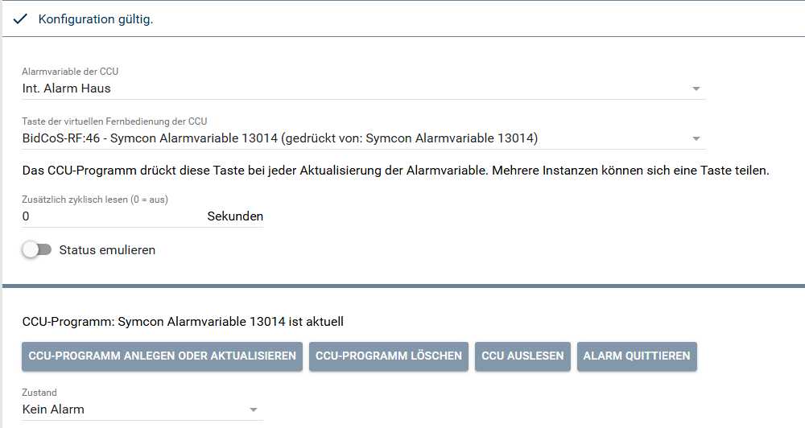
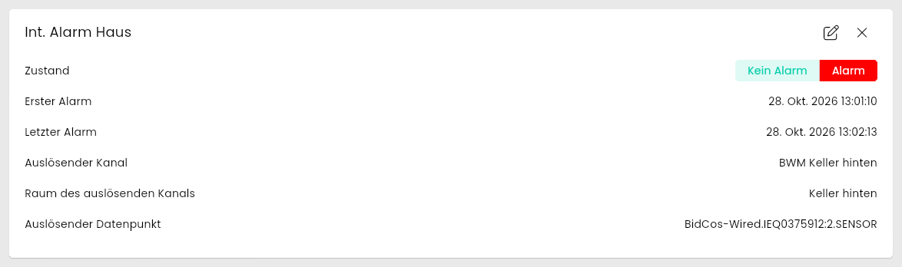
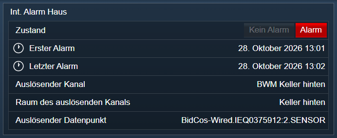

[](https://www.symcon.de/service/dokumentation/entwicklerbereich/sdk-tools/sdk-php/)
[](https://community.symcon.de/t/modul-homematic-extended-systemvariablen-programme-powermeter-u-v-m/38340)
[](https://www.symcon.de/de/service/dokumentation/installation/migrationen/v81-v90-q1-2026/)  
[](#10-lizenz)
[](https://github.com/Nall-chan/HomematicExtended/actions)
[](https://github.com/Nall-chan/HomematicExtended/actions)  
[](../README.md#6-spenden)
[](../README.md#6-spenden)

# HomeMatic Alarmvariable  <!-- omit in toc -->

   Bereitstellen einer Alarmvariable der CCU in Symcon.  

## Dokumentation <!-- omit in toc -->

**Inhaltsverzeichnis**

- [1. Funktionsumfang](#1-funktionsumfang)
- [2. Voraussetzungen](#2-voraussetzungen)
- [3. Software-Installation](#3-software-installation)
- [4. Einrichten der Instanzen in IP-Symcon](#4-einrichten-der-instanzen-in-ip-symcon)
  - [Eigenschaften](#eigenschaften)
- [5. Statusvariablen](#5-statusvariablen)
- [6. Visualisierung](#6-visualisierung)
  - [Kachel Visualisierung](#kachel-visualisierung)
  - [WebFront Visualisierung](#webfront-visualisierung)
- [7. PHP-Befehlsreferenz](#7-php-befehlsreferenz)
- [8. Aktionen](#8-aktionen)
- [9. Anhang](#9-anhang)
  - [1. Changelog](#1-changelog)
  - [2. Spenden](#2-spenden)
- [10. Lizenz](#10-lizenz)

## 1. Funktionsumfang

- Eine Instanz je Alarmvariable der CCU (z.B. die Alarmvariablen der Alarmanlage oder die `WatchDog: …`-Alarme von RaspberryMatic).  
- Zustand, erster und letzter Alarm sowie Kanal, Raum und Datenpunkt des Auslösers als Statusvariablen.  
- Quittieren des Alarms aus Symcon.  
- Änderungen auf der CCU kommen sofort in Symcon an, wie beim Modul [HomeMatic Systemvariablen](../Systemvariablen/#das-ccu-programm): Ein Programm auf der CCU drückt bei jeder Aktualisierung der Alarmvariable eine Taste der virtuellen Fernbedienung. Das Modul legt dieses Programm auf Wunsch selbst an.  

   Für Reaktionen auf einen Alarm in Symcon wird ein Ereignis (ausgelöst bei Änderung) auf die Statusvariable `Zustand` angelegt. Das Alarm-Script der Systemvariablen bis Version 3.78 wird dafür nicht mehr benötigt.  

## 2. Voraussetzungen

- IP-Symcon ab Version 9.0  
- Ein Homematic Socket (`HomeMatic Socket`), an dem die CCU angebunden ist  
- Die Firewall der CCU erlaubt den Zugriff auf die `Remote HomeMatic-Script API` (siehe [Haupt-README](../README.md#2-voraussetzungen))  
- Für die sofortige Aktualisierung: Im Homematic Socket ist das Interface der virtuellen Fernbedienung aktiviert (`BidCos-RF` für `BidCoS-RF:n`, `HomeMatic IP` für `HmIP-RCV-1:n`).  

## 3. Software-Installation

Dieses Modul ist Bestandteil der [HomeMaticExtended-Library](../).  

## 4. Einrichten der Instanzen in IP-Symcon

> [!TIP]
> Der [HomeMatic Extended Konfigurator](../ExtendedConfigurator/) listet alle Alarmvariablen der CCU und legt die Instanzen an.

   Unter Instanz hinzufügen ist das Modul 'HomeMatic Alarmvariable' unter dem Hersteller 'HomeMatic' zu finden. Als übergeordnete Instanz wird der Homematic Socket der CCU gewählt.  

   Einrichtung:  

1. Unter `Alarmvariable der CCU` die Alarmvariable wählen (beim Anlegen über den Konfigurator bereits eingetragen).  
2. Unter `Taste der virtuellen Fernbedienung der CCU` eine Taste wählen. Alle Alarm-Instanzen können sich eine Taste teilen. Die Liste zeigt die Verwendung der Tasten, eine belegte Taste wird wie beim Modul [HomeMatic Systemvariablen](../Systemvariablen/#das-ccu-programm) abgelehnt, und eine Taste mit Werksnamen erhält den Namen des Programms.  
3. Mit `CCU-Programm anlegen oder aktualisieren` das Programm `Symcon Alarmvariable <Instanz-ID>` auf der CCU anlegen.  

  

   Teilen sich mehrere Instanzen eine Taste, lesen alle Instanzen bei jedem Tastendruck. Eine Instanz schreibt ihre Statusvariablen nur, wenn sich der Zeitstempel ihrer Alarmvariable auf der CCU geändert hat.  

### Eigenschaften

|                Eigenschaft                 |     Name      |  Typ   |  Standardwert  |                                                         Beschreibung                                                         |
| :----------------------------------------: | :-----------: | :----: | :------------: | :--------------------------------------------------------------------------------------------------------------------------: |
|          Alarmvariable der CCU             |    AlarmID    |  int   |       0        |                                  ID der Alarmvariable auf der CCU, 0 = keine gewählt                                   |
| Taste der virtuellen Fernbedienung der CCU |    Address    | string | `XXX9999999:n` | Adresse der Taste, `BidCoS-RF:1` bis `BidCoS-RF:50` oder `HmIP-RCV-1:1` bis `HmIP-RCV-1:50`. Der Platzhalter bedeutet: keine Taste |
|    Zusätzlich zyklisch lesen (0 = aus)     |   Interval    |  int   |       0        |                                    Intervall in Sekunden, 0 = aus, sonst mindestens 5                                    |
|              Status emulieren              | EmulateStatus |  bool  |     false      |                  Nach dem Quittieren wird `Zustand` sofort auf `Kein Alarm` gesetzt, ohne auf die CCU zu warten                  |
|                  Protokoll                 |   Protocol    |  int   |       0        |                                 Wird nicht im Formular angezeigt, ergibt sich aus der Taste                                  |

```php
IPS_SetProperty(12345, 'AlarmID', 1253);
IPS_SetProperty(12345, 'Address', 'BidCoS-RF:50');
IPS_ApplyChanges(12345);
```

   Statuscodes: `102` aktiv, `104` keine Taste und kein Intervall (gelesen wird nur beim Übernehmen und auf Anforderung), `203` Intervall kleiner als 5 Sekunden, `204` keine Alarmvariable gewählt.  

## 5. Statusvariablen

|       Ident        |              Name              |   Typ   |                          Beschreibung                          |
| :----------------: | :----------------------------: | :-----: | :------------------------------------------------------------: |
|       STATE        |            Zustand             | boolean |  `Alarm` bzw. `Kein Alarm`, bedienbar: `Kein Alarm` quittiert  |
|     FIRST_TIME     |          Erster Alarm          | integer |       Zeitpunkt der ersten Auslösung (Datum/Uhrzeit)        |
|     LAST_TIME      |         Letzter Alarm          | integer |       Zeitpunkt der letzten Auslösung (Datum/Uhrzeit)        |
|  TRIGGER_CHANNEL   |       Auslösender Kanal        | string  |               Name des auslösenden Kanals               |
|    TRIGGER_ROOM    | Raum des auslösenden Kanals    | string  |               Raum des auslösenden Kanals               |
| TRIGGER_DATAPOINT  |     Auslösender Datenpunkt     | string  |   Datenpunkt des Auslösers, z.B. `BidCos-RF.<Adresse>:1.STATE`   |

   Eine Alarmvariable, die noch nie ausgelöst hat, liefert keine Zeitpunkte, die Statusvariablen zeigen dann `-`.  
   `TRIGGER_CHANNEL`, `TRIGGER_ROOM` und `TRIGGER_DATAPOINT` zeigen den Auslöser eines anstehenden Alarms und werden geleert, sobald der Alarm nicht mehr ansteht. `FIRST_TIME` und `LAST_TIME` behalten die Zeitpunkte des letzten Alarms. Die Variablen des Auslösers werden erst angelegt, wenn ein Alarm mit Auslöser ansteht. Interne Alarmvariablen wie die `WatchDog: …`-Alarme von RaspberryMatic haben keinen auslösenden Kanal, ihre Instanzen haben nur Zustand, ersten und letzten Alarm.  

> [!NOTE]
> Zustand, Zeitpunkte und Auslöser eines anstehenden Alarms sowie das Leeren des Auslösers nach dem Ende sind live geprüft.

## 6. Visualisierung

### Kachel Visualisierung

  

### WebFront Visualisierung

  

## 7. PHP-Befehlsreferenz

   Alle Funktionen melden Fehler an den Aufrufer und liefern dann `false`.  

```php
bool HM_ReadAlarm(integer $InstanzID);
```

   Liest Zustand und Auslöser der Alarmvariable von der CCU. Liefert `true` bei Erfolg.  

```php
bool HM_AlarmReceipt(integer $InstanzID);
```

   Quittiert den Alarm auf der CCU. Liefert `true`, wenn ein anstehender Alarm quittiert wurde, und `false`, wenn kein Alarm anstand.  

```php
string HM_CreateCCUProgram(integer $InstanzID);
string HM_DeleteCCUProgram(integer $InstanzID);
```

   Legt das CCU-Programm für die gespeicherte Alarmvariable und Taste an (ein vorhandenes Programm der Instanz wird ersetzt) bzw. löscht es. Liefert eine Meldung für den Nutzer.  

## 8. Aktionen

**Grundsätzlich können alle bedienbaren Statusvariablen als Ziel einer [`Aktion`](https://www.symcon.de/service/dokumentation/konzepte/automationen/ablaufplaene/aktionen/) mit `Auf Wert schalten` angesteuert werden, so dass hier keine speziellen Aktionen benutzt werden müssen.**  

   Für `Zustand` ist nur der Wert `Kein Alarm` (quittieren) zulässig.  

## 9. Anhang

### 1. Changelog

Der vollständige Changelog der Library steht in der [Haupt-README](../README.md#2-changelog).  

Version 3.80:

- Neues Modul.  

### 2. Spenden

Dieses Modul ist für die nicht kommerzielle Nutzung kostenlos, Schenkungen als Unterstützung für den Autor werden hier akzeptiert:

  [](https://paypal.me/Nall4chan)

  [](https://www.amazon.de/hz/wishlist/ls/YU4AI9AQT9F?ref_=wl_share)

## 10. Lizenz

[Custom NC-SA](../LICENSE)
