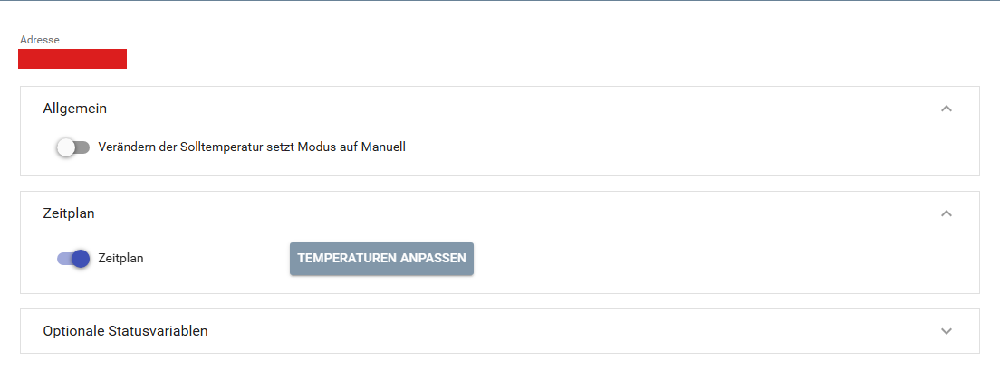
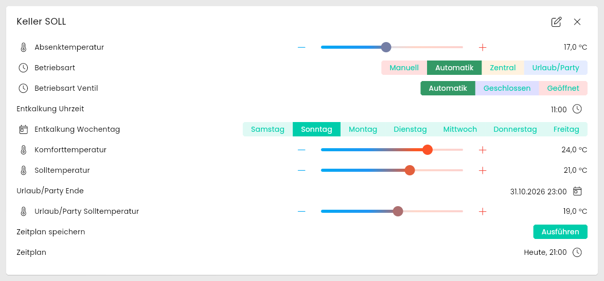
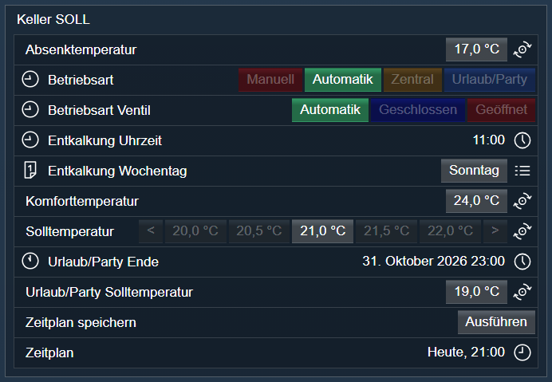

[](https://www.symcon.de/service/dokumentation/entwicklerbereich/sdk-tools/sdk-php/)
[](https://community.symcon.de/t/modul-homematic-extended-systemvariablen-programme-powermeter-u-v-m/38340)
[](https://www.symcon.de/de/service/dokumentation/installation/migrationen/v81-v90-q1-2026/)
[](#10-lizenz)
[](https://github.com/Nall-chan/HomematicExtended/actions)
[](https://github.com/Nall-chan/HomematicExtended/actions)
[](../README.md#6-spenden)
[](../README.md#6-spenden)

# HomeMatic Climate Control Regulator <!-- omit in toc -->

Wandthermostat `HM-CC-TC` mit Statusvariablen und Zeitprofil (Wochenplan).  

## Dokumentation <!-- omit in toc -->

**Inhaltsverzeichnis**

- [1. Funktionsumfang](#1-funktionsumfang)
- [2. Voraussetzungen](#2-voraussetzungen)
- [3. Software-Installation](#3-software-installation)
- [4. Einrichten der Instanzen in IP-Symcon](#4-einrichten-der-instanzen-in-ip-symcon)
- [5. Statusvariablen](#5-statusvariablen)
- [6. Visualisierung](#6-visualisierung)
  - [Kachel Visualisierung](#kachel-visualisierung)
  - [WebFront Visualisierung](#webfront-visualisierung)
- [7. PHP-Befehlsreferenz](#7-php-befehlsreferenz)
- [8. Aktionen](#8-aktionen)
- [9. Anhang](#9-anhang)
  - [1. Changelog](#1-changelog)
  - [2. Spenden](#2-spenden)
- [10. Lizenz](#10-lizenz)

## 1. Funktionsumfang

- Stellt Soll-Temperatur, Ist-Temperatur und Luftfeuchtigkeit des Wandthermostaten `HM-CC-TC` als Statusvariablen dar.  
- Zeitprofil (Wochenplan mit bis zu 24 Schaltpunkten pro Tag) als Wochenplan-Ereignis in IP-Symcon.  
- Optionale Statusvariablen für Urlaub/Party und Entkalkung.  

## 2. Voraussetzungen

- IP-Symcon ab Version 9.0  
- Ein Homematic Socket (`HomeMatic Socket`), an dem die CCU angebunden ist  
- Der Wandthermostat `HM-CC-TC` ist an der CCU angelernt (Funk, BidCos-RF)  

## 3. Software-Installation

Dieses Modul ist Bestandteil der [HomeMaticExtended-Library](../).  

## 4. Einrichten der Instanzen in IP-Symcon

> [!TIP]
> Am einfachsten wird die Instanz über den [`HomeMatic Extended Konfigurator`](../ExtendedConfigurator/) angelegt. Er trägt die Adresse selbstständig ein.  

Alternativ unter `Instanz hinzufügen` das Gerät `HomeMatic Climate Control Regulator` unter dem Hersteller `HomeMatic` auswählen.  
Nach dem Anlegen der Instanz sollte als übergeordnetes Gerät schon der Homematic Socket ausgewählt sein.  
Existieren in IPS mehrere Homematic Sockets, so ist der auszuwählen, an dem das Gerät bzw. die Gruppe angebunden ist.  

**Konfigurationsseite:**  

  

| Eigenschaft | Name | Typ | Standardwert | Beschreibung |
| :---------- | :--- | :-- | :----------- | :----------- |
| Adresse | Address | string | leer | Adresse des Gerätes bzw. der Gruppe, z.B. `IEQ1234567`. Das Modul spricht den Kanal 2 des Wandthermostaten an. Die Adresse wird ohne Kanal eingetragen. |
| System | Protocol | integer | 0 | Funk (BidCos-RF). Wird vom Modul gesetzt und nicht im Formular angezeigt. |
| Verändern der Solltemperatur setzt Modus auf Manuell | SetPointBehavior | boolean | `true` | Das Ändern der Solltemperatur schaltet den Modus der Solltemperatur auf Manuell. |
| Zeitplan | enable_SCHEDULE | boolean | `true` | Legt den Wochenplan (Ereignis) und die Variablen zum Speichern an. |
| Urlaub/Party Solltemperatur | enable_TEMPERATUR_PARTY_VALUE | boolean | `true` | Optionale Statusvariable (Bereich „Urlaub/Party“) |
| Urlaub/Party Ende | enable_PARTY_END_TIME | boolean | `true` | Optionale Statusvariable (Bereich „Urlaub/Party“) |
| Komforttemperatur | enable_TEMPERATUR_COMFORT_VALUE | boolean | `false` | Optionale Statusvariable (Bereich „Temperatur“) |
| Absenktemperatur | enable_TEMPERATUR_LOWERING_VALUE | boolean | `false` | Optionale Statusvariable (Bereich „Temperatur“) |
| Entkalkung Uhrzeit | enable_DECALCIFICATION_TIME | boolean | `false` | Optionale Statusvariable (Bereich „Entkalkung“) |
| Entkalkung Wochentag | enable_DECALCIFICATION_DAY | boolean | `false` | Optionale Statusvariable (Bereich „Entkalkung“) |
| Betriebsart Ventil | enable_MODE_TEMPERATUR_VALVE | boolean | `false` | Optionale Statusvariable (Bereich „Ventil“) |
| Temperaturen anpassen | ScheduleTemps | string (JSON) | 6, 16, 17, 18, 19, 20, 21, 22, 23, 24, 25, 30 | Temperaturen, die im Wochenplan immer als Aktion zur Verfügung stehen. Maximal 31 Aktionen. Bearbeitung über die Schaltfläche `Temperaturen anpassen`. |

Beispiel (Optionale Statusvariable aktivieren):  

```php
IPS_SetProperty(12345, 'enable_TEMPERATUR_PARTY_VALUE', true);
IPS_ApplyChanges(12345);
```

## 5. Statusvariablen

Welche Statusvariablen angelegt werden, richtet sich nach dem Gerät und den Optionen der Konfiguration. Die Namen werden in der Systemsprache angezeigt.  

| Name | Ident | Typ | Bedienbar | Optional | Quelle | Darstellung |
| :--- | :---- | :-- | :-------- | :------- | :----- | :---------- |
| Solltemperatur | SETPOINT | Float | ja |  | Werte | Schieberegler Temperatur ¹ |
| Betriebsart | MODE_TEMPERATUR_REGULATOR | Integer | ja |  | Parameter | Aufzählung (Manuell, Automatik, Zentral, Urlaub/Party) |
| Entkalkung Wochentag | DECALCIFICATION_DAY | Integer | ja | ja (aus) | Parameter | Aufzählung (Samstag bis Freitag) |
| Entkalkung Uhrzeit | DECALCIFICATION_TIME | Integer | ja | ja (aus) | Parameter | Datum/Uhrzeit (Uhrzeit) |
| Betriebsart Ventil | MODE_TEMPERATUR_VALVE | Integer | ja | ja (aus) | Parameter | Aufzählung (Automatik, Geschlossen, Geöffnet) |
| Absenktemperatur | TEMPERATUR_LOWERING_VALUE | Float | ja | ja (aus) | Parameter | Schieberegler Temperatur ¹ |
| Komforttemperatur | TEMPERATUR_COMFORT_VALUE | Float | ja | ja (aus) | Parameter | Schieberegler Temperatur ¹ |
| Urlaub/Party Ende | PARTY_END_TIME | Integer | ja |  | Parameter | Datum/Uhrzeit |
| Urlaub/Party Solltemperatur | TEMPERATUR_PARTY_VALUE | Float | ja |  | Parameter | Schieberegler Temperatur ¹ |

Zusätzlich werden bei aktivem Wochenplan angelegt:  

| Name | Ident | Typ | Bedienbar | Beschreibung |
| :--- | :---- | :-- | :-------- | :----------- |
| Wochenplan | WEEK_PROFIL | Ereignis | ja | Wochenplan des aktiven Zeitprofils. Die Aktionen sind die Temperaturen. |
| Zeitplan speichern | SUBMIT_WEEK_PROGRAM | Integer | ja | Überträgt den Wochenplan in das Zeitprofil des Gerätes zur CCU. |

¹ Schieberegler mit Verwendung Temperatur, Schrittweite 0,5 °C. Minimum, Maximum und Sonderwerte liefert die CCU je Datenpunkt (HM-CC-TC Solltemperatur: 6 bis 30 °C, zusätzlich 0 = `Ventil geschlossen` und 100 = `Ventil offen`).  

> [!NOTE]
> Parameter (Betriebsart, Absenk-, Komfort- und Party-Temperatur, Entkalkung, Wochenplan) übernimmt der HM-CC-TC erst nach einem Druck auf die Anlerntaste. Bis dahin zeigt die CCU, dass Konfigurationsdaten zur Übertragung anstehen.  
> Ein Setzen der Solltemperatur (`SETPOINT`) übernimmt das Gerät an der aktuellen CCU nicht, auch nicht über die Oberfläche der CCU. Die Statusvariable folgt dem Wert, den das Gerät meldet.  

> [!WARNING]
> Das Ändern einer Option in der Konfiguration löscht die Statusvariable der abgewählten Option.  

## 6. Visualisierung

### Kachel Visualisierung

Der HM-CC-TC liefert in diesem Modul keine Ist-Temperatur, die Instanz erscheint daher als Liste:  

  

### WebFront Visualisierung

  

## 7. PHP-Befehlsreferenz

**`bool HM_RequestParams(integer $InstanzID);`**  

Liest alle Parameter (Zeitprofile und Einstellungen des Gerätes) von der CCU und aktualisiert die Statusvariablen sowie den Wochenplan.  
Liefert `true`, wenn die CCU die Parameter geliefert hat, sonst `false`.  

```php
HM_RequestParams(12345);
```

**`bool HM_RequestState(integer $InstanzID, string $Ident);`**  

Liest den Wert eines Datenpunktes (Quelle `Werte` in der Tabelle der Statusvariablen) von der CCU und schreibt ihn in die Statusvariable.  
`$Ident` ist der Ident der Statusvariable, z.B. `SETPOINT`. Ein Ident ohne Datenpunkt der Quelle `Werte` wird mit einer Fehlermeldung abgelehnt.  
Liefert `true`, wenn die CCU den Wert geliefert hat, sonst `false`.  

```php
HM_RequestState(12345, 'SETPOINT');
```

## 8. Aktionen

**Grundsätzlich können alle bedienbaren Statusvariablen als Ziel einer [`Aktion`](https://www.symcon.de/service/dokumentation/konzepte/automationen/ablaufplaene/aktionen/) mit `Auf Wert schalten` angesteuert werden, so dass hier keine speziellen Aktionen benutzt werden müssen.**  

Der Wochenplan hat für jede Temperatur eine Aktion, die beim Auslösen die Parameter der CCU neu liest (`HM_RequestParams`). Die Temperaturen des Wochenplans werden in der Konfiguration unter `Temperaturen anpassen` gepflegt.  
Beim Speichern werden die Zeiten auf 10 Minuten gerundet (Raster des Gerätes). Ein Tag darf höchstens 24 Schaltpunkte haben, sonst wird nicht gespeichert und eine Meldung ausgegeben. Die Temperaturen liegen zwischen 6 und 30 °C.  

## 9. Anhang

### 1. Changelog

Der vollständige Changelog der Library steht in der [Haupt-README](../README.md#2-changelog).  

**Version 3.82:**

- Wochenplan: Die Zeiten werden beim Speichern auf das Raster des Gerätes (10 Minuten) gerundet, bisher schnitt die CCU ab und der Wochenplan in Symcon zeigte andere Zeiten. Mehr als 24 Schaltpunkte an einem Tag werden mit einer Meldung abgelehnt statt mit einem Fehler der CCU.  
- Wochenplan: Temperaturen erst ab 6 °C (Grenze des Gerätes), auch in der Liste `Temperaturen anpassen`.  
- Die Statusvariablen nutzen Darstellungen statt Variablenprofilen (Spalte `Darstellung`). Variablen und Archivdaten bleiben erhalten, die Profile der Library werden gelöscht, sobald keine Variable sie mehr nutzt.  
- Die Temperaturen übernehmen Minimum, Maximum und Sonderwerte von der CCU.  

**Version 3.81:**

- Abgewählte Urlaub/Party-Variablen wurden nicht entfernt und blieben bedienbar.  
- Das Ende von Urlaub/Party wurde mit falschem Datentyp für die Tage gesendet.  

**Version 3.75:**

- Das Modul nutzt den Datenfluss des Homematic Sockets (ohne eigene Verbindung).  
- Die Aktions-IDs des Wochenplans beginnen bei 1 (Fehler „Wochenplan-Aktions-ID muss größer als 0 sein“ behoben).  
- Zeiten für Party und Entkalkung werden in 30-Minuten-Schritten übertragen (exakt 30 Minuten wird nicht mehr abgerundet).  
- Texte der CCU mit Umlauten bzw. dem Zeichen `°` werden richtig gelesen.  

### 2. Spenden

Dieses Modul ist für die nicht kommerzielle Nutzung kostenlos, Schenkungen als Unterstützung für den Autor werden hier akzeptiert:

  [](https://paypal.me/Nall4chan)

  [](https://www.amazon.de/hz/wishlist/ls/YU4AI9AQT9F?ref_=wl_share)

## 10. Lizenz

[Custom NC-SA](../LICENSE)
