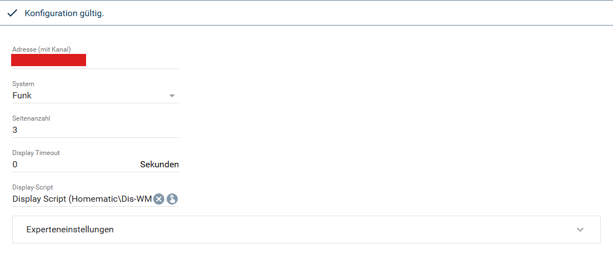

[](https://www.symcon.de/service/dokumentation/entwicklerbereich/sdk-tools/sdk-php/)
[](https://community.symcon.de/t/modul-homematic-extended-systemvariablen-programme-powermeter-u-v-m/38340)
[](https://www.symcon.de/de/service/dokumentation/installation/migrationen/v81-v90-q1-2026/)  
[](#10-lizenz)
[](https://github.com/Nall-chan/HomematicExtended/actions)
[](https://github.com/Nall-chan/HomematicExtended/actions)  
[](../README.md#6-spenden)
[](../README.md#6-spenden)

# HomeMatic Dis-WM55 <!-- omit in toc -->

Dynamische Textanzeige auf dem Display-Wandtaster `HM-Dis-WM55` mit mehrseitiger Anzeige und Aktionen per Tastendruck.  

## Dokumentation <!-- omit in toc -->

**Inhaltsverzeichnis**

- [1. Funktionsumfang](#1-funktionsumfang)
- [2. Voraussetzungen](#2-voraussetzungen)
- [3. Software-Installation](#3-software-installation)
- [4. Einrichten der Instanzen in IP-Symcon](#4-einrichten-der-instanzen-in-ip-symcon)
  - [Tasten des Displays](#tasten-des-displays)
  - [Experteneinstellungen](#experteneinstellungen)
  - [Display-Script](#display-script)
- [5. Statusvariablen](#5-statusvariablen)
- [6. Visualisierung](#6-visualisierung)
- [7. PHP-Befehlsreferenz](#7-php-befehlsreferenz)
- [8. Aktionen](#8-aktionen)
- [9. Anhang](#9-anhang)
  - [1. Changelog](#1-changelog)
  - [2. Spenden](#2-spenden)
- [10. Lizenz](#10-lizenz)

## 1. Funktionsumfang

- Stellt Inhalte auf dem Farbdisplay des Wandtasters dar, wenn eine der beiden Tasten gedrückt wird.  
- Unterstützt mehrseitige Anzeigen. Mit den beiden Tasten wird zwischen den Seiten geblättert.  
- Führt benutzerspezifische Aktionen aus (langer Tastendruck), auch in Abhängigkeit der angezeigten Seite.  
- Die Inhalte werden von einem Script (Display-Script) erzeugt, das mit der Instanz angelegt wird.  
- Zusätzliche Auslöser (Tasten anderer Geräte) können den Funktionen zugeordnet werden.  

> [!NOTE]
> Das Display ist nur kurz nach einem Tastendruck empfangsbereit. Es kann deshalb nur auf einen Tastendruck hin beschrieben werden, nicht zu einem beliebigen Zeitpunkt.  

## 2. Voraussetzungen

- IP-Symcon ab Version 9.0  
- Ein Homematic Socket (`HomeMatic Socket`), an dem die CCU angebunden ist  
- Das Display `HM-Dis-WM55` ist an der CCU angelernt  
- Die Firewall der CCU erlaubt den Zugriff auf die `Remote HomeMatic-Script API` (siehe [Haupt-README](../README.md#2-voraussetzungen))  

## 3. Software-Installation

Dieses Modul ist Bestandteil der [HomeMaticExtended-Library](../).  

## 4. Einrichten der Instanzen in IP-Symcon

> [!TIP]
> Am einfachsten wird die Instanz über den `HomeMatic Extended Konfigurator` angelegt. Er trägt die Adresse des Displays mit dem Kanal 1 selbstständig ein.  

  

Alternativ unter `Instanz hinzufügen` das Gerät `HomeMatic Dis-WM55` unter dem Hersteller `HomeMatic` auswählen.  
Nach dem Anlegen der Instanz sollte als übergeordnetes Gerät schon der Homematic Socket ausgewählt sein.  
Existieren in IPS mehrere Homematic Sockets, so ist der auszuwählen, an welcher CCU das Display angelernt ist.  
Beim Anlegen der Instanz wird ein verstecktes Demo `Display-Script` unterhalb der Instanz erzeugt.  
Wurde das Script gelöscht, legt die Schaltfläche `Display-Script wiederherstellen` (Aktionsbereich der Konfiguration) es mit der Vorlage neu an und trägt es in die Instanz ein. Die Schaltfläche ist nur aktiv, solange das Script fehlt.  

**Konfigurationsseite:**  

  

| Eigenschaft          | Name           | Typ     | Standardwert                 | Beschreibung                                                                                                  |
| :------------------- | :------------- | :------ | :--------------------------- | :------------------------------------------------------------------------------------------------------------ |
| Adresse (mit Kanal)  | Address        | string  | `XXX9999995:0` (Platzhalter) | Adresse des Displays mit Kanal, z.B. `NEQ1234567:1`. An diese Adresse wird immer ausgegeben.                 |
| System               | Protocol       | integer | 0                            | 0 = Funk (BidCos-RF)                                                                                          |
| Anzahl der Seiten    | MaxPage        | integer | 1                            | Anzahl der Seiten (1-99)                                                                                      |
| Display Timeout      | Timeout        | integer | 0                            | Zeit in Sekunden, nach der wieder auf die erste Seite zurückgesprungen wird (0 = aus, bis 86400)              |
| Display-Script       | ScriptID       | integer |                              | Script, das bei einem Tastendruck ausgeführt wird                                                             |
| Zusätzliche Auslöser | ExpertTriggers | string  | `[]`                         | JSON-Liste der Experteneinstellungen (siehe unten)                                                            |

> [!IMPORTANT]
> Die Adresse muss den Kanal enthalten (`NEQ1234567:1`). Der Kanal bestimmt, an welches `SUBMIT` des Displays die Daten gesendet werden. Die Tasten werden aus der Geräteadresse abgeleitet, unabhängig vom eingetragenen Kanal.  

Der Platzhalter ist notwendig, damit sich der Homematic Konfigurator von Symcon nicht aufhängt, und gilt als nicht eingetragen.  

**Status der Instanz:**  

| Status | Bedeutung                                                              |
| :----: | :--------------------------------------------------------------------- |
|  102   | Konfiguration gültig                                                   |
|  104   | Keine Adresse eingetragen (Platzhalter)                                |
|  202   | Ein oder mehrere ungültige Auslöser in den Experteneinstellungen       |
|  203   | Kein Display-Script ausgewählt                                         |
|  204   | Timeout ungültig                                                       |
|  205   | Anzahl der Seiten ungültig                                             |
|  206   | Die Adresse enthält keinen Kanal                                       |

### Tasten des Displays

Die beiden Tasten des Displays werden über den Datenfluss des Homematic Sockets empfangen und lösen das Display-Script aus:  

| Taste                      | Funktion                                                  | Wert für `$_IPS['ACTION']` |
| :------------------------- | :-------------------------------------------------------- | :------------------------- |
| Kanal 2, kurzer Tastendruck | Seite hoch: blättert zurück (von Seite 1 zur letzten Seite) | `UP`                       |
| Kanal 1, kurzer Tastendruck | Seite runter: blättert weiter (von der letzten Seite zu Seite 1) | `DOWN`                |
| Kanal 2, langer Tastendruck | Aktion oben                                               | `ActionUP`                 |
| Kanal 1, langer Tastendruck | Aktion unten                                              | `ActionDOWN`               |

Die Seite ist 0, solange noch keine Seitentaste gedrückt wurde (Ruhezustand), und läuft sonst von 1 bis zur eingestellten Anzahl der Seiten.  
Nach Ablauf des Timeouts oder bei einer ungültigen Konfiguration ist die Seite wieder 0. Das Display-Script erhält als Seite immer mindestens 1.  
Die Aktionstasten ändern die Seite nicht, das Script erhält die aktuelle Seite.  

### Experteneinstellungen

Im Bereich `Experteneinstellungen` können zusätzliche Auslöser eingetragen werden, z.B. Tasten anderer Homematic Geräte.  
Jeder Eintrag besteht aus einer Variable einer Homematic Geräteinstanz (Variable mit der Taste, z.B. `PRESS_SHORT`) und der Funktion `Seite hoch`, `Seite runter`, `Aktion oben` oder `Aktion unten`.  
Die Ausgabe erfolgt auch bei diesen Auslösern immer an die konfigurierte Adresse.  

**Beispiel für das Setzen der Einstellungen per PHP:**  

```php
// Die Variable 23456 (PRESS_SHORT einer fremden Taste) blättert eine Seite weiter,
// die Variable 34567 (PRESS_LONG einer fremden Taste) führt die Aktion oben aus.
$ExpertTriggers = [
    ['VariableID' => 23456, 'Action' => 1], // 0 = Seite hoch, 1 = Seite runter
    ['VariableID' => 34567, 'Action' => 2]  // 2 = Aktion oben, 3 = Aktion unten
];
IPS_SetProperty(12345, 'Address', 'NEQ1234567:1');
IPS_SetProperty(12345, 'ExpertTriggers', json_encode($ExpertTriggers));
IPS_ApplyChanges(12345);
```

Wird eine Variable aus der Liste gelöscht, geht die Instanz in den Status 202, bis der Eintrag entfernt wurde.  

> [!NOTE]
> Bestehende Instanzen aus früheren Versionen werden beim Update übernommen. Die Adresse (mit Kanal) wird aus der ersten bisher eingetragenen Variable ermittelt. Auslöser des Displays mit der Standardzuordnung entfallen, alle anderen Auslöser stehen danach in den Experteneinstellungen.  

### Display-Script

Das Script wird bei jedem Tastendruck ausgeführt. Es erzeugt die Inhalte und gibt diese als JSON-String per `echo` zurück.  
Beim Anlegen der Instanz wird ein ausführliches Demo-Script erzeugt.  

Folgende Werte stehen dem Script in `$_IPS` zur Verfügung:  

| Name            | Typ     | Beschreibung                                                                                     |
| :-------------- | :------ | :----------------------------------------------------------------------------------------------- |
| `$_IPS['SENDER']` | string  | Immer `HMDisWM55`                                                                              |
| `$_IPS['ACTION']` | string  | Die Funktion: `UP`, `DOWN`, `ActionUP` oder `ActionDOWN`                                       |
| `$_IPS['PAGE']`   | integer | Die Seite, die dargestellt wird (1 bis Anzahl der Seiten)                                      |
| `$_IPS['EVENT']`  | integer | Die Instanz-ID der Dis-WM55 Instanz                                                            |

Die Rückgabe ist ein JSON-String mit den Zeilen 1 bis 6 des Displays. Jede Zeile besteht aus:  

| Schlüssel | Beschreibung                                                                    |
| :-------- | :------------------------------------------------------------------------------ |
| `Text`    | Der Text der Zeile (leer = Zeile bleibt leer)                                   |
| `Icon`    | Das Icon (`0` = kein Icon, `0x80` bis `0x8B` siehe Demo-Script)                 |
| `Color`   | Die Farbe der Zeile (`0x81` rot, `0x82` orange, `0x83` gelb, `0x84` grün, `0x85` blau) |

**Beispiel für ein einfaches Display-Script:**  

```php
<?php
if ($_IPS['SENDER'] != 'HMDisWM55') {
    return;
}
$Lines = [];
switch ($_IPS['ACTION']) {
    case 'UP':
    case 'DOWN':
        // Zeile 1 zeigt die Seite
        $Lines[1] = ['Text' => 'SEITE ' . $_IPS['PAGE'], 'Icon' => 0x86, 'Color' => 0x82];
        $Lines[2] = ['Text' => date('H:i:s'), 'Icon' => 0, 'Color' => 0x82];
        break;
    case 'ActionUP':
        $Lines[1] = ['Text' => 'Aktion', 'Icon' => 0, 'Color' => 0x84];
        $Lines[2] = ['Text' => 'OBEN', 'Icon' => 0, 'Color' => 0x84];
        break;
    case 'ActionDOWN':
        $Lines[1] = ['Text' => 'Aktion', 'Icon' => 0, 'Color' => 0x84];
        $Lines[2] = ['Text' => 'UNTEN', 'Icon' => 0, 'Color' => 0x84];
        break;
}
echo json_encode($Lines);
```

Umlaute und der Doppelpunkt müssen für die Anzeige umgewandelt werden (`Ä Ö Ü ä ö ü ß :`). Die Funktion `hex_encode` im Demo-Script erledigt das.  

> [!NOTE]
> Lehnt die CCU eine Übertragung an das Display ab, wird sofort einmal wiederholt. Dass die CCU die Daten annimmt, belegt nicht, dass das Display sie empfangen hat. Bei schlechtem Empfang kann eine Anzeige ausbleiben.  

## 5. Statusvariablen

Es werden keine Statusvariablen angelegt.  

## 6. Visualisierung

Die Instanz besitzt keine Statusvariablen und wird nicht visualisiert.  

## 7. PHP-Befehlsreferenz

Die Instanz besitzt keine PHP-Befehle für Anwender.  

Die Funktion `HM_ResetTimer` wird vom Timeout intern verwendet und setzt die Seite wieder auf 0.  

## 8. Aktionen

**Grundsätzlich können alle bedienbaren Statusvariablen als Ziel einer [`Aktion`](https://www.symcon.de/service/dokumentation/konzepte/automationen/ablaufplaene/aktionen/) mit `Auf Wert schalten` angesteuert werden, so dass hier keine speziellen Aktionen benutzt werden müssen.**  

Die Instanz besitzt keine Statusvariablen.  

Das Display-Script kann über die Schaltfläche `Display-Script wiederherstellen` oder per Befehl neu angelegt werden, solange es fehlt:  

```php
IPS_RequestAction(12345, 'RestoreDisplayScript', true);
```

## 9. Anhang

### 1. Changelog

Der vollständige Changelog der Library steht in der [Haupt-README](../README.md#2-changelog).  

**Version 3.75:**

- Die Adresse des Displays (mit Kanal) ersetzt die Auswahl der vier Variablen. Bestehende Instanzen werden übernommen.  
- Die Ausgabe erfolgt immer an die konfigurierte Adresse.  
- Neue Experteneinstellungen für zusätzliche Auslöser.  
- Die Taste 'Seite hoch' blättert zurück, 'Seite runter' blättert weiter. Dem Display-Script wird nie die Seite 0 übergeben.  
- Lehnt die CCU eine Übertragung ab, wird sofort einmal wiederholt.  
- Neuer Status 206, wenn die Adresse keinen Kanal enthält.  
- Neue Schaltfläche `Display-Script wiederherstellen`, falls das Script gelöscht wurde.  

### 2. Spenden

Dieses Modul ist für die nicht kommerzielle Nutzung kostenlos, Schenkungen als Unterstützung für den Autor werden hier akzeptiert:  

  [](https://paypal.me/Nall4chan)  

  [](https://www.amazon.de/hz/wishlist/ls/YU4AI9AQT9F?ref_=wl_share)  

## 10. Lizenz

[Custom NC-SA](../LICENSE)  
