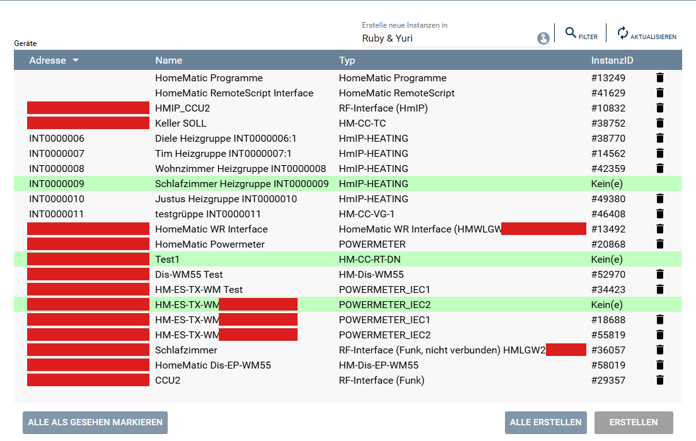

  

  

# HomeMatic Extended Konfigurator <!-- omit in toc -->

Legt die Instanzen der Geräte dieser Library an und erkennt bereits vorhandene Instanzen.  

## Dokumentation <!-- omit in toc -->

**Inhaltsverzeichnis**

- [1. Funktionsumfang](#1-funktionsumfang)
- [2. Voraussetzungen](#2-voraussetzungen)
- [3. Software-Installation](#3-software-installation)
- [4. Einrichten der Instanzen in IP-Symcon](#4-einrichten-der-instanzen-in-ip-symcon)
  - [Unterstützte Geräte](#unterstützte-geräte)
  - [Hinweise in der Liste](#hinweise-in-der-liste)
  - [RF-Interfaces](#rf-interfaces)
- [5. Statusvariablen](#5-statusvariablen)
- [6. Visualisierung](#6-visualisierung)
- [7. PHP-Befehlsreferenz](#7-php-befehlsreferenz)
- [8. Aktionen](#8-aktionen)
- [9. Anhang](#9-anhang)
  - [1. Changelog](#1-changelog)
  - [2. Spenden](#2-spenden)
- [10. Lizenz](#10-lizenz)

## 1. Funktionsumfang

- Liest die Geräte, Namen und Räume von der CCU und listet alle Geräte, für die diese Library eine Instanz bietet.  
- Erkennt bereits angelegte Instanzen anhand der Geräteadresse. Bei Geräten mit Ausgabekanal (Displays) wird dabei der Kanal nicht verglichen.  
- Legt neue Instanzen mit der richtigen Adresse und dem richtigen System an. Bei bekannten Räumen wird die Instanz im gleichnamigen Objekt abgelegt.  
- Legt die RF-Interfaces (Gateways) der CCU mit der notwendigen Kette aus RF-Interface, RF-Interface Splitter und Homematic Socket an, auch Gateways, die gerade offline sind.  
- Weist auf Instanzen hin, deren Gerät auf der CCU nicht gefunden wurde oder die noch keine Adresse haben.  

## 2. Voraussetzungen

- IP-Symcon ab Version 9.0  
- Ein Homematic Socket (`HomeMatic Socket`), an dem die CCU angebunden ist  
- Die benötigten Protokolle (Funk, HmIP, Wired, Gruppen) sind im Homematic Socket aktiviert  
- Die Firewall der CCU erlaubt den Zugriff auf die `Remote HomeMatic-Script API` (siehe [Haupt-README](../README.md#2-voraussetzungen))  

## 3. Software-Installation

Dieses Modul ist Bestandteil der [HomeMaticExtended-Library](../).  

## 4. Einrichten der Instanzen in IP-Symcon

Unter `Instanz hinzufügen` ist der `HomeMatic Extended Konfigurator` unter dem Hersteller `HomeMatic` zu finden.  
Nach dem Anlegen der Instanz sollte als übergeordnetes Gerät schon der Homematic Socket ausgewählt sein.  
Existieren in IPS mehrere Homematic Sockets, so ist der auszuwählen, an dem die gewünschte CCU angebunden ist.  

**Konfigurationsseite:**  

  

Die Instanz besitzt keine einstellbaren Eigenschaften, die Liste der Geräte wird bei jedem Öffnen der Konfiguration neu von der CCU gelesen. Neu angelernte Geräte erscheinen dadurch ohne weitere Schritte.  

### Unterstützte Geräte

| Gerät                                 | Modul                                                                    | System        | Adresse der Instanz                  |
| :------------------------------------ | :----------------------------------------------------------------------- | :------------ | :----------------------------------- |
| Schaltaktor mit Leistungsmessung u.ä. | [HomeMatic Powermeter](../PowerMeter/)                                   | Funk, HmIP    | Gerät mit Kanal des Zählers          |
| HmIP-Wetterstation `HmIP-SWO-…`       | [HomeMatic Weather](../Weather/)                                         | HmIP          | Gerät mit Kanal 1                    |
| `HM-Dis-WM55`                         | [HomeMatic Dis-WM55](../DisplayStatusAnzeige/)                           | Funk          | Gerät mit Kanal 1                    |
| `HM-Dis-EP-WM55`                      | [HomeMatic Dis-EP-WM55](../ePaperStatusAnzeige/)                         | Funk          | Gerät mit Kanal 3                    |
| `HM-CC-RT-DN`                         | [HomeMatic Heating Device](../HeatingDevice/)                            | Funk          | Gerät                                |
| `HM-CC-TC`                            | [HomeMatic Climate Control Regulator](../ClimacontrolRegulator/)         | Funk          | Gerät                                |
| Heizgruppe `HM-CC-VG-1`               | [HomeMatic Heating Group](../HeatingGroup/)                              | Gruppen       | Gruppe (`INT…`)                      |
| HmIP Heizgruppe                       | [HomeMatic IP Heating Group](../HeatingGroupHmIP/)                       | Gruppen       | Gruppe (`INT…`)                      |
| Wired-Interface                       | [HomeMatic WR-Interface](../WRInterface/)                                | Wired         | feste Adresse                        |
| Programme der CCU                     | [HomeMatic Programme](../Programme/)                                     | alle          | feste Adresse                        |
| Ausführen von HM-Scripten             | [HomeMatic RemoteScript](../HomeMaticScript/)                            | alle          | feste Adresse                        |
| Systemvariablen der CCU               | [HomeMatic Systemvariablen](../Systemvariablen/)                         | alle          | Instanzen des Moduls                 |
| Alarmvariablen der CCU                | [HomeMatic Alarmvariable](../Alarmvariable/)                             | alle          | ID der Alarmvariable                 |
| RF-Interfaces (Gateways)              | [HomeMatic RF-Interface](../RFInterface/)                                | Funk, HmIP    | Adresse des Interfaces               |

Die Zeilen für Programme, RemoteScript und WR-Interface stehen für das jeweilige Modul und sind nicht an ein Gerät gebunden. Ist ein Wired-Gateway eingerichtet (`/etc/config/hs485d.conf`), zeigt die Zeile des WR-Interface dessen Seriennummer, Typ und IP-Adresse. Das WR-Interface bleibt eine Instanz je CCU.  

Für die Systemvariablen zeigt der Konfigurator die vorhandenen Instanzen bzw. eine Zeile zum Anlegen, die Systemvariablen selbst werden in der Instanz gewählt. Für jede Alarmvariable der CCU gibt es eine Zeile, die Instanz erhält die ID der Alarmvariable. Die Spalte `Adresse` zeigt den Namen der Alarmvariable auf der CCU (die Instanz kann anders heißen), interne Alarmvariablen wie die `WatchDog: …`-Alarme von RaspberryMatic sind im Typ mit `(intern)` gekennzeichnet. Instanzen, deren Alarmvariable auf der CCU fehlt, erscheinen mit einem Hinweis.  

### Hinweise in der Liste

- **Gerät auf der CCU nicht gefunden:** Zu einer vorhandenen Instanz gibt es auf der CCU kein Gerät mit der eingetragenen Adresse (Gerät abgelernt, Tippfehler, falscher Socket).  
- **Keine Adresse konfiguriert (Migration erforderlich):** Die Instanz stammt aus einer älteren Version und hat noch keine Adresse. Die Adresse wird beim Update aus den bisherigen Einstellungen übernommen, gelingt das nicht, ist die Adresse in der Instanz einzutragen.  
- **Nicht aktivierte Protokolle:** Sind Funk, HmIP oder Gruppen im Homematic Socket nicht aktiviert, erscheint beim Öffnen eine Meldung mit der Liste der Protokolle und der Schaltfläche `I/O Instanz öffnen`. Die Geräte dieser Protokolle fehlen in der Liste. Wired wird nicht gemeldet, die Library unterstützt keine Wired-Geräte (die Zeile des WR-Interface erscheint nur bei aktiviertem Wired).  

### RF-Interfaces

Jedes Gateway erhält eine eigene Zeile. Die Liste entsteht aus zwei Quellen: Die RPC-Anfrage `listBidcosInterfaces` meldet nur erreichbare Interfaces. Zusätzlich liest der Konfigurator die eingerichteten Gateways aus der Konfigurationsdatei der CCU (`/etc/config/rfd.conf`). Dadurch erscheinen auch Gateways, die gerade offline sind, mit Name, Typ und IP-Adresse und dem Hinweis `nicht verbunden`. Gelesen werden nur die Felder Typ, Name, Seriennummer, IP-Adresse und Beschreibung, der Sicherheitsschlüssel wird nie gelesen. Kann die Datei nicht gelesen werden (z.B. bei anderer Firmware), zeigt die Liste nur die erreichbaren Interfaces.  

Beim Anlegen wird eine Kette erzeugt: `HomeMatic RF-Interface` → `HomeMatic RF-Interface Splitter` → `HomeMatic Socket`. Ist der Splitter oder der Socket schon vorhanden, wird er von Symcon wiederverwendet, ein Gateway mit denselben Kettenelementen bekommt trotzdem eine eigene Instanz.  

## 5. Statusvariablen

Es werden keine Statusvariablen angelegt.  

## 6. Visualisierung

Die Instanz besitzt keine Statusvariablen und wird nicht visualisiert.  

## 7. PHP-Befehlsreferenz

Die Instanz besitzt keine PHP-Befehle für Anwender.  

## 8. Aktionen

**Grundsätzlich können alle bedienbaren Statusvariablen als Ziel einer [`Aktion`](https://www.symcon.de/service/dokumentation/konzepte/automationen/ablaufplaene/aktionen/) mit `Auf Wert schalten` angesteuert werden, so dass hier keine speziellen Aktionen benutzt werden müssen.**  

Die Instanz besitzt keine Statusvariablen und keine speziellen Aktionen.  

## 9. Anhang

### 1. Changelog

Der vollständige Changelog der Library steht in der [Haupt-README](../README.md#2-changelog).  

**Version 3.80:**

- Neue Zeilen für die Systemvariablen und je Alarmvariable der CCU (`HomeMatic Alarmvariable`).  
- Fehler beim Lesen der CCU erscheinen als Hinweis im Formular.  

**Version 3.78:**

- Neue Zeilen für die HmIP-Geräte des Powermeter (z.B. HmIP-PSM, HmIP-ESI) und für die HmIP-Wetterstationen (`HomeMatic Weather`).  
- Ein geschlossenes Wired-Interface wird nicht mehr gemeldet.  

**Version 3.75:**

- Neue Zeilen für Dis-WM55, Dis-EP-WM55, Heizungsgeräte, Heizgruppen, Klimaregler, RemoteScript und RF-Interfaces.  
- Nicht aktivierte Protokolle werden in einer Meldung mit Schaltfläche zum Homematic Socket aufgelistet.  
- Die RF-Interfaces werden mit der Kette aus RF-Interface, RF-Interface Splitter und Homematic Socket angelegt, jedes Gateway der CCU erhält eine Zeile.  
- Gateways, die offline sind, erscheinen mit Name, Typ und IP-Adresse (aus der Konfigurationsdatei der CCU), die Zeile des WR-Interface zeigt die Daten des Wired-Gateways.  
- Instanzen ohne Adresse oder ohne Gerät auf der CCU werden mit einem Hinweis angezeigt.  

### 2. Spenden

Dieses Modul ist für die nicht kommerzielle Nutzung kostenlos, Schenkungen als Unterstützung für den Autor werden hier akzeptiert:  

    

    

## 10. Lizenz

[Custom NC-SA](../LICENSE)
