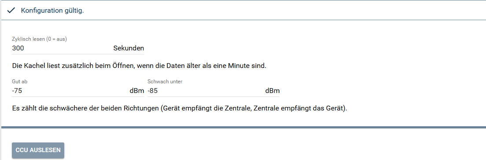
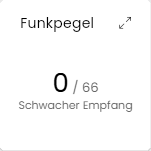
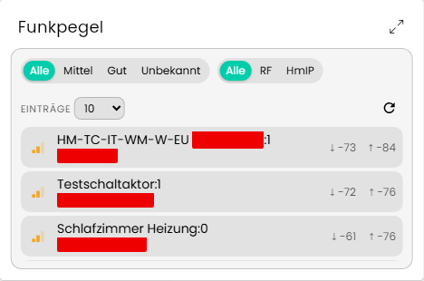
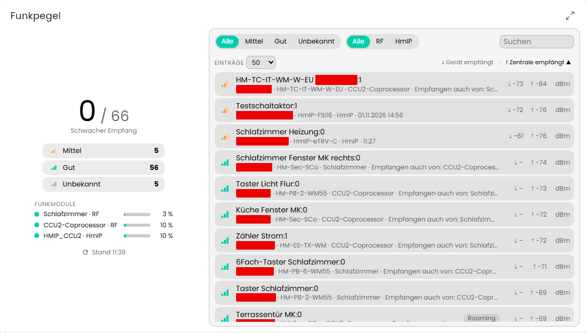

[](https://www.symcon.de/service/dokumentation/entwicklerbereich/sdk-tools/sdk-php/)
[](https://community.symcon.de/t/modul-homematic-extended-systemvariablen-programme-powermeter-u-v-m/38340)
[](https://www.symcon.de/de/service/dokumentation/installation/migrationen/v81-v90-q1-2026/)  
[](#10-lizenz)
[](https://github.com/Nall-chan/HomematicExtended/actions)
[](https://github.com/Nall-chan/HomematicExtended/actions)  
[](../README.md#6-spenden)
[](../README.md#6-spenden)

# HomeMatic Funkpegel  <!-- omit in toc -->

   Übersicht der Funkpegel (RSSI) aller Funkgeräte der CCU als Kachel und per PHP-Befehl, für BidCos-RF und HmIP.  

## Dokumentation <!-- omit in toc -->

**Inhaltsverzeichnis**

- [1. Funktionsumfang](#1-funktionsumfang)
- [2. Voraussetzungen](#2-voraussetzungen)
- [3. Software-Installation](#3-software-installation)
- [4. Einrichten der Instanzen in IP-Symcon](#4-einrichten-der-instanzen-in-ip-symcon)
  - [Eigenschaften](#eigenschaften)
  - [Woher die Werte kommen](#woher-die-werte-kommen)
- [5. Statusvariablen](#5-statusvariablen)
- [6. Visualisierung](#6-visualisierung)
  - [Kachel Visualisierung](#kachel-visualisierung)
  - [Anwendungsfälle](#anwendungsfälle)
  - [WebFront Visualisierung](#webfront-visualisierung)
- [7. PHP-Befehlsreferenz](#7-php-befehlsreferenz)
- [8. Aktionen](#8-aktionen)
- [9. Anhang](#9-anhang)
  - [1. Changelog](#1-changelog)
  - [2. Spenden](#2-spenden)
- [10. Lizenz](#10-lizenz)

## 1. Funktionsumfang

- Funkpegel jedes Funkgerätes in beide Richtungen: `Gerät empfängt` (wie gut das Gerät die Zentrale hört) und `Zentrale empfängt` (wie gut die Zentrale das Gerät hört).  
- Bewertung als gut, mittel oder schwach nach einstellbaren Grenzen. Es zählt die schwächere Richtung.  
- BidCos-RF: zugeordnetes Funk-Gateway (LAN-Gateway, Funkmodul der CCU), alle weiteren Gateways, die das Gerät hören, Kennzeichnung `Roaming` und Gateways, die in der CCU nicht mehr eingerichtet sind.  
- Funkmodule und Gateways mit Duty Cycle.  
- Zeigt zu jedem Gerät, ob es in Symcon als Instanz eingerichtet ist.  
- Die Instanz legt keine Statusvariablen an. Die Werte zeigt eine eigene Kachel, Skripte erhalten sie per [PHP-Befehl](#7-php-befehlsreferenz).  

## 2. Voraussetzungen

- IP-Symcon ab Version 9.0  
- Ein Homematic Socket (`HomeMatic Socket`), an dem die CCU angebunden ist, mit aktiviertem Interface `BidCos-RF` und/oder `HomeMatic IP`  
- Die Firewall der CCU erlaubt den Zugriff auf die `Remote HomeMatic-Script API` (siehe [Haupt-README](../README.md#2-voraussetzungen))  

## 3. Software-Installation

Dieses Modul ist Bestandteil der [HomeMaticExtended-Library](../).  

## 4. Einrichten der Instanzen in IP-Symcon

> [!TIP]
> Die Instanz wird am einfachsten über den [HomeMatic Extended Konfigurator](../ExtendedConfigurator/) angelegt.

   Unter Instanz hinzufügen ist das Modul 'HomeMatic Funkpegel' unter dem Hersteller 'HomeMatic' zu finden. Als übergeordnete Instanz wird der Homematic Socket der CCU gewählt. Eine Instanz je CCU genügt. Weitere Einstellungen sind nicht nötig.  

  

### Eigenschaften

|          Eigenschaft          |   Name    | Typ | Standardwert |                                                    Beschreibung                                                    |
| :---------------------------: | :-------: | :-: | :----------: | :---------------------------------------------------------------------------------------------------------------: |
| Zyklisch lesen (0 = aus)      | Interval  | int |     300      | Intervall in Sekunden, 0 = aus, sonst mindestens 60. Die Kachel liest beim Öffnen zusätzlich, wenn die Werte älter als eine Minute sind |
| Gut ab                        | LevelGood | int |     -75      | Pegel in dBm, ab dem der Empfang als gut gilt                                                                       |
| Schwach unter                 | LevelWeak | int |     -85      | Pegel in dBm, unter dem der Empfang als schwach gilt. Dazwischen gilt er als mittel                                 |

```php
IPS_SetProperty(12345, 'Interval', 600);
IPS_SetProperty(12345, 'LevelWeak', -90);
IPS_ApplyChanges(12345);
```

   Statuscodes: `102` aktiv, `203` Intervall kleiner als 60 Sekunden, `205` `Gut ab` ist nicht größer als `Schwach unter`.  

### Woher die Werte kommen

- **BidCos-RF:** Die CCU führt für jedes Paar aus Gerät und Gateway den zuletzt gemessenen Pegel in beide Richtungen (XML-RPC `rssiInfo`). Das zugeordnete Gateway und `Roaming` stammen aus der Geräteliste der CCU, der Duty Cycle aus der Liste der Funk-Interfaces. Die Namen der Gateways sind die Bezeichnungen aus der Konfiguration der LAN-Gateways in der WebUI. Ohne eigene Bezeichnung zeigt die Kachel den Typ des Gateways.  
- **HmIP:** Die Pegel stehen in den Datenpunkten `RSSI_DEVICE` und `RSSI_PEER` auf Kanal 0 des Gerätes. Die CCU kennt bei HmIP kein zugeordnetes Gateway.  
- Werte, die die CCU nicht kennt (z.B. Geräte, die noch nie gesendet haben), erscheinen als `–` und zählen nicht als schwach.  

## 5. Statusvariablen

   Die Instanz legt keine Statusvariablen an.  

## 6. Visualisierung

### Kachel Visualisierung

   Die Instanz bringt eine eigene Kachel mit. Sie passt sich der Größe an und übernimmt Farben und Schrift der Visualisierung.  

| Größe der Kachel   | Anzeige                                                                                                                       |
| :----------------- | :---------------------------------------------------------------------------------------------------------------------------- |
| 1 × 1              | Anzahl der Geräte mit schwachem Empfang und Anzahl aller Geräte                                                               |
| 3 × 2              | Liste der Geräte mit beiden Pegeln, Filter nach Bewertung, Schnittstelle und Gateway (Chips oben)                             |
| ab ca. 7 × 4       | Links die Anzahl je Bewertung (ein Klick filtert) und die Funkmodule mit Duty Cycle, rechts die Liste mit Filter, Suche, Gerätetyp, Gateway und den weiteren Gateways, die das Gerät hören |


  

  

- Die Chips oben und die Legende links filtern gleich, es erscheinen nur vorhandene Werte. Die Auswahl merkt sich der Browser.  
- Die Spaltenköpfe `↓ Gerät empfängt` und `↑ Zentrale empfängt` sortieren die Liste per Klick auf- bzw. absteigend. Ab Werk ist nach `Zentrale empfängt` sortiert, der schwächste Wert zuerst, Geräte ohne Wert am Ende.  
- Ist ein Gateway gewählt, zeigt die Liste alle Geräte, die dieses Gateway hören, mit den Pegeln zu diesem Gateway. Geräte, die ihm zugeordnet sind, tragen `zugeordnet`; bei den übrigen steht vorn das zugeordnete Gateway (`zugeordnet: <Name>`).  
- `Empfangen auch von` nennt die weiteren Gateways, die das Gerät hören (ab ca. 7 × 4).  
- `Roaming`: Das Gerät ist keinem festen Gateway zugeordnet, die CCU wählt selbst das Gateway mit dem besten Empfang.  
- `Stand <Uhrzeit>` zeigt, wann zuletzt gelesen wurde. Ein Klick darauf liest sofort neu, währenddessen dreht sich das Symbol.  
- Geräte ohne Instanz in Symcon sind gekennzeichnet (`Gerät nicht in Symcon eingerichtet`).  

### Anwendungsfälle

- **Schwache Geräte finden:** Filter `Schwach`, sortiert nach `Zentrale empfängt` bzw. `Gerät empfängt`. Liegt nur eine Richtung schlecht, hilft oft ein anderer Standort des Gateways.  
- **Besseres Gateway finden:** Ein Gateway als Filter wählen. Die Liste zeigt, wie gut dieses Gateway jedes Gerät hört, auch Geräte, die einem anderen Gateway zugeordnet sind. Hört es ein Gerät deutlich besser, kann das Gerät in der WebUI der CCU (Einstellungen des Gerätes) diesem Gateway zugeordnet werden.  
- **Nicht mehr eingerichtete Gateways:** Wurde ein LAN-Gateway aus der CCU entfernt, bleiben ihm Geräte trotzdem zugeordnet. Die Kachel kennzeichnet es mit `(nicht mehr eingerichtet)`; die betroffenen Geräte sollten einem vorhandenen Gateway zugeordnet werden.  

### WebFront Visualisierung

Das klassische WebFront wird nicht unterstützt, die Instanz bietet nur die Kachel-Visualisierung.  

## 7. PHP-Befehlsreferenz

```php
array|false HM_GetRSSIValues(integer $InstanzID);
```

   Liest die Funkpegel sofort von der CCU. Bei einem Fehler erhält der Aufrufer die Meldung und `false`. Das Ergebnis enthält:  

- `time`: Zeitpunkt des Lesens nach der Uhr der CCU (Unix-Zeit)  
- `devices`: Liste der Geräte, der schwächste Pegel zuerst  
- `gateways`: Liste der Funkmodule und Gateways  

   Felder je Gerät:  

| Feld           | Typ         | Inhalt                                                                                                     |
| :------------- | :---------- | :--------------------------------------------------------------------------------------------------------- |
| `address`      | string      | Adresse des Gerätes                                                                                        |
| `interface`    | string      | `BidCos-RF` oder `HmIP-RF`                                                                                 |
| `type`         | string      | Gerätetyp, z.B. `HmIP-SRH`                                                                                 |
| `name`         | string      | Name auf der CCU                                                                                           |
| `device`       | int\|null   | `Gerät empfängt` in dBm, `null` wenn unbekannt                                                             |
| `peer`         | int\|null   | `Zentrale empfängt` in dBm, `null` wenn unbekannt                                                          |
| `level`        | int\|null   | Die schwächere der beiden Richtungen                                                                       |
| `quality`      | string      | `good`, `medium`, `weak` oder `unknown`                                                                    |
| `gateway`      | string      | BidCos-RF: Seriennummer des zugeordneten Gateways; HmIP: leer                                              |
| `roaming`      | bool        | BidCos-RF: `true`, wenn die CCU das Gateway selbst wählt                                                   |
| `links`        | array       | BidCos-RF: alle Gateways, die das Gerät hören, je `gateway`, `device`, `peer`; das zugeordnete zuerst      |
| `time`         | int         | HmIP: Zeitpunkt des letzten Wertes von `RSSI_DEVICE` (Unix-Zeit); BidCos-RF: `0`                           |
| `instanceID`   | int         | Symcon-Instanz des Gerätes, `0` wenn keine gefunden wurde                                                  |
| `instanceName` | string      | Name dieser Instanz, sonst leer                                                                            |

   Felder je Gateway: `address` (Seriennummer), `interface`, `type` (z.B. `HMLGW2`), `name` (Name aus der WebUI, leer ohne eigenen Namen), `connected`, `configured` (`false` = in der CCU nicht mehr eingerichtet), `default` (Standard-Gateway), `dutyCycle` und `carrierSense` (in %, `null` wenn unbekannt) und `devices` (Anzahl der zugeordneten Geräte).  

```php
// Alle Geräte mit schwachem Empfang ausgeben
$Result = HM_GetRSSIValues(12345);
foreach ($Result['devices'] as $Device) {
    if ($Device['quality'] == 'weak') {
        echo $Device['name'] . ': ' . $Device['device'] . ' / ' . $Device['peer'] . ' dBm' . PHP_EOL;
    }
}
```

## 8. Aktionen

**Grundsätzlich können alle bedienbaren Statusvariablen als Ziel einer [`Aktion`](https://www.symcon.de/service/dokumentation/konzepte/automationen/ablaufplaene/aktionen/) mit `Auf Wert schalten` angesteuert werden, so dass hier keine speziellen Aktionen benutzt werden müssen.**  

   Diese Instanz hat keine Statusvariablen und keine eigenen Aktionen. Der PHP-Befehl lässt sich über die Aktion `PHP-Code ausführen` nutzen.  

## 9. Anhang

### 1. Changelog

Der vollständige Changelog der Library steht in der [Haupt-README](../README.md#2-changelog).  

**Version 4.10:**

- Neues Modul.  

### 2. Spenden

Dieses Modul ist für die nicht kommerzielle Nutzung kostenlos, Schenkungen als Unterstützung für den Autor werden hier akzeptiert:

  [](https://paypal.me/Nall4chan)

  [](https://www.amazon.de/hz/wishlist/ls/YU4AI9AQT9F?ref_=wl_share)

## 10. Lizenz

[Custom NC-SA](../LICENSE)
