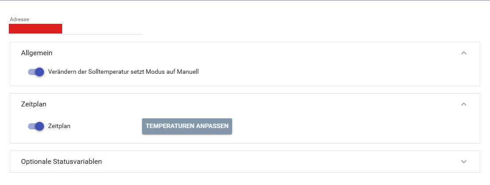

[](https://www.symcon.de/service/dokumentation/entwicklerbereich/sdk-tools/sdk-php/)
[](https://community.symcon.de/t/modul-homematic-extended-systemvariablen-programme-powermeter-u-v-m/38340)
[](https://www.symcon.de/de/service/dokumentation/installation/migrationen/v81-v90-q1-2026/)
[](#10-lizenz)
[](https://github.com/Nall-chan/HomematicExtended/actions)
[](https://github.com/Nall-chan/HomematicExtended/actions)
[](../README.md#6-spenden)
[](../README.md#6-spenden)

# HomeMatic Heating Device <!-- omit in toc -->

Heizkörperthermostat `HM-CC-RT-DN` mit Statusvariablen und Zeitprofil (Wochenplan).  

## Dokumentation <!-- omit in toc -->

**Inhaltsverzeichnis**

- [1. Funktionsumfang](#1-funktionsumfang)
- [2. Voraussetzungen](#2-voraussetzungen)
- [3. Software-Installation](#3-software-installation)
- [4. Einrichten der Instanzen in IP-Symcon](#4-einrichten-der-instanzen-in-ip-symcon)
- [5. Statusvariablen](#5-statusvariablen)
- [6. Visualisierung](#6-visualisierung)
  - [Kachel Visualisierung](#kachel-visualisierung)
  - [WebFront Visualisierung](#webfront-visualisierung)
- [7. PHP-Befehlsreferenz](#7-php-befehlsreferenz)
- [8. Aktionen](#8-aktionen)
- [9. Anhang](#9-anhang)
  - [1. Changelog](#1-changelog)
  - [2. Spenden](#2-spenden)
- [10. Lizenz](#10-lizenz)

## 1. Funktionsumfang

- Stellt die Werte des Heizkörperthermostaten `HM-CC-RT-DN` als Statusvariablen dar (Soll-/Ist-Temperatur, Ventilstellung, Modus, Boost usw.).  
- Zeitprofil (Wochenplan) als Wochenplan-Ereignis in IP-Symcon, das dort bearbeitet und zum Gerät übertragen werden kann.  
- Optionale Statusvariablen für Urlaub/Party, Fenster-offen-Funktion, Entkalkung, Sperren und weitere Parameter des Gerätes.  

> [!NOTE]
> Die Variablen entsprechen denen der Heizgruppe `HM-CC-VG-1`, das Gerät nutzt dieselben Datenpunkte.  

## 2. Voraussetzungen

- IP-Symcon ab Version 9.0  
- Ein Homematic Socket (`HomeMatic Socket`), an dem die CCU angebunden ist  
- Der Heizkörperthermostat `HM-CC-RT-DN` ist an der CCU angelernt (Funk, BidCos-RF)  

## 3. Software-Installation

Dieses Modul ist Bestandteil der [HomeMaticExtended-Library](../).  

## 4. Einrichten der Instanzen in IP-Symcon

> [!TIP]
> Am einfachsten wird die Instanz über den [`HomeMatic Extended Konfigurator`](../ExtendedConfigurator/) angelegt. Er trägt die Adresse selbstständig ein.  

Alternativ unter `Instanz hinzufügen` das Gerät `HomeMatic Heating Device` unter dem Hersteller `HomeMatic` auswählen.  
Nach dem Anlegen der Instanz sollte als übergeordnetes Gerät schon der Homematic Socket ausgewählt sein.  
Existieren in IPS mehrere Homematic Sockets, so ist der auszuwählen, an dem das Gerät bzw. die Gruppe angebunden ist.  

**Konfigurationsseite:**  

  

| Eigenschaft | Name | Typ | Standardwert | Beschreibung |
| :---------- | :--- | :-- | :----------- | :----------- |
| Adresse | Address | string | leer | Adresse des Gerätes bzw. der Gruppe, z.B. `NEQ1234567`. Das Modul spricht Kanal 4 (Werte) und das Gerät selbst (Zeitprofil) an. Die Adresse wird ohne Kanal eingetragen. |
| System | Protocol | integer | 0 | Funk (BidCos-RF). Wird vom Modul gesetzt und nicht im Formular angezeigt. |
| Verändern der Solltemperatur setzt Modus auf Manuell | SetPointBehavior | boolean | `true` | Das Ändern der Solltemperatur schaltet den Modus der Solltemperatur auf Manuell. |
| Zeitplan | enable_SCHEDULE | boolean | `true` | Legt den Wochenplan (Ereignis) und die Variablen zum Speichern an. |
| Setze auf Komfort Temperatur | enable_COMFORT_MODE | boolean | `true` | Optionale Statusvariable (Bereich „Regelung“) |
| Setze auf Absenktemperatur | enable_LOWERING_MODE | boolean | `true` | Optionale Statusvariable (Bereich „Regelung“) |
| Boost Ventilöffnung | enable_BOOST_POSITION | boolean | `false` | Optionale Statusvariable (Bereich „Boost“) |
| Boostdauer | enable_BOOST_TIME_PERIOD | boolean | `false` | Optionale Statusvariable (Bereich „Boost“) |
| Urlaub/Party Steuerung | enable_PARTY | boolean | `true` | Optionale Statusvariable (Bereich „Urlaub/Party“) |
| Komforttemperatur | enable_TEMPERATURE_COMFORT | boolean | `false` | Optionale Statusvariable (Bereich „Temperatur“) |
| Absenktemperatur | enable_TEMPERATURE_LOWERING | boolean | `false` | Optionale Statusvariable (Bereich „Temperatur“) |
| Fenster offen Temperatur | enable_TEMPERATUREFALL_WINDOW_OPEN | boolean | `true` | Optionale Statusvariable (Bereich „Fenster“) |
| Fenster offen Dauer | enable_TEMPERATUREFALL_WINDOW_OPEN_TIME_PERIOD | boolean | `false` | Optionale Statusvariable (Bereich „Fenster“) |
| Boost wenn Fenster geschlossen wurde | enable_BOOST_AFTER_WINDOW_OPEN | boolean | `false` | Optionale Statusvariable (Bereich „Fenster“) |
| Entkalkung Uhrzeit | enable_DECALCIFICATION_TIME | boolean | `false` | Optionale Statusvariable (Bereich „Entkalkung“) |
| Entkalkung Wochentag | enable_DECALCIFICATION_WEEKDAY | boolean | `false` | Optionale Statusvariable (Bereich „Entkalkung“) |
| Tastensperre | enable_BUTTON_LOCK | boolean | `false` | Optionale Statusvariable (Bereich „Sperren“) |
| Modus gesperrt | enable_MODUS_BUTTON_LOCK | boolean | `false` | Optionale Statusvariable (Bereich „Sperren“) |
| Gerätesperre | enable_GLOBAL_BUTTON_LOCK | boolean | `false` | Optionale Statusvariable (Bereich „Sperren“) |
| Temperaturen anpassen | ScheduleTemps | string (JSON) | 5, 16, 17, 18, 19, 20, 21, 22, 23, 24, 25, 30 | Temperaturen, die im Wochenplan immer als Aktion zur Verfügung stehen. Maximal 31 Aktionen. Bearbeitung über die Schaltfläche `Temperaturen anpassen`. |

Beispiel (Optionale Statusvariable aktivieren):  

```php
IPS_SetProperty(12345, 'enable_COMFORT_MODE', true);
IPS_ApplyChanges(12345);
```

## 5. Statusvariablen

Welche Statusvariablen angelegt werden, richtet sich nach dem Gerät und den Optionen der Konfiguration. Die Namen werden in der Systemsprache angezeigt.  

| Name | Ident | Typ | Bedienbar | Optional | Quelle | Profil / Darstellung |
| :--- | :---- | :-- | :-------- | :------- | :----- | :------------------- |
| Feuchtigkeit | ACTUAL_HUMIDITY | Integer | nein |  | Werte | folgt |
| Temperatur | ACTUAL_TEMPERATURE | Float | nein |  | Werte | folgt |
| Solltemperatur | SET_TEMPERATURE | Float | ja |  | Werte | folgt |
| Modus Solltemperatur | CONTROL_MODE | Integer | ja |  | Werte | folgt |
| Urlaub/Party Solltemperatur | PARTY_TEMPERATURE | Float | ja | ja (an) | Werte | folgt |
| Urlaub/Party Anfang | PARTY_START_TIME | Integer | ja | ja (an) | Werte | folgt |
| Urlaub/Party Ende | PARTY_STOP_TIME | Integer | ja | ja (an) | Werte | folgt |
| Setze auf Komfort Temperatur | COMFORT_MODE | Integer | ja | ja (an) | Werte | folgt |
| Setze auf Absenktemperatur | LOWERING_MODE | Integer | ja | ja (an) | Werte | folgt |
| Aktives Zeitprofil | WEEK_PROGRAM_POINTER | Integer | ja | ja (an) | Parameter | folgt |
| Entkalkung Uhrzeit | DECALCIFICATION_TIME | Integer | ja | ja (aus) | Parameter | folgt |
| Entkalkung Wochentag | DECALCIFICATION_WEEKDAY | Integer | ja | ja (aus) | Parameter | folgt |
| Boost Ventilöffnung | BOOST_POSITION | Integer | ja | ja (aus) | Parameter | folgt |
| Boostdauer | BOOST_TIME_PERIOD | Integer | ja | ja (aus) | Parameter | folgt |
| Komforttemperatur | TEMPERATURE_COMFORT | Float | ja | ja (aus) | Parameter | folgt |
| Absenktemperatur | TEMPERATURE_LOWERING | Float | ja | ja (aus) | Parameter | folgt |
| Tastensperre | BUTTON_LOCK | Boolean | ja | ja (aus) | Parameter | folgt |
| Gerätesperre | GLOBAL_BUTTON_LOCK | Boolean | ja | ja (aus) | Parameter | folgt |
| Modus gesperrt | MODUS_BUTTON_LOCK | Boolean | ja | ja (aus) | Parameter | folgt |
| Boost wenn Fenster geschlossen wurde | BOOST_AFTER_WINDOW_OPEN | Boolean | ja | ja (aus) | Parameter | folgt |
| Fenster offen Temperatur | TEMPERATUREFALL_WINDOW_OPEN | Float | ja | ja (an) | Parameter | folgt |
| Fenster offen Dauer | TEMPERATUREFALL_WINDOW_OPEN_TIME_PERIOD | Integer | ja | ja (aus) | Parameter | folgt |

Zusätzlich werden bei aktivem Wochenplan angelegt:  

| Name | Ident | Typ | Bedienbar | Beschreibung |
| :--- | :---- | :-- | :-------- | :----------- |
| Wochenplan | WEEK_PROFIL | Ereignis | ja | Wochenplan des aktiven Zeitprofils. Die Aktionen sind die Temperaturen. |
| Zeitplan speichern | SUBMIT_WEEK_PROGRAM | Integer | ja | Überträgt den Wochenplan in das Zeitprofil des Gerätes zur CCU. |

> [!NOTE]
> Die Spalte `Profil / Darstellung` ist noch nicht gefüllt. Die Variablenprofile werden auf Darstellungen umgestellt.  

> [!WARNING]
> Das Ändern einer Option in der Konfiguration löscht die Statusvariable der abgewählten Option.  

## 6. Visualisierung

### Kachel Visualisierung

*Screenshot der Kachel Visualisierung folgt.*  

### WebFront Visualisierung

*Screenshot des WebFront folgt.*  

Das klassische WebFront zeigt Font-Awesome-Symbole nicht an.  

## 7. PHP-Befehlsreferenz

**`bool HM_RequestParams(integer $InstanzID);`**  

Liest alle Parameter (Zeitprofile und Einstellungen des Gerätes) von der CCU und aktualisiert die Statusvariablen sowie den Wochenplan.  
Liefert `true`, wenn die CCU die Parameter geliefert hat, sonst `false`.  

```php
HM_RequestParams(12345);
```

**`bool HM_RequestState(integer $InstanzID, string $Ident);`**  

Liest den Wert eines Datenpunktes (Quelle `Werte` in der Tabelle der Statusvariablen) von der CCU und schreibt ihn in die Statusvariable.  
`$Ident` ist der Ident der Statusvariable, z.B. `SET_TEMPERATURE`. Ein Ident ohne Datenpunkt der Quelle `Werte` wird mit einer Fehlermeldung abgelehnt.  
Liefert `true`, wenn die CCU den Wert geliefert hat, sonst `false`.  

```php
HM_RequestState(12345, 'SET_TEMPERATURE');
```

## 8. Aktionen

**Grundsätzlich können alle bedienbaren Statusvariablen als Ziel einer [`Aktion`](https://www.symcon.de/service/dokumentation/konzepte/automationen/ablaufplaene/aktionen/) mit `Auf Wert schalten` angesteuert werden, so dass hier keine speziellen Aktionen benutzt werden müssen.**  

Der Wochenplan hat für jede Temperatur eine Aktion, die beim Auslösen die Parameter der CCU neu liest (`HM_RequestParams`). Die Temperaturen des Wochenplans werden in der Konfiguration unter `Temperaturen anpassen` gepflegt.  

## 9. Anhang

### 1. Changelog

Der vollständige Changelog der Library steht in der [Haupt-README](../README.md#2-changelog).  

Version 3.75:

- Das Modul nutzt den Datenfluss des Homematic Sockets (ohne eigene Verbindung).  
- Die Aktions-IDs des Wochenplans beginnen bei 1 (Fehler „Wochenplan-Aktions-ID muss größer als 0 sein“ behoben).  
- Zeiten für Party und Entkalkung werden in 30-Minuten-Schritten übertragen (exakt 30 Minuten wird nicht mehr abgerundet).  
- Texte der CCU mit Umlauten bzw. dem Zeichen `°` werden richtig gelesen.  

### 2. Spenden

Dieses Modul ist für die nicht kommerzielle Nutzung kostenlos, Schenkungen als Unterstützung für den Autor werden hier akzeptiert:

  [](https://paypal.me/Nall4chan)

  [](https://www.amazon.de/hz/wishlist/ls/YU4AI9AQT9F?ref_=wl_share)

## 10. Lizenz

[Custom NC-SA](../LICENSE)
