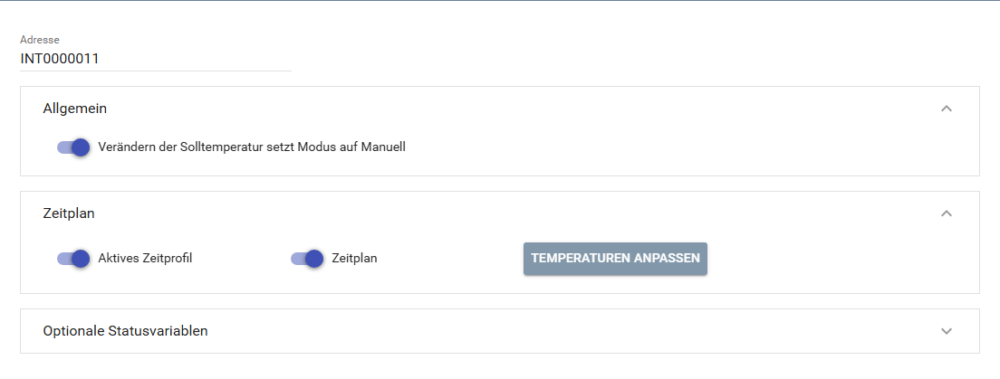
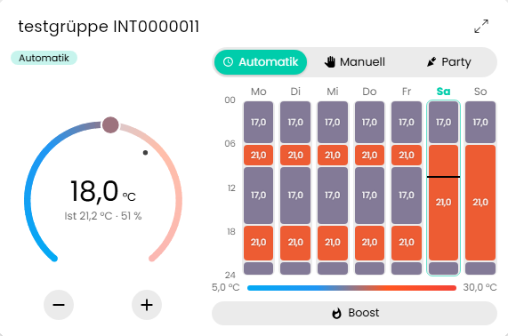
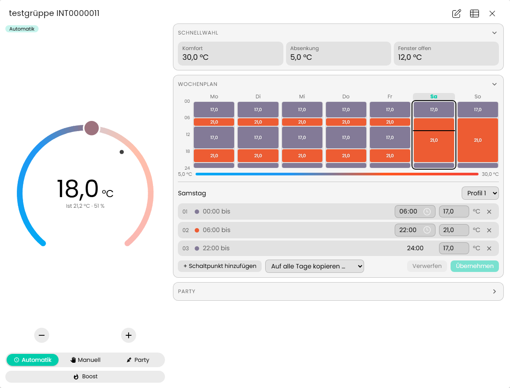
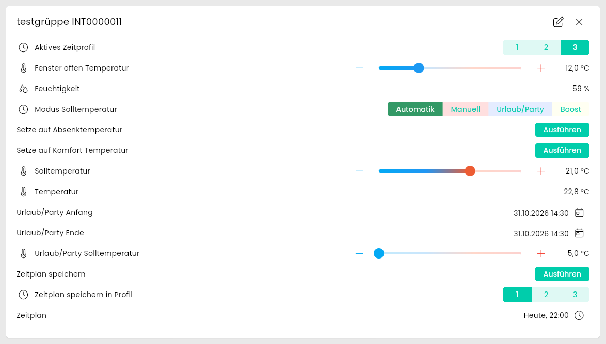
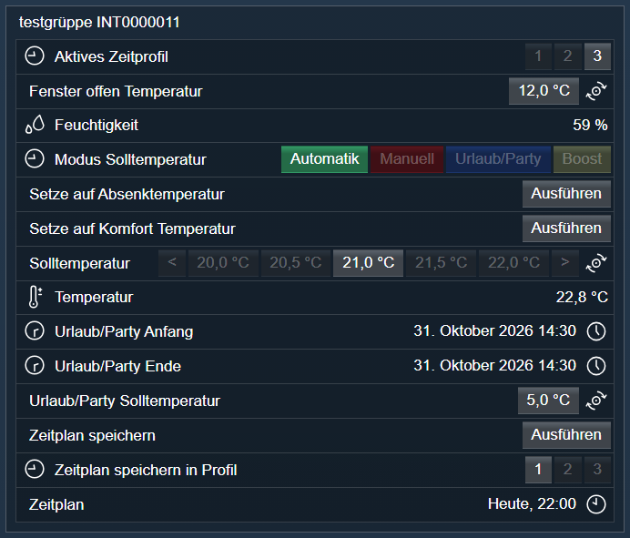

[](https://www.symcon.de/service/dokumentation/entwicklerbereich/sdk-tools/sdk-php/)
[](https://community.symcon.de/t/modul-homematic-extended-systemvariablen-programme-powermeter-u-v-m/38340)
[](https://www.symcon.de/de/service/dokumentation/installation/migrationen/v81-v90-q1-2026/)
[](#10-lizenz)
[](https://github.com/Nall-chan/HomematicExtended/actions)
[](https://github.com/Nall-chan/HomematicExtended/actions)
[](../README.md#6-spenden)
[](../README.md#6-spenden)

# HomeMatic Heating Group <!-- omit in toc -->

Heizgruppe `HM-CC-VG-1` mit Statusvariablen und Zeitprofil (Wochenplan).  

## Dokumentation <!-- omit in toc -->

**Inhaltsverzeichnis**

- [1. Funktionsumfang](#1-funktionsumfang)
- [2. Voraussetzungen](#2-voraussetzungen)
- [3. Software-Installation](#3-software-installation)
- [4. Einrichten der Instanzen in IP-Symcon](#4-einrichten-der-instanzen-in-ip-symcon)
- [5. Statusvariablen](#5-statusvariablen)
- [6. Visualisierung](#6-visualisierung)
  - [Kachel Visualisierung](#kachel-visualisierung)
  - [WebFront Visualisierung](#webfront-visualisierung)
- [7. PHP-Befehlsreferenz](#7-php-befehlsreferenz)
- [8. Aktionen](#8-aktionen)
- [9. Anhang](#9-anhang)
  - [1. Changelog](#1-changelog)
  - [2. Spenden](#2-spenden)
- [10. Lizenz](#10-lizenz)

## 1. Funktionsumfang

- Stellt die Werte einer virtuellen Heizgruppe (`HM-CC-VG-1`) der CCU als Statusvariablen dar.  
- Drei Zeitprofile (Wochenpläne), das aktive Zeitprofil ist umschaltbar. Der Wochenplan wird in IP-Symcon bearbeitet und in ein wählbares Profil der CCU gespeichert.  
- Optionale Statusvariablen für Urlaub/Party, Fenster-offen-Funktion, Entkalkung, Sperren und weitere Parameter.  

## 2. Voraussetzungen

- IP-Symcon ab Version 9.0  
- Ein Homematic Socket (`HomeMatic Socket`), an dem die CCU angebunden ist  
- Eine Heizgruppe `HM-CC-VG-1` ist auf der CCU angelegt  
- Die Verwendung der HomeMatic Gruppen ist im Homematic Socket aktiviert (`Gruppen`)  

## 3. Software-Installation

Dieses Modul ist Bestandteil der [HomeMaticExtended-Library](../).  

## 4. Einrichten der Instanzen in IP-Symcon

> [!TIP]
> Am einfachsten wird die Instanz über den [`HomeMatic Extended Konfigurator`](../ExtendedConfigurator/) angelegt. Er trägt die Adresse selbstständig ein.  

Alternativ unter `Instanz hinzufügen` das Gerät `HomeMatic Heating Group` unter dem Hersteller `HomeMatic` auswählen.  
Nach dem Anlegen der Instanz sollte als übergeordnetes Gerät schon der Homematic Socket ausgewählt sein.  
Existieren in IPS mehrere Homematic Sockets, so ist der auszuwählen, an dem das Gerät bzw. die Gruppe angebunden ist.  

**Konfigurationsseite:**  

  

| Eigenschaft | Name | Typ | Standardwert | Beschreibung |
| :---------- | :--- | :-- | :----------- | :----------- |
| Adresse | Address | string | leer | Adresse des Gerätes bzw. der Gruppe, z.B. `INT0000001`. Die Adresse der Gruppe beginnt mit `INT` und wird ohne Kanal eingetragen. |
| System | Protocol | integer | 3 | Gruppen (virtuelle Geräte der CCU). Wird vom Modul gesetzt und nicht im Formular angezeigt. |
| Verändern der Solltemperatur setzt Modus auf Manuell | SetPointBehavior | boolean | `true` | Das Ändern der Solltemperatur schaltet den Modus der Solltemperatur auf Manuell. |
| Aktives Zeitprofil | enable_WEEK_PROGRAM_POINTER | boolean | `true` | Variable für das aktive Zeitprofil. |
| Wochenprogramm als Ereignis anlegen | enable_SCHEDULE | boolean | `false` | Legt das Wochenprogramm als Ereignis (Wochenplan) und die Variablen zum Speichern an. Gilt nur für dieses Ereignis: Die Kachel zeigt und bearbeitet den Wochenplan unabhängig davon. Bis Version 3.91 war die Eigenschaft standardmäßig aktiv, bestehende Instanzen behalten ihre Einstellung. |
| Setze auf Komfort Temperatur | enable_COMFORT_MODE | boolean | `true` | Optionale Statusvariable (Bereich „Regelung“) |
| Setze auf Absenktemperatur | enable_LOWERING_MODE | boolean | `true` | Optionale Statusvariable (Bereich „Regelung“) |
| Ventilöffnung | enable_VALVE_STATE | boolean | `false` | Optionale Statusvariable (Bereich „Status“) |
| Batteriespannung | enable_BATTERY_STATE | boolean | `false` | Optionale Statusvariable (Bereich „Status“) |
| Störung | enable_FAULT_REPORTING | boolean | `false` | Optionale Statusvariable (Bereich „Status“) |
| Boost Restlaufzeit | enable_BOOST_STATE | boolean | `false` | Optionale Statusvariable (Bereich „Status“) |
| Boost Ventilöffnung | enable_BOOST_POSITION | boolean | `false` | Optionale Statusvariable (Bereich „Boost“) |
| Boostdauer | enable_BOOST_TIME_PERIOD | boolean | `false` | Optionale Statusvariable (Bereich „Boost“) |
| Urlaub/Party Steuerung | enable_PARTY | boolean | `true` | Optionale Statusvariable (Bereich „Urlaub/Party“) |
| Komforttemperatur | enable_TEMPERATURE_COMFORT | boolean | `false` | Optionale Statusvariable (Bereich „Temperatur“) |
| Absenktemperatur | enable_TEMPERATURE_LOWERING | boolean | `false` | Optionale Statusvariable (Bereich „Temperatur“) |
| Fenster offen Temperatur | enable_TEMPERATUREFALL_WINDOW_OPEN | boolean | `true` | Optionale Statusvariable (Bereich „Fenster“) |
| Fenster offen Dauer | enable_TEMPERATUREFALL_WINDOW_OPEN_TIME_PERIOD | boolean | `false` | Optionale Statusvariable (Bereich „Fenster“) |
| Boost wenn Fenster geschlossen wurde | enable_BOOST_AFTER_WINDOW_OPEN | boolean | `false` | Optionale Statusvariable (Bereich „Fenster“) |
| Entkalkung Uhrzeit | enable_DECALCIFICATION_TIME | boolean | `false` | Optionale Statusvariable (Bereich „Entkalkung“) |
| Entkalkung Wochentag | enable_DECALCIFICATION_WEEKDAY | boolean | `false` | Optionale Statusvariable (Bereich „Entkalkung“) |
| Tastensperre | enable_BUTTON_LOCK | boolean | `false` | Optionale Statusvariable (Bereich „Sperren“) |
| Modus gesperrt | enable_MODUS_BUTTON_LOCK | boolean | `false` | Optionale Statusvariable (Bereich „Sperren“) |
| Gerätesperre | enable_GLOBAL_BUTTON_LOCK | boolean | `false` | Optionale Statusvariable (Bereich „Sperren“) |
| Temperaturen anpassen | ScheduleTemps | string (JSON) | 5, 16, 17, 18, 19, 20, 21, 22, 23, 24, 25, 30 | Temperaturen, die im Wochenplan immer als Aktion zur Verfügung stehen. Maximal 31 Aktionen. Bearbeitung über die Schaltfläche `Temperaturen anpassen`. |

Beispiel (Optionale Statusvariable aktivieren):  

```php
IPS_SetProperty(12345, 'enable_WEEK_PROGRAM_POINTER', true);
IPS_ApplyChanges(12345);
```

## 5. Statusvariablen

Welche Statusvariablen angelegt werden, richtet sich nach dem Gerät und den Optionen der Konfiguration. Die Namen werden in der Systemsprache angezeigt.  

| Name | Ident | Typ | Bedienbar | Optional | Quelle | Darstellung |
| :--- | :---- | :-- | :-------- | :------- | :----- | :---------- |
| Feuchtigkeit | ACTUAL_HUMIDITY | Integer | nein |  | Werte | Wertanzeige % |
| Temperatur | ACTUAL_TEMPERATURE | Float | nein |  | Werte | Wertanzeige °C, Verwendung Temperatur |
| Solltemperatur | SET_TEMPERATURE | Float | ja |  | Werte | Schieberegler Temperatur ¹ |
| Modus Solltemperatur | CONTROL_MODE | Integer | ja |  | Werte | Aufzählung (Automatik, Manuell, Urlaub/Party, Boost) |
| Urlaub/Party Solltemperatur | PARTY_TEMPERATURE | Float | ja | ja (an) | Werte | Schieberegler Temperatur ¹ |
| Urlaub/Party Anfang | PARTY_START_TIME | Integer | ja | ja (an) | Werte | Datum/Uhrzeit |
| Urlaub/Party Ende | PARTY_STOP_TIME | Integer | ja | ja (an) | Werte | Datum/Uhrzeit |
| Setze auf Komfort Temperatur | COMFORT_MODE | Integer | ja | ja (an) | Werte | Aufzählung (Ausführen) |
| Setze auf Absenktemperatur | LOWERING_MODE | Integer | ja | ja (an) | Werte | Aufzählung (Ausführen) |
| Ventilöffnung | VALVE_STATE | Integer | nein | ja (aus) | Werte | Wertanzeige 0 bis 100 % |
| Batteriespannung | BATTERY_STATE | Float | nein | ja (aus) | Werte | Wertanzeige V |
| Störung | FAULT_REPORTING | Integer | nein | ja (aus) | Werte | Wertanzeige mit Texten (Keine Störung, Ventil schwergängig, Stellbereich zu groß/klein, Kommunikationsfehler, Batterie schwach, Notbetrieb) |
| Boost Restlaufzeit | BOOST_STATE | Integer | nein | ja (aus) | Werte | Wertanzeige 0 bis 30 min |
| Aktives Zeitprofil | WEEK_PROGRAM_POINTER | Integer | ja | ja (an) | Parameter | Aufzählung (1, 2, 3) |
| Entkalkung Uhrzeit | DECALCIFICATION_TIME | Integer | ja | ja (aus) | Parameter | Datum/Uhrzeit (Uhrzeit) |
| Entkalkung Wochentag | DECALCIFICATION_WEEKDAY | Integer | ja | ja (aus) | Parameter | Aufzählung (Samstag bis Freitag) |
| Boost Ventilöffnung | BOOST_POSITION | Integer | ja | ja (aus) | Parameter | Schieberegler 0 bis 100 % |
| Boostdauer | BOOST_TIME_PERIOD | Integer | ja | ja (aus) | Parameter | Schieberegler 0 bis 30 min, Schrittweite 5 |
| Komforttemperatur | TEMPERATURE_COMFORT | Float | ja | ja (aus) | Parameter | Schieberegler Temperatur ¹ |
| Absenktemperatur | TEMPERATURE_LOWERING | Float | ja | ja (aus) | Parameter | Schieberegler Temperatur ¹ |
| Tastensperre | BUTTON_LOCK | Boolean | ja | ja (aus) | Parameter | Schalter |
| Gerätesperre | GLOBAL_BUTTON_LOCK | Boolean | ja | ja (aus) | Parameter | Schalter |
| Modus gesperrt | MODUS_BUTTON_LOCK | Boolean | ja | ja (aus) | Parameter | Schalter |
| Boost wenn Fenster geschlossen wurde | BOOST_AFTER_WINDOW_OPEN | Boolean | ja | ja (aus) | Parameter | Schalter |
| Fenster offen Temperatur | TEMPERATUREFALL_WINDOW_OPEN | Float | ja | ja (an) | Parameter | Schieberegler Temperatur ¹ |
| Fenster offen Dauer | TEMPERATUREFALL_WINDOW_OPEN_TIME_PERIOD | Integer | ja | ja (aus) | Parameter | Schieberegler 0 bis 60 min, Schrittweite 5 |

Zusätzlich werden bei aktivem Wochenplan angelegt:  

| Name | Ident | Typ | Bedienbar | Beschreibung |
| :--- | :---- | :-- | :-------- | :----------- |
| Wochenplan | WEEK_PROFIL | Ereignis | ja | Wochenplan des aktiven Zeitprofils. Die Aktionen sind die Temperaturen. |
| Zeitplan speichern in Profil | SELECT_NEW_WEEK_PROGRAM | Integer | ja | Zeitprofil der CCU (1 bis 3), in das der Wochenplan gespeichert wird. |
| Zeitplan speichern | SUBMIT_WEEK_PROGRAM | Integer | ja | Überträgt den Wochenplan in das gewählte Zeitprofil zur CCU. |

¹ Schieberegler mit Verwendung Temperatur, Schrittweite 0,5 °C. Minimum und Maximum liefert die CCU je Gerät (HM-CC-VG-1: 5 bis 30 °C, ohne `Aus`/`An`).  

> [!WARNING]
> Das Ändern einer Option in der Konfiguration löscht die Statusvariable der abgewählten Option.  

## 6. Visualisierung

### Kachel Visualisierung

Die Instanz hat eine eigene Kachel (HTML-SDK), die sich nach ihrer Größe richtet. In der Kachel-Visualisierung erscheint sie z.B. so:



Maximiert (ab etwa 880 × 520 Pixel) kommen Schnellwahl, Party und der Wochenplan zum Bearbeiten dazu:



| Größe der Kachel | Inhalt |
| --- | --- |
| Klein | Wählrad mit Solltemperatur und Betriebsart, darin Ist-Temperatur und Luftfeuchte |
| Mittel | zusätzlich die Tasten `-` und `+`, der Umschalter `Automatik` / `Manuell` / `Party`, der Boost-Schalter mit Restlaufzeit sowie Ventilöffnung, Fensterzustand und Betriebsart (Heizen/Kühlen) |
| Groß (ab etwa 560 × 300 Pixel) | Wählrad links, rechts Umschalter, Wochenplan des aktiven Zeitprofils (Ansicht) und Statusanzeigen |
| Maximiert (ab etwa 880 × 520 Pixel) | zusätzlich Schnellwahl (Komfort, Absenkung, Fenster offen), Party-Formular und der Wochenplan zum Bearbeiten |

* Die Solltemperatur wird am Wählrad gezogen oder mit `-` / `+` in den Schritten der Statusvariable geändert. Wie bei der Statusvariable schaltet das Ändern in der Betriebsart Automatik auf Manuell, sofern die Option in der Konfiguration aktiv ist.
* Die Farben von Wählrad, Wochenplan und Legende folgen dem Farbverlauf der Darstellung der Solltemperatur (`Verlauf`): Bei `Temperatur` der Verlauf der Symcon-Temperaturdarstellung, bei `Eigener Verlauf` die Farben des Nutzers, bei `Standard` die Akzentfarbe der Visualisierung. Die Aktionen des Wochenplan-Ereignisses erhalten dieselben Farben.
* Grenzen, Schrittweite und Sonderwerte (z.B. „Aus“ und „An“ bei 4,5 und 30,5 °C) des Wählrads entnimmt die Kachel der Darstellung der Statusvariable. Hat der Nutzer eine eigene Darstellung eingestellt, gilt sie, sonst die Darstellung der Library.
* Statusvariablen, die in der Instanz abgewählt sind (z.B. Party, Boost-Restlaufzeit, Ventilöffnung), zeigt die Kachel nicht. Die übrigen Bedienelemente nutzen den frei gewordenen Platz.
* Elemente, deren Statusvariable keine Aktion hat oder bei der der Nutzer die Standardaktion deaktiviert hat (`VariableCustomAction` = `VARIABLE_ACTION_DISABLED`), zeigt die Kachel abgedunkelt und nicht bedienbar (z.B. das Wählrad, wenn die Solltemperatur nicht bedient werden darf).
* Schnellwahl: `Komfort` und `Absenkung` erscheinen, wenn die Statusvariablen `Setze auf Komfort Temperatur` bzw. `Setze auf Absenktemperatur` (Konfiguration, Bereich „Regelung“) aktiv sind, und lösen diese Funktionen des Gerätes aus. Die angezeigte Temperatur stammt aus der Komfort- bzw. Absenktemperatur, ist deren Variable abgewählt, aus den Parametern des Gerätes. `Fenster offen` erscheint, wenn `Fenster offen Temperatur` aktiv ist, und setzt die Solltemperatur.
* Die maximierte Kachel gliedert das Bedienfeld in die Gruppen `Schnellwahl`, `Wochenplan` (mit den Schaltpunkten des gewählten Tages) und `Party`. Ein Klick auf die Überschrift klappt die Gruppe ein oder aus, die Party ist zunächst eingeklappt. Der Zustand wird im Browser gemerkt.
* Party: Beginn, Ende und Temperatur werden im maximierten Formular eingegeben. `Party starten` überträgt alles in einem Aufruf an die CCU.
* Wochenplan bearbeiten: Tag wählen, Zeiten und Temperaturen ändern, Schaltpunkte hinzufügen oder entfernen, auf andere Tage kopieren. `Übernehmen` schreibt das aktive Zeitprofil in einem Aufruf in das Gerät (Endzeiten im Raster des Gerätes, Temperaturen in 0,5 °C), vorher gelten die Änderungen nur als Entwurf in der Kachel. Die Kachel zeigt den Wochenplan ab der Größe „Groß“ immer, auch ohne die Eigenschaft `Wochenprogramm als Ereignis anlegen`.
* Die Kachel zeigt die Werte der Statusvariablen der Instanz; Änderungen von der CCU erscheinen sofort.
* Die Listenansicht bleibt erhalten: Im Kacheldialog der Visualisierung (Tabellen-Symbol oben rechts) lässt sich die Darstellung auf `Liste` umschalten. Sie zeigt alle Statusvariablen der Instanz:



### WebFront Visualisierung

  

## 7. PHP-Befehlsreferenz

**`bool HM_RequestParams(integer $InstanzID);`**  

Liest alle Parameter (Zeitprofile und Einstellungen des Gerätes) von der CCU und aktualisiert die Statusvariablen sowie den Wochenplan.  
Liefert `true`, wenn die CCU die Parameter geliefert hat, sonst `false`.  

```php
HM_RequestParams(12345);
```

**`bool HM_RequestState(integer $InstanzID, string $Ident);`**  

Liest den Wert eines Datenpunktes (Quelle `Werte` in der Tabelle der Statusvariablen) von der CCU und schreibt ihn in die Statusvariable.  
`$Ident` ist der Ident der Statusvariable, z.B. `SET_TEMPERATURE`. Ein Ident ohne Datenpunkt der Quelle `Werte` wird mit einer Fehlermeldung abgelehnt.  
Liefert `true`, wenn die CCU den Wert geliefert hat, sonst `false`.  

```php
HM_RequestState(12345, 'SET_TEMPERATURE');
```

**`bool HM_WriteValueBoolean2(integer $InstanzID, string $Parameter, bool $Value);`**
**`bool HM_WriteValueInteger2(integer $InstanzID, string $Parameter, int $Value);`**
**`bool HM_WriteValueFloat2(integer $InstanzID, string $Parameter, float $Value);`**
**`bool HM_WriteValueString2(integer $InstanzID, string $Parameter, string $Value);`**

Schreibt einen Wert in eine bedienbare Statusvariable (Spalte `Aktion` in der Tabelle der Statusvariablen). Die Funktion entspricht der Bedienung der Variable: Der Wert wird wie dort verarbeitet und an die CCU gesendet.
`$Parameter` ist der Ident der Statusvariable, z.B. `SET_TEMPERATURE`. Ein unbekannter Ident, eine nicht bedienbare Variable oder ein Wert, dessen Typ nicht zur Variable passt, wird mit einer Fehlermeldung abgelehnt (Funktion für Boolean bei Boolean-Variablen, Integer auch für Aufzählungen, Float für Fließkommazahlen, String für Texte).
Liefert `true`, wenn der Wert angenommen wurde, sonst `false`.
Ab Symcon 10.0 stehen dieselben Funktionen auch ohne `2` zur Verfügung (`HM_WriteValueBoolean` usw.). Ein Modul kann diese Namen erst ab Symcon 10.0 belegen, bis dahin sind die Funktionen mit `2` zu verwenden. Ab Symcon 10.0 erzeugt ein Aufruf der Funktionen mit `2` eine Warnung im Log.

```php
HM_WriteValueFloat2(12345, 'SET_TEMPERATURE', 22.5);
```

## 8. Aktionen

**Grundsätzlich können alle bedienbaren Statusvariablen als Ziel einer [`Aktion`](https://www.symcon.de/service/dokumentation/konzepte/automationen/ablaufplaene/aktionen/) mit `Auf Wert schalten` angesteuert werden, so dass hier keine speziellen Aktionen benutzt werden müssen.**  

Der Wochenplan hat für jede Temperatur eine Aktion, die beim Auslösen die Parameter der CCU neu liest (`HM_RequestParams`). Die Temperaturen des Wochenplans werden in der Konfiguration unter `Temperaturen anpassen` gepflegt.  
Beim Speichern werden die Zeiten auf 5 Minuten gerundet (Raster des Gerätes). Ein Tag darf höchstens 13 Schaltpunkte haben, sonst wird nicht gespeichert und eine Meldung ausgegeben. Die Temperaturen liegen zwischen 5 und 30 °C.  

## 9. Anhang

### 1. Changelog

Der vollständige Changelog der Library steht in der [Haupt-README](../README.md#2-changelog).  

**Version 3.82:**

- Wochenplan: Die Zeiten werden beim Speichern auf das Raster des Gerätes (5 Minuten) gerundet, bisher schnitt die CCU ab und der Wochenplan in Symcon zeigte andere Zeiten. Mehr als 13 Schaltpunkte an einem Tag werden mit einer Meldung abgelehnt statt mit einem Fehler der CCU.  
- Die Statusvariablen nutzen Darstellungen statt Variablenprofilen. Variablen und Archivdaten bleiben erhalten. Die Profile der Library werden gelöscht, sobald keine Variable sie mehr nutzt (Spalte `Darstellung`).  
- Die Temperaturen übernehmen Minimum und Maximum von der CCU.  

**Version 3.81:**

- Der Entkalkungstag war um einen Tag verschoben (Anzeige und Schreiben).  
- Meldungen der CCU zu Urlaub/Party erzeugten Warnungen im Log, wenn die zugehörige Statusvariable fehlte.  
- Datenpunkte, bei denen die CCU die Bedienbarkeit nicht mitliefert, führten beim Übernehmen zu einem Fehler.  

**Version 3.75:**

- Das Modul nutzt den Datenfluss des Homematic Sockets (ohne eigene Verbindung).  
- Die Aktions-IDs des Wochenplans beginnen bei 1 (Fehler „Wochenplan-Aktions-ID muss größer als 0 sein“ behoben).  
- Zeiten für Party und Entkalkung werden in 30-Minuten-Schritten übertragen (exakt 30 Minuten wird nicht mehr abgerundet).  
- Texte der CCU mit Umlauten bzw. dem Zeichen `°` werden richtig gelesen.  

### 2. Spenden

Dieses Modul ist für die nicht kommerzielle Nutzung kostenlos, Schenkungen als Unterstützung für den Autor werden hier akzeptiert:

  [](https://paypal.me/Nall4chan)

  [](https://www.amazon.de/hz/wishlist/ls/YU4AI9AQT9F?ref_=wl_share)

## 10. Lizenz

[Custom NC-SA](../LICENSE)
