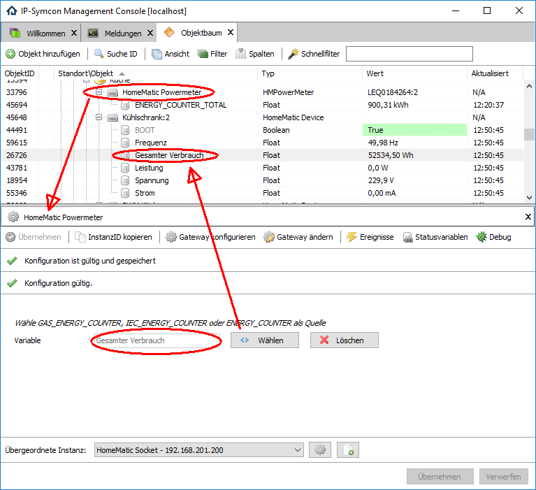
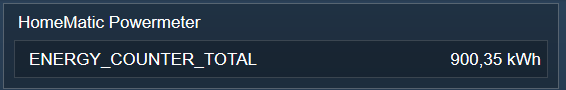

  

  

# HomeMatic Powermeter  <!-- omit in toc -->

   Abfragen des Summenzählers der Geräte mit Leistungsmessung aus der CCU.  

## Dokumentation <!-- omit in toc -->

**Inhaltsverzeichnis**

- [1. Funktionsumfang](#1-funktionsumfang)
- [2. Voraussetzungen](#2-voraussetzungen)
- [3. Software-Installation](#3-software-installation)
- [4. Einrichten der Instanzen in IP-Symcon](#4-einrichten-der-instanzen-in-ip-symcon)
- [5. Statusvariablen](#5-statusvariablen)
- [6. Visualisierung](#6-visualisierung)
  - [Kachel Visualisierung](#kachel-visualisierung)
  - [WebFront Visualisierung](#webfront-visualisierung)
- [7. PHP-Befehlsreferenz](#7-php-befehlsreferenz)
- [8. Aktionen](#8-aktionen)
- [9. Anhang](#9-anhang)
  - [1. Changelog](#1-changelog)
  - [2. Spenden](#2-spenden)
- [10. Lizenz](#10-lizenz)

## 1. Funktionsumfang

   Die CCU legt für jeden 'Schaltaktor mit Leistungsmessung' und
   jeden Energiezähler 'HM-ES-TX' automatisch eine Systemvariable
   und ein Programm an, welches den Totalwert dieses Gerätes hoch zählt.  

   Dieser Wert wird auch bei Stromausfall bzw. ausstecken des entsprechenden Aktoren, gehalten.  

   Diese Systemvariable unterscheidet sich von den 'normalen' Systemvariablen dahingehend,
   dass Sie nicht in der der Übersicht aller Systemvariablen in der CCU auftaucht.  
   (Im Gegensatz zu den Regenmengen Zählern des OC3.)  

   Entsprechend war es nötig für diesen Typ von Systemvariable ein eigenes IPS-Device zu
   implementieren.  

## 2. Voraussetzungen

- IP-Symcon ab Version 9.0  
- Ein Homematic Socket (`HomeMatic Socket`), an dem die CCU angebunden ist  
- Ein Schaltaktor mit Leistungsmessung oder ein Energiezähler `HM-ES-TX` ist an der CCU angelernt  
- Die Firewall der CCU erlaubt den Zugriff auf die `Remote HomeMatic-Script API` (siehe [Haupt-README](../README.md#2-voraussetzungen))  

## 3. Software-Installation

Dieses Modul ist Bestandteil der [HomeMaticExtended-Library](../).  

## 4. Einrichten der Instanzen in IP-Symcon

  
   Unter Instanz hinzufügen ist das Gerät 'HomeMatic Powermeter' unter dem Hersteller
   'HomeMatic' zu finden.  

   Nach dem Anlegen der Instanz sollte als übergeordnetes Gerät schon der HomeMatic Socket
   ausgewählt sein.  
   Existieren in IPS mehrere Homematic Socket, so ist der auszuwählen, der der CCU
   entspricht an dem das Gerät angelernt ist.  

   Dieses Modul fragt den Wert aus der CCU immer dann ab, wenn der Wert
   der Variable 'GAS_ENERGY_COUNTER', 'IEC_ENERGY_COUNTER' oder 'ENERGY_COUNTER'
   des entsprechenden Gerätes sich in IPS aktualisiert.  
   Oder der IPS-Dienst startet bzw. wenn eine Instanz neu konfiguriert wurde.  

   Auch die HmIP Geräte mit Leistungsmessung funktionieren.  

**Konfigurationsseite:**  
  

   Im Einstellungsdialog der Instanz ist entsprechend die zugehörige
   'GAS_ENERGY_COUNTER', 'IEC_ENERGY_COUNTER' oder 'ENERGY_COUNTER'
   Variable des Aktoren auszuwählen, von dem der 'ENERGY_COUNTER_TOTAL' Wert
   gelesen werden soll.  

| Eigenschaft |   Typ   | Standardwert |                    Funktion                     |
| :---------: | :-----: | :----------: | :---------------------------------------------: |
|   EventID   | integer |      0       | Variable-ID von einem ENERGY_COUNTER Datenpunkt |

## 5. Statusvariablen

Eine der folgende Statusvariablen wird automatisch angelegt, je nach verwendeten Gerät.  
**Statusvariable:**  

|      Name  /  Ident      |  Typ  |    Profil    |
| :----------------------: | :---: | :----------: |
|    GAS_VOLUME_TOTAL      | float |     ~Gas     |
| GAS_ENERGY_COUNTER_TOTAL | float |     ~Gas     |
| IEC_ENERGY_COUNTER_TOTAL | float | ~Electricity |
|   ENERGY_COUNTER_TOTAL   | float | ~Electricity |

Die Variablen der Summenzähler werden erst angelegt, wenn die CCU die zugehörige Systemvariable liefert und der Wert nicht 0 ist.  

**Profile:**  
Es werden die IPS-Profile ~Electricity und ~Gas genutzt, neue Profile werden nicht angelegt.  

## 6. Visualisierung

### Kachel Visualisierung

*Screenshot der Kachel Visualisierung folgt.*  

### WebFront Visualisierung

Die direkte Darstellung im WebFront ist möglich, es wird aber empfohlen mit Links zu arbeiten.  
  

## 7. PHP-Befehlsreferenz

   Es existieren keine PHP-Befehle für dieses Modul.  

## 8. Aktionen

**Grundsätzlich können alle bedienbaren Statusvariablen als Ziel einer [`Aktion`](https://www.symcon.de/service/dokumentation/konzepte/automationen/ablaufplaene/aktionen/) mit `Auf Wert schalten` angesteuert werden, so dass hier keine speziellen Aktionen benutzt werden müssen.**  

## 9. Anhang

### 1. Changelog

Der vollständige Changelog der Library steht in der [Haupt-README](../README.md#2-changelog).  

Version 3.76:

- HmIP-ESI im Gasmodus: Der Summenzähler der CCU wird als `GAS_VOLUME_TOTAL` in m³ angezeigt (bisher fälschlich als `ENERGY_COUNTER_TOTAL` in kWh, um Faktor 1000 zu klein). Eine vorhandene Variable `ENERGY_COUNTER_TOTAL` wird dann nicht mehr aktualisiert und kann gelöscht werden.  
- Die Summenzähler werden nur angelegt, wenn die CCU die Systemvariable liefert und der Wert nicht 0 ist.  

Version 3.75:

- Die Instanz nutzt direkt die Adresse des Gerätes (mit Kanal) statt einer Referenz auf eine andere Instanz. Bestehende Instanzen werden übernommen.  
- Zusätzliche Einheiten (mA, A, V, Hz) erhalten passende Profile.  

### 2. Spenden

Dieses Modul ist für die nicht kommerzielle Nutzung kostenlos, Schenkungen als Unterstützung für den Autor werden hier akzeptiert:

  

  

## 10. Lizenz

[Custom NC-SA](../LICENSE)
