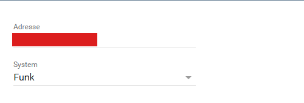
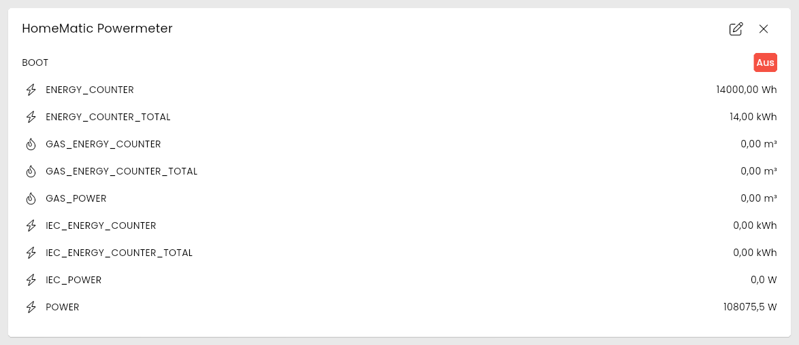
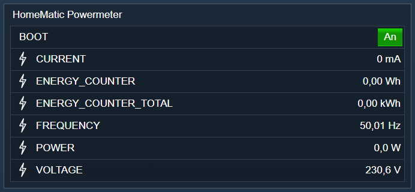

[](https://www.symcon.de/service/dokumentation/entwicklerbereich/sdk-tools/sdk-php/)
[](https://community.symcon.de/t/modul-homematic-extended-systemvariablen-programme-powermeter-u-v-m/38340)
[](https://www.symcon.de/de/service/dokumentation/installation/migrationen/v81-v90-q1-2026/)  
[](#10-lizenz)
[](https://github.com/Nall-chan/HomematicExtended/actions)
[](https://github.com/Nall-chan/HomematicExtended/actions)  
[](../README.md#6-spenden)
[](../README.md#6-spenden)

# HomeMatic Powermeter  <!-- omit in toc -->

   Abfragen des Summenzählers der Geräte mit Leistungsmessung aus der CCU.  

## Dokumentation <!-- omit in toc -->

**Inhaltsverzeichnis**

- [1. Funktionsumfang](#1-funktionsumfang)
  - [Unterstützte Geräte](#unterstützte-geräte)
- [2. Voraussetzungen](#2-voraussetzungen)
- [3. Software-Installation](#3-software-installation)
- [4. Einrichten der Instanzen in IP-Symcon](#4-einrichten-der-instanzen-in-ip-symcon)
- [5. Statusvariablen](#5-statusvariablen)
- [6. Visualisierung](#6-visualisierung)
  - [Kachel Visualisierung](#kachel-visualisierung)
  - [WebFront Visualisierung](#webfront-visualisierung)
- [7. PHP-Befehlsreferenz](#7-php-befehlsreferenz)
- [8. Aktionen](#8-aktionen)
- [9. Anhang](#9-anhang)
  - [1. Changelog](#1-changelog)
  - [2. Spenden](#2-spenden)
- [10. Lizenz](#10-lizenz)

## 1. Funktionsumfang

   Die CCU legt für jeden 'Schaltaktor mit Leistungsmessung' und
   jeden Energiezähler 'HM-ES-TX' automatisch eine Systemvariable
   und ein Programm an, welches den Totalwert dieses Gerätes hoch zählt.  

   Dieser Wert wird auch bei Stromausfall bzw. ausstecken des entsprechenden Aktoren, gehalten.  

   Diese Systemvariable unterscheidet sich von den 'normalen' Systemvariablen dahingehend,
   dass Sie nicht in der der Übersicht aller Systemvariablen in der CCU auftaucht.  
   (Im Gegensatz zu den Regenmengen Zählern des OC3.)  

   Entsprechend war es nötig für diesen Typ von Systemvariable ein eigenes IPS-Device zu
   implementieren.  

### Unterstützte Geräte

Das Modul arbeitet nach dem Kanaltyp des Gerätes (`POWERMETER`, `POWERMETER_IGL`, `POWERMETER_IEC1`, `POWERMETER_IEC2` und `ENERGIE_METER_TRANSMITTER`), nicht nach einer Liste von Gerätetypen. Der Konfigurator bietet daher alle Kanäle dieser Typen an.  
Geräte mit gleichen Datenpunkten und gleicher Systemvariable der CCU sind zu einer Zeile zusammengefasst. Getestet ist mindestens ein Gerät der Zeile, die übrigen verhalten sich laut CCU-Firmware gleich.  

| Geräte                                                                                                                                                                                                                     | Kanal                     | Datenpunkt → Systemvariable der CCU                                                         | Statusvariable                 | Getestet                                   |
| -------------------------------------------------------------------------------------------------------------------------------------------------------------------------------------------------------------------------- | ------------------------- | ------------------------------------------------------------------------------------------- | ------------------------------ | ------------------------------------------ |
| Schaltaktoren mit Leistungsmessung: HM-ES-PMSw1-Pl, HM-ES-PMSw1-Pl-DN-R1 … R5, HM-ES-PMSw1-DR, HM-ES-PMSw1-SM, HM-ES-PMSwX, HmIP-PSM, HmIP-PSM-PE, -UK, -IT, -CH, HmIP-PSM-2, HmIP-PSM-PE-2, HmIP-PSM-CH-2, HmIP-PSM-A, HmIP-BSM, HmIP-BSM-I, HmIP-FSM, HmIP-FSM16, HmIP-USBSM | HM: :2, HmIP-PSM/-USBSM: :6, BSM: :7, FSM: :5 | `ENERGY_COUNTER` → `svEnergyCounter_…`                                                      | `ENERGY_COUNTER_TOTAL` (kWh)   | ✅ (HM-ES-PMSw1-Pl)                        |
| Schaltaktoren mit Einspeisung: HmIP-PSMCO, ELV-SH-PSMCI                                                                                                                                                                     | :6                        | `ENERGY_COUNTER` → `svEnergyCounter_…`<br>`ENERGY_COUNTER_FEED_IN` → `svEnergyCounterFeedIn_…` | `ENERGY_COUNTER_TOTAL` (kWh)<br>`ENERGY_COUNTER_FEED_IN_TOTAL` (kWh) | Bezug ✅ (wie Schaltaktoren)<br>Einspeisung ❌ |
| Zählersensor HM-ES-TX-WM (alle Firmwarestände)                                                                                                                                                                             | :1, IEC zusätzlich :2     | Strom: `ENERGY_COUNTER` → `svEnergyCounter_…`<br>Gas: `GAS_ENERGY_COUNTER` → `svEnergyCounterGas_…`<br>IEC: `IEC_ENERGY_COUNTER` → `svEnergyCounterIEC_…` | `ENERGY_COUNTER_TOTAL` (kWh)<br>`GAS_ENERGY_COUNTER_TOTAL` (m³)<br>`IEC_ENERGY_COUNTER_TOTAL` (kWh) | Strom ✅<br>Gas ✅<br>IEC ❌ |
| Zählersensor HmIP-ESI, HmIP-ESI-IND (nur Gas)                                                                                                                                                                              | Zähler auf :2 bis :4      | Gas: `GAS_VOLUME` → `svEnergyCounter_…`<br>Strom und IEC: `ENERGY_COUNTER` → `svEnergyCounter_…` | `GAS_VOLUME_TOTAL` (m³)<br>`ENERGY_COUNTER_TOTAL` (kWh) | Gas ✅<br>Strom und IEC ✅ (wie Schaltaktoren) |

Die Kanäle der Geräte stammen aus der CCU-Firmware ([eq-3/occu](https://github.com/eq-3/occu)). Ein Schaltaktor hat zusätzlich einen Schaltkanal, dieser gehört nicht zu diesem Modul.  
Der HmIP-ESI nutzt im Gasmodus dieselbe Systemvariable wie im Strommodus. Das Modul erkennt den Gasmodus daran, dass das Gerät `GAS_VOLUME`, aber kein `ENERGY_COUNTER` liefert.  

## 2. Voraussetzungen

- IP-Symcon ab Version 9.0  
- Ein Homematic Socket (`HomeMatic Socket`), an dem die CCU angebunden ist  
- Ein Schaltaktor mit Leistungsmessung oder ein Energiezähler `HM-ES-TX` ist an der CCU angelernt  
- Die Firewall der CCU erlaubt den Zugriff auf die `Remote HomeMatic-Script API` (siehe [Haupt-README](../README.md#2-voraussetzungen))  

## 3. Software-Installation

Dieses Modul ist Bestandteil der [HomeMaticExtended-Library](../).  

## 4. Einrichten der Instanzen in IP-Symcon

> [!TIP]
> Am einfachsten wird die Instanz über den `HomeMatic Extended Konfigurator` angelegt. Er bietet alle Messkanäle der [unterstützten Geräte](#unterstützte-geräte) an und trägt Adresse und System selbstständig ein.  

  

Alternativ unter `Instanz hinzufügen` das Gerät `HomeMatic Powermeter` unter dem Hersteller `HomeMatic` auswählen.  
Nach dem Anlegen der Instanz sollte als übergeordnetes Gerät schon der Homematic Socket ausgewählt sein.  
Existieren in IPS mehrere Homematic Sockets, so ist der auszuwählen, an welcher CCU das Gerät angelernt ist.  

**Konfigurationsseite:**  
  

| Eigenschaft | Name     | Typ     | Standardwert | Beschreibung                                                                                                  |
| :---------- | :------- | :------ | :----------- | :------------------------------------------------------------------------------------------------------------ |
| Adresse     | Address  | string  | (leer)       | Adresse des Messkanals mit Kanalnummer, z.B. `MEQ0123456:1` (Kanal siehe [unterstützte Geräte](#unterstützte-geräte)). |
| System      | Protocol | integer | `0`          | Schnittstelle der CCU, an der das Gerät angelernt ist: `0` = Funk, `1` = Kabelgebunden, `2` = IP.               |

Die Instanz liest beim Übernehmen der Einstellungen und beim Start von Symcon alle Datenpunkte des Kanals (Paramset `VALUES`) und legt dafür Statusvariablen an. Danach aktualisieren die Ereignisse der CCU diese Variablen.  
Meldet die CCU einen Zählerstand (`ENERGY_COUNTER`, `ENERGY_COUNTER_FEED_IN`, `GAS_ENERGY_COUNTER`, `GAS_VOLUME` oder `IEC_ENERGY_COUNTER`), liest die Instanz 50 ms später den Summenzähler aus der zugehörigen Systemvariable der CCU (siehe [Statusvariablen](#5-statusvariablen)). Die kurze Pause gibt dem Programm der CCU Zeit, den Summenzähler zu aktualisieren, der Zeitstempel im Archiv passt weiterhin zur Messung.  

Bestehende Instanzen aus älteren Versionen (Eigenschaft `EventID`) werden beim Update auf Adresse und System umgestellt.  

**Beispiel für das Setzen der Adresse per PHP:**  

```php
IPS_SetProperty(12345, 'Address', 'MEQ0123456:1');
IPS_SetProperty(12345, 'Protocol', 0);
IPS_ApplyChanges(12345);
```

## 5. Statusvariablen

Eine der folgende Statusvariablen wird automatisch angelegt, je nach verwendeten Gerät.  
**Statusvariable:**  

|      Name  /  Ident      |  Typ  |    Profil    |
| :----------------------: | :---: | :----------: |
|    GAS_VOLUME_TOTAL      | float |     ~Gas     |
| GAS_ENERGY_COUNTER_TOTAL | float |     ~Gas     |
| IEC_ENERGY_COUNTER_TOTAL | float | ~Electricity |
|   ENERGY_COUNTER_TOTAL   | float | ~Electricity |
| ENERGY_COUNTER_FEED_IN_TOTAL | float | ~Electricity |

Die Variablen der Summenzähler werden erst angelegt, wenn die CCU die zugehörige Systemvariable liefert und der Wert nicht 0 ist.  

**Profile:**  
Es werden die IPS-Profile ~Electricity und ~Gas genutzt, neue Profile werden nicht angelegt.  

## 6. Visualisierung

### Kachel Visualisierung

  

### WebFront Visualisierung

Die direkte Darstellung im WebFront ist möglich, es wird aber empfohlen mit Links zu arbeiten.  
  

## 7. PHP-Befehlsreferenz

   Es existieren keine PHP-Befehle für dieses Modul.  

## 8. Aktionen

**Grundsätzlich können alle bedienbaren Statusvariablen als Ziel einer [`Aktion`](https://www.symcon.de/service/dokumentation/konzepte/automationen/ablaufplaene/aktionen/) mit `Auf Wert schalten` angesteuert werden, so dass hier keine speziellen Aktionen benutzt werden müssen.**  

## 9. Anhang

### 1. Changelog

Der vollständige Changelog der Library steht in der [Haupt-README](../README.md#2-changelog).  

**Version 3.81:**

- Datenpunkte, bei denen die CCU einzelne Angaben (Einheit, Typ, Bedienbarkeit) nicht mitliefert (z.B. beim HmIP-BSM), führten beim Übernehmen zu einem Fehler.  
- Ein Ereignis der CCU, das unmittelbar nach einem Update der Library eintraf, erzeugte einen PHP-Fehler im Log.  

**Version 3.78:**

- Der `HomeMatic Extended Konfigurator` listet jetzt auch die HmIP-Geräte (z.B. HmIP-PSM, HmIP-ESI).  
- Der Summenzähler wird 50 ms nach der Meldung des Gerätes gelesen. Bisher konnte er um eine Meldung hinterherhängen, wenn das Programm der CCU den Zähler noch nicht aktualisiert hatte.  

**Version 3.77:**

- Neue Statusvariable `ENERGY_COUNTER_FEED_IN_TOTAL` (kWh) für den Einspeisezähler der HmIP-PSMCO und ELV-SH-PSMCI.  

**Version 3.76:**

- HmIP-ESI im Gasmodus: Der Summenzähler der CCU wird als `GAS_VOLUME_TOTAL` in m³ angezeigt (bisher fälschlich als `ENERGY_COUNTER_TOTAL` in kWh, um Faktor 1000 zu klein). Eine vorhandene Variable `ENERGY_COUNTER_TOTAL` wird dann nicht mehr aktualisiert und kann gelöscht werden.  
- Die Summenzähler werden nur angelegt, wenn die CCU die Systemvariable liefert und der Wert nicht 0 ist.  

**Version 3.75:**

- Die Instanz nutzt direkt die Adresse des Gerätes (mit Kanal) statt einer Referenz auf eine andere Instanz. Bestehende Instanzen werden übernommen.  
- Zusätzliche Einheiten (mA, A, V, Hz) erhalten passende Profile.  

### 2. Spenden

Dieses Modul ist für die nicht kommerzielle Nutzung kostenlos, Schenkungen als Unterstützung für den Autor werden hier akzeptiert:

  [](https://paypal.me/Nall4chan)

  [](https://www.amazon.de/hz/wishlist/ls/YU4AI9AQT9F?ref_=wl_share)

## 10. Lizenz

[Custom NC-SA](../LICENSE)
