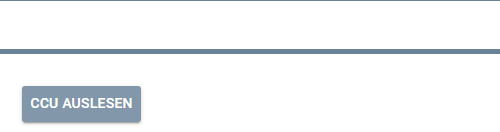
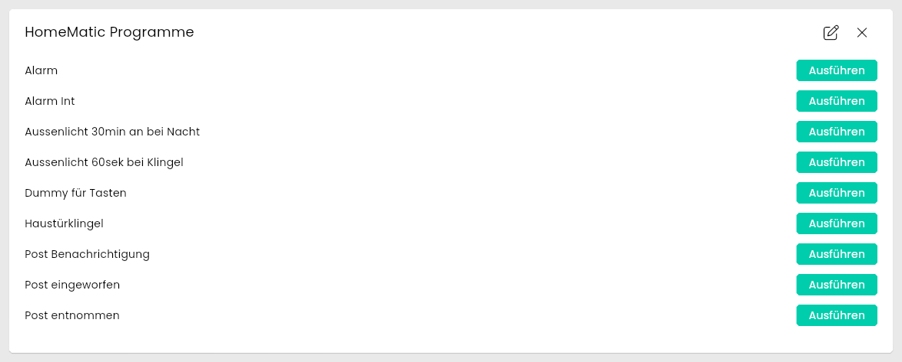
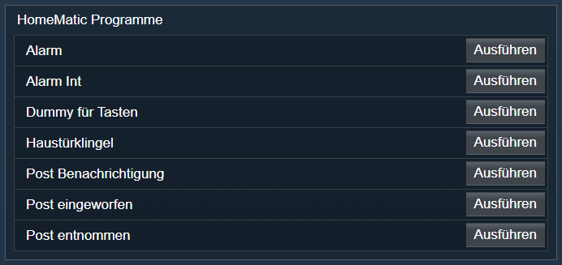

[](https://www.symcon.de/service/dokumentation/entwicklerbereich/sdk-tools/sdk-php/)
[](https://community.symcon.de/t/modul-homematic-extended-systemvariablen-programme-powermeter-u-v-m/38340)
[](https://www.symcon.de/de/service/dokumentation/installation/migrationen/v81-v90-q1-2026/)  
[](#10-lizenz)
[](https://github.com/Nall-chan/HomematicExtended/actions)
[](https://github.com/Nall-chan/HomematicExtended/actions)  
[](../README.md#6-spenden)
[](../README.md#6-spenden)

# HomeMatic Programme  <!-- omit in toc -->

  Integration der Programme auf der CCU.  

## Dokumentation <!-- omit in toc -->

**Inhaltsverzeichnis**

- [1. Funktionsumfang](#1-funktionsumfang)
- [2. Voraussetzungen](#2-voraussetzungen)
- [3. Software-Installation](#3-software-installation)
- [4. Einrichten der Instanzen in IP-Symcon](#4-einrichten-der-instanzen-in-ip-symcon)
- [5. Statusvariablen](#5-statusvariablen)
- [6. Visualisierung](#6-visualisierung)
  - [Kachel Visualisierung](#kachel-visualisierung)
  - [WebFront Visualisierung](#webfront-visualisierung)
- [7. PHP-Befehlsreferenz](#7-php-befehlsreferenz)
- [8. Aktionen](#8-aktionen)
- [9. Anhang](#9-anhang)
  - [1. Changelog](#1-changelog)
  - [2. Spenden](#2-spenden)
- [10. Lizenz](#10-lizenz)

## 1. Funktionsumfang

   Abfragen der auf der CCU vorhandenen HM-Programme.  
   Ausführen der HM-Programme auf der CCU.  
   Standard Actionhandler für die Bedienung der HM-Programme aus dem IPS-Webfront.  

## 2. Voraussetzungen

- IP-Symcon ab Version 9.0  
- Ein Homematic Socket (`HomeMatic Socket`), an dem die CCU angebunden ist  
- Die Firewall der CCU erlaubt den Zugriff auf die `Remote HomeMatic-Script API` (siehe [Haupt-README](../README.md#2-voraussetzungen))  

## 3. Software-Installation

Dieses Modul ist Bestandteil der [HomeMaticExtended-Library](../).  

## 4. Einrichten der Instanzen in IP-Symcon

  
   Unter Instanz hinzufügen sind die 'HomeMatic Programme' unter dem Hersteller 'HomeMatic' zu finden.  
   Nach dem Anlegen der Instanz sollte als übergeordnetes Gerät schon der HomeMatic Socket ausgewählt sein.  
   Existieren in IPS mehrere Homematic Socket, so ist der auszuwählen, aus welcher CCU die Programme gelesen werden sollen.  

**Konfigurationsseite:**  

   Dieses Modul hat keinerlei Einstellungen, welche konfiguriert werden müssen.  

   Im Testcenter ist es jedoch über den Button 'CCU auslesen' möglich, die auf der CCU vorhandenen Programme auszulesen.  
   Dies erfolgt auch automatisch wenn Symcon die Verbindung zur CCU herstellt und wenn die Instanz angelegt wird.  

## 5. Statusvariablen

   Die Programme werden als Integer-Variable unterhalb der Instanz erzeugt. Es wird automatisch der Name und die Beschreibung aus der CCU übernommen.  
   Des weiteren wird ein Standard-Profil 'Execute-HM' angelegt und den Variablen zugeordnet.  
   Es ist somit sofort möglich die Programme aus dem WebFront heraus zu starten.  
   Werden in der CCU Programme gelöscht, so müssen die dazugehörigen Variablen in IPS bei Bedarf manuell gelöscht werden.  
  

## 6. Visualisierung

### Kachel Visualisierung

  

### WebFront Visualisierung

Die direkte Darstellung im WebFront ist möglich, es wird aber empfohlen mit Links zu arbeiten.  
  

## 7. PHP-Befehlsreferenz

   ```php
    boolean HM_ReadPrograms(int $InstantID /*[HomeMatic Programme]*/)
```
   Alle Programme auf der CCU werden ausgelesen und bei Bedarf neu angelegt.

```php
    boolean HM_StartProgram(int $InstantID /*[HomeMatic Programme]*/, string $IDENT);
```
   Startet ein auf der CCU hinterlegtes Programm. Als `$IDENT` muss der Ident der Variable des Programmes übergeben werden.  
   (Die IDENT werden unter dem Reiter 'Statusvariablen' des Einstellungsdialogs der Instanz angezeigt.)  

   Diese Funktionen liefern einen bool Rückgabewert.
   True bei Erfolg, im Fehlerfall False.  

   **Beispiele:**

```php
    $Erfolg = @HM_ReadPrograms(12345 /*[HomeMatic Programme]*/);  
    if ($Erfolg === false) echo "Fehler beim Lesen der Programme";  

    $Erfolg = @HM_StartProgram(12345 /*[HomeMatic Programme]*/, '4711' /* IDENT von Programm Licht Alles aus */);  
    if ($Erfolg === false) echo "Fehler beim starten des Programm";  
```
    

## 8. Aktionen

**Grundsätzlich können alle bedienbaren Statusvariablen als Ziel einer [`Aktion`](https://www.symcon.de/service/dokumentation/konzepte/automationen/ablaufplaene/aktionen/) mit `Auf Wert schalten` angesteuert werden, so dass hier keine speziellen Aktionen benutzt werden müssen.**  

## 9. Anhang

### 1. Changelog

Der vollständige Changelog der Library steht in der [Haupt-README](../README.md#2-changelog).  

**Version 3.75:**

- Fehlermeldung, wenn das Starten eines Programms fehlschlägt, statt eines PHP-Fehlers.  
- Programmnamen mit Umlauten werden richtig angezeigt.  

### 2. Spenden

Dieses Modul ist für die nicht kommerzielle Nutzung kostenlos, Schenkungen als Unterstützung für den Autor werden hier akzeptiert:

  [](https://paypal.me/Nall4chan)

  [](https://www.amazon.de/hz/wishlist/ls/YU4AI9AQT9F?ref_=wl_share)

## 10. Lizenz

[Custom NC-SA](../LICENSE)
