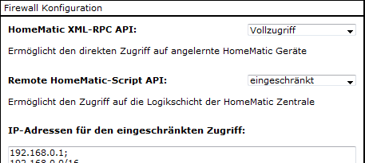

  

  

# Symcon-Modul: HomeMaticExtended <!-- omit in toc -->  

Erweitert IPS um die native Unterstützung von:  

* Systemvariablen der CCU
* Programmen auf der CCU
* Summenzähler aller Typen von Verbrauchsmessern
* Display Status-Anzeige (Dis-WM55)
* ePaper Status-Anzeige (Dis-EP-WM55)
* Heizungsgeräte: Heizkörperthermostat, Heizgruppen und Wandthermostat mit Wochenplan und weiteren Parametern
* HomeMaticScript
* Status der Funk-Interfaces
* Status des Wired-Interface
* Konfigurator zum Anlegen der Instanzen

## Inhaltsverzeichnis  <!-- omit in toc -->  

- [1. Funktionsumfang](#1-funktionsumfang)
  - [HomeMatic Systemvariablen:](#homematic-systemvariablen)
  - [HomeMatic Powermeter:](#homematic-powermeter)
  - [HomeMatic Programme:](#homematic-programme)
  - [HomeMatic RemoteScript Interface:](#homematic-remotescript-interface)
  - [HomeMatic Dis-WM55:](#homematic-dis-wm55)
  - [HomeMatic Dis-EP-WM55:](#homematic-dis-ep-wm55)
  - [HomeMatic Heizungsgeräte:](#homematic-heizungsgeräte)
  - [HomeMatic Extended Konfigurator:](#homematic-extended-konfigurator)
  - [HomeMatic RF-Interface Splitter:](#homematic-rf-interface-splitter)
  - [HomeMatic RF-Interface:](#homematic-rf-interface)
  - [HomeMatic WR-Interface:](#homematic-wr-interface)
- [2. Voraussetzungen](#2-voraussetzungen)
- [3. Software-Installation](#3-software-installation)
- [4. Einrichten der Instanzen in IP-Symcon](#4-einrichten-der-instanzen-in-ip-symcon)
- [5. Anhang](#5-anhang)
  - [1. GUID der Module](#1-guid-der-module)
  - [2. Changelog](#2-changelog)
- [6. Spenden](#6-spenden)
- [7. Lizenz](#7-lizenz)

## 1. Funktionsumfang

### [HomeMatic Systemvariablen:](Systemvariablen/)  

   Abfragen von System- und Alarmvariablen inkl. Profilen und Werten von der CCU.  
   Schreiben von Werten der Systemvariablen zur CCU.  
   Standard Actionhandler für die Bedienung der System- und Alarmvariablen aus dem IPS-Webfront.  

### [HomeMatic Powermeter:](PowerMeter/)  

   Abfragen des Summenzählers der Geräte mit Leistungsmessung aus der CCU.  

### [HomeMatic Programme:](Programme/)  

   Abfragen der auf der CCU vorhandenen HM-Programme.  
   Ausführen der HM-Programme auf der CCU.  
   Standard Actionhandler für die Bedienung der HM-Programme aus dem IPS-Webfront.  

### [HomeMatic RemoteScript Interface:](HomeMaticScript)  

   Native Schnittstelle zur CCU, um HomeMatic-Scripte durch die CCU ausführen zu lassen.  
   Direkte Rückmeldung der Ausführung durch einen Antwortstring im JSON-Format.  

### [HomeMatic Dis-WM55:](DisplayStatusAnzeige/)

   Dynamische Textanzeige auf dem Display-Wandtaster mit Statusdisplay.  
   Unterstützt mehrseite Anzeigen und das durchblättern per Tastendruck.  
   Ausführen von benutzerspezifischen Aktionen, auch in Abhängigkeit der angezeigten Seite.  

### [HomeMatic Dis-EP-WM55:](ePaperStatusAnzeige/)  

   Hier handelt es sich um eine Instanz, welche die Verwendung des ePaper Statusdisplays im 55er-Rahmen vereinfachen soll.  
   Über spezielle PHP-Befehle ist es möglich das Display anzusteuern.  

### HomeMatic Heizungsgeräte:

   Erweiterte Bedienung der Heizungsgeräte der CCU:

* [HomeMatic Heating Device](HeatingDevice/) (Heizkörperthermostat `HM-CC-RT-DN`)
* [HomeMatic Heating Group](HeatingGroup/) (Heizgruppe `HM-CC-VG-1`)
* [HomeMatic IP Heating Group](HeatingGroupHmIP/) (Heizgruppe `HmIP-HEATING`)
* [HomeMatic Climate Control Regulator](ClimacontrolRegulator/) (Wandthermostat `HM-CC-TC`)

   Die Zeitprofile werden als Wochenplan in IPS dargestellt und können dort bearbeitet und zum Gerät übertragen werden.
   Party-/Urlaubsmodus, der Modus der Soll-Temperatur, die Entkalkung und weitere Parameter der Geräte stehen als Variablen zur Verfügung.
   Welche Variablen angelegt werden, lässt sich in der Konfiguration der Instanz einstellen.

### [HomeMatic Extended Konfigurator:](ExtendedConfigurator/)

   Legt die Instanzen der Geräte dieser Library an (Powermeter, Displays, Heizungsgeräte, Programme, RemoteScript und WR-Interface).
   Bereits angelegte Instanzen werden erkannt. Instanzen, zu denen kein Gerät auf der CCU gefunden wird, werden mit einem Hinweis angezeigt.

### [HomeMatic RF-Interface Splitter:](RFInterfaceSplitter/)

   Auslesen der Informationen zu jedem Funk-Interface der CCU.

### [HomeMatic RF-Interface:](RFInterface/)  

   Bereitstellen der Informationen zu den Funk-Interfaces innerhalb von IPS.

### [HomeMatic WR-Interface:](WRInterface/)  

   Bereitstellen der Informationen zu dem Wired-Interface innerhalb von IPS.

## 2. Voraussetzungen

   Funktionsfähige CCU1, CCU2 oder CCU3, welche schon mit einem HomeMatic Socket in IPS eingerichtet ist.  
   In der CCU muß die Firewall entsprechend eingerichtet sein, das IPS auf die 'Remote HomeMatic-Script API' der CCU zugreifen kann.  

    Einstellungen -> Systemsteuerung -> Firewall konfigurieren

   Bei 'Remote HomeMatic-Script API' muß entweder 'Vollzugriff' oder 'Eingeschränkt' eingestellt sein.
   Bei 'Eingeschränkt' ist dann unter 'IP-Adressen für eingeschränkten Zugriff' euer LAN / IPS-PC einzugeben.  
   (z.B. 192.168.178.0/24 => /24 ist die Subnet-Maske für das Netzwerk. Bei 255.255.255.0 ist das 24 bei 255.255.0.0. ist es 16.  
   Oder es kann direkt eine einzelne Adresse eingetragen werden. z.B. 192.168.0.2  

  

## 3. Software-Installation

   Über den 'Module-Store' in Symcon das Modul 'HomematicExtended' hinzufügen.  

## 4. Einrichten der Instanzen in IP-Symcon

  Ist direkt in der Dokumentation der jeweiligen Module beschrieben.  
  Die Module der Geräte sind im Dialog 'Instanz hinzufügen' unter dem Hersteller 'HomeMatic' zu finden.  

  

## 5. Anhang

### 1. GUID der Module

|                Modul                |     Typ      |                  GUID                  |
| :---------------------------------: | :----------: | :------------------------------------: |
|      HomeMatic Systemvariablen      |    Device    | {AF50C42B-7183-4992-B04A-FAFB07BB1B90} |
|        HomeMatic Powermeter         |    Device    | {400F9193-FE79-4086-8D76-958BF9C1B357} |
|         HomeMatic Programme         |    Device    | {A5010577-C443-4A85-ABF2-3F2D6CDD2465} |
|  HomeMatic RemoteScript Interface   |    Device    | {246EDB89-70BC-403B-A1FA-3B3B1B540401} |
|         HomeMatic Dis-WM55          |    Device    | {271BCAB1-0658-46D9-A164-985AEB641B48} |
|        HomeMatic Dis-EP-WM55        |    Device    | {E64ED916-FA6C-45B2-B8E3-EDC3191BC4C0} |
|   HomeMatic RF-Interface Splitter   |   Splitter   | {6EE35B5B-9DD9-4B23-89F6-37589134852F} |
|       HomeMatic RF-Interface        |    Device    | {36549B96-FA11-4651-8662-F310EEEC5C7D} |
|       HomeMatic WR-Interface        |    Device    | {01C66202-7E94-49C4-8D8F-6A75CE944E87} |
|      HomeMatic Heating Device       |    Device    | {E2674369-5272-44FE-905A-DCBF0E5126C6} |
|      HomeMatic Heating Group        |    Device    | {F179857C-DF5A-2CED-F553-CDB4D42815ED} |
|     HomeMatic IP Heating Group      |    Device    | {05CD9BAE-5A3B-E10B-79D6-48CB45A02C6A} |
|  HomeMatic Climate Control Regulator |    Device    | {AA29D32D-A00D-EC8F-4987-5EB071F77011} |
|    HomeMatic Extended Configurator  | Configurator | {7B8F83C6-E3BC-AC8C-3FFC-D81CAC96D93B} |

### 2. Changelog

Version 3.75:

> [!IMPORTANT]
> * Mindestens IP-Symcon 9.0 erforderlich.
> * Das Modul `HomeMatic Paraset Interface` wurde entfernt. Vorhandene Instanzen sind nach dem Update ohne Funktion.
> * Das Modul `HomeMatic RF-Interface Konfigurator` wurde entfernt. Die RF-Interfaces (Gateways) legt der `HomeMatic Extended Konfigurator` an. Eine vorhandene Instanz des RF-Interface Konfigurators muss gelöscht werden, die Instanzen `HomeMatic RF-Interface` und `HomeMatic RF-Interface Splitter` bleiben erhalten.
> * `HomeMatic Dis-WM55`: Die Eigenschaften `PageUpID`, `PageDownID`, `ActionUpID` und `ActionDownID` entfallen. Stattdessen wird die Adresse des Displays mit Kanal eingetragen (z.B. `NEQ1234567:1`), an diese Adresse wird immer ausgegeben. Bestehende Instanzen werden beim Update übernommen, Auslöser von anderen Geräten stehen danach in den Experteneinstellungen.
> * `HomeMatic Dis-WM55`: Die Taste 'Seite hoch' blättert jetzt zurück und 'Seite runter' weiter (bisher war die Richtung vertauscht).

**Neue Funktionen und Aktionen**
* Konfigurator: Kann jetzt auch die Displays `HM-Dis-WM55` und `HM-Dis-EP-WM55`, die Instanz `HomeMatic RemoteScript` sowie die RF-Interfaces (Gateways) der CCU anlegen. Für ein RF-Interface wird die Kette aus RF-Interface, RF-Interface Splitter und Homematic Socket erzeugt, jedes Gateway erhält eine eigene Zeile. Auch Gateways, die gerade offline sind, werden mit Name, Typ und IP-Adresse angezeigt.
* HomeMatic Dis-WM55: Experteneinstellungen für zusätzliche Auslöser von Variablen anderer Homematic Geräte.
* HomeMatic Dis-WM55: Neue Schaltfläche `Display-Script wiederherstellen` legt das Display-Script neu an, wenn es gelöscht wurde. Die Schaltfläche ist erst aktiv, wenn das Script fehlt.

**Geändertes Verhalten**
* HomeMatic RF-Interface Splitter: Neue Instanzen haben das Intervall 60 Sekunden (bisher 0, also aus). Bestehende Instanzen behalten ihr Intervall.
* Konfigurator: Instanzen, zu denen kein Gerät auf der CCU gefunden wurde oder die keine Adresse besitzen (Migration), werden mit einem Hinweis angezeigt. Sind Protokolle im Homematic Socket nicht aktiviert, werden diese in einer Meldung mit Schaltfläche zum Homematic Socket aufgelistet.
* HomeMatic Dis-WM55: Die Tasten werden direkt über den Datenfluss des Homematic Sockets empfangen. Dem Display-Script wird nie die Seite 0 übergeben, die gewählte Seite bleibt bei Änderungen der Konfiguration erhalten. Lehnt die CCU eine Übertragung ab (das Display ist nach einem Tastendruck nur kurz empfangsbereit), wird sofort einmal wiederholt. Neuer Status, wenn die Adresse keinen Kanal enthält.
* HomeMatic Dis-EP-WM55: Die Adresse mit dem Kanal 3 wird geprüft (neue Status), die Zeile der Befehle `HM_WriteValueDisplayLine` und `HM_WriteValueDisplayLineEx` wird auf 1-3 geprüft.
* HomeMatic Powermeter: Adresse und Protokoll werden aus der bisherigen Variable übernommen. Die Variablen für Strom, Spannung und Frequenz erhalten wieder Profile mit Einheit.
* Konfigurationsformulare: Adressen und Zahlenwerte (Timeout, Intervall, Anzahl der Seiten) können nur noch mit gültigen Werten eingegeben werden.
* Fehlermeldungen bei der Bedienung von Variablen werden im Frontend angezeigt (z.B. 'Party ist in der Konfiguration deaktiviert').

**Fehlerbehebungen**
* Heizgruppen und HM-CC-TC: Die Fehlermeldung `Wochenplan-Aktions-ID muss größer als 0 sein` ist behoben. Fehler beim Zuordnen von Variablen der Parameter behoben.
* Powermeter: Der Summenzähler wurde bei Ereignissen nicht aktualisiert. Unbekannte Datenpunkte oder Einheiten führen nicht mehr zu Fehlern.
* HomeMatic RF-Interface: Die Variable `CONNECTED` blieb auf dem alten Wert, wenn das Funk-Interface offline war und von der CCU nicht mehr gemeldet wurde. Ist ein Interface nicht mehr erreichbar, wird `CONNECTED` jetzt auf `false` gesetzt.  
* Heizgruppen (`HM-CC-VG-1`, `HmIP-HEATING`): Zeiten wurden bei exakt 30 Minuten auf die volle Stunde abgerundet (z.B. 09:30 auf 09:00 bei Party Start/Ende und Entkalkung).  
* HomeMatic Programme: Programme mit ungültiger ID werden nicht mehr an die CCU gesendet. Startet die CCU ein Programm nicht, wird eine Fehlermeldung ausgegeben.  
* HomeMatic WR-Interface: Falsche Fehlermeldung, wenn das Wired-Interface im Homematic Socket deaktiviert ist.
* Heizungsgeräte: Antworten der CCU mit dem Zeichen `°` (ISO-8859-1) führten dazu, dass die Statusvariablen nicht angelegt wurden.
* Fehlende Übersetzungen ergänzt.

Version 3.74:
* Konfiguration der festen Temperaturen lässt beim Bearbeiten keine ungültigen oder doppelten Werte mehr zu.  
* Übersteigt die Summe der festen Temperaturen mit denen aus den Geräten ausgelesenen Temperaturen die Anzahl von 31, so wird eine Warnung in das Log geschrieben und die Anzahl auf 31 begrenzt (maximale Anzahl der Aktionen von einem Wochenplan).  

Version 3.73:
* Neue Eigenschaft in der Konfiguration der Heizgruppen und der HM-CC-TC Instanzen, um feste Temperaturen als Auswahl für den Wochenplan einzustellen.  
  
Version 3.71:
* Neue Eigenschaft in der Konfiguration der Heizgruppen und der HM-CC-TC Instanzen, um das Verhalten des Modus bei manueller Bedienung der Soll-Temperatur einzustellen.  
* Fehlermeldungen wenn Aktives Zeitprofil in der Konfiguration abgeschaltet und Zeitplan eingeschaltet war.  
* Zeitplan schaltet sofort um, wenn sich aktive Zeitprofil ändert.   
* HeatingDevice (Heizkörperthermostat) HM-CC-RT-DN ergänzt.  
* Fehlerhafte Umlaute in CCU Programmen und Systemvariablen behoben.  
* Fehler bei Profilen verhinderte das neu anlegen der Instanz `Homematic Programme`.  
* Homematic Script Instanz liefert jetzt ein Array anstatt JSON als Rückgabewert.  
* Homematic Script Instanz liefert im Index `['Output']` des Rückgabewertes alle Write/WriteLine Scriptausgaben.  

Version 3.70:

* Zeitprofile der Heizgruppen und des HM-CC-TC werden als Wochenplan in IPS dargestellt und können dort bearbeitet werden.  

Version 3.60:

**Profile vor dem Update löschen:**  
* Heating.Control.Profile.HmIP
* Heating.Control.SetPoint.Mode.HM
  
Anpassungen für die ClimacontrolRegulator:
* Prüfung der maximalen Anzahl von Tagen für den Party/Urlaub Modus war defekt.  
* Veränderungen der Solltemperatur setzen den Modus auf Manuell.  
  
Anpassungen für die HeatingGroupHmIP:
* Modus Solltemperatur ist nicht mehr optional.  
* Veränderungen der Solltemperatur während des Modus Automatik setzen den Modus auf Manuell.  
* Veränderungen der Solltemperatur während des Modus Party/Urlaub sind möglich.  
* Alle Party/Urlaub Einstellungen als eine Konfig-Einstellung zusammengefasst.  
* Sind die Start und Endwerte von Party/Urlaub nicht gesetzt, wird initial die aktuelle Zeit übernommen.  

HeatingGroup:
* Instanz funktional hinzugefügt.  
 
Version 3.50:

* Neu: HomeMatic Paraset Interface Instanz zum lesen und schreiben von Parametern von Geräten.  
* Neu: HM-Script wird intern über Symcon übertragen.  

Version 3.20:

* Neu: Symcon-Aktionen (Actions) für Homematic-Instanzen.  

Version 3.12:

* Fix: Fehlermeldung bei Senden an Dis-EP-WM55.  
* Fix: Dokumentation für Dis-EP-WM55 korrigiert.  

Version 3.11:

* Fix: IntervalBox durch NumberSpinner ersetzt.  
* Fix: Diverse Schreibfehler.  

Version 3.10:  

* Neu: Konfigurator für RF-Interfaces  
* Fix: HMScript Fehler im Log der CCU bei Verwendung der Systemvariablen-Instanz.  

Version 3.00:  

* Neu: Release für IPS 5.1 und den Module-Store

Version 2.80:

* Neu: Referenzen werden in Symcon registriert.  
* Fix: IPS_SetProperty und IPS_Applychanges auf sich selbst entfernt.  

Version 2.65:

* Fix: Keine Verbindung mehr bei CCU1 und CCU2.  

Version 2.61:

* Fix: memory exhausted error.  
* Fix: Fehler bei der Verarbeitung von AlarmVariablen bei der CCU3.  
* Neu: SSL und Authentifizierung wird für CCU3 unterstützt (sofern in IPS verfügbar!).  

Version 2.60:

* Neu: Modul intern überarbeitet.  
* Neu: Diverse Anpassungen für IPS 5.0 und neuer.  
* Fix: HmScript Fehler im Log der CCU bei Verwendung der PowerMeter-Instanz.  
* Fix: Fehlermeldung bei AlarmScriptID in der Instanz Systemvariablen.  

Version 2.50:  

* Fix: Für PHP 7.3

Version 2.44:  

* Fix: ~String-Profil entfernt  

Version 2.43:  

* Fix: Für IPS 5.0  

Version 2.42:  

* Fix: RF-Splitter hat beim anlegen von RF-Interface Instanzen der CCU1 Fehler gemeldet.  
* Fix: Icon ON/OFF vertauscht in der Display-Statusanzeige.  

Version 2.40:  

* Neu: Übersetzungen für IPS 4.3  
* Neu: Doku überarbeitet  
* Fix: Systemvariablen vom Typ Float konnten falsch übertragen werden.  

Version 2.35:  

* Fix: Dis-EP-WM55 hat nur Icons von 0-3 angenommen.  

Version 2.31:  

* Fix: Fehlerbehandlung verbessert.  

Version 2.30:  

* Fix: Fehlerbehandlung verbessert.  
* Fix: Eventuelle XML-Fehler durch die CCU versucht abzufangen.  

Version 2.22:  

* Fix: HomeMatic Remote-Script Instanzen belegten unnötig PHP-Slots.  
* Fix: Fehlermeldung im HomeMatic Systemvariablen durch eine falsche Fehlermeldung wurde ein eigentlicher Fehler überdeckt.  

Version 2.20:  

* Neu: Dis-EP-WM55 Ermöglicht es per PHP die Anzeige zu beschreiben.
* Neu: Doku für HomeMatic WR-Interface ergänzt.

Version 2.10:  

* Neu: HomeMatic WR-Interface zeigt den Status des Wired-Interfaces der CCU an.  
* Neu: Alle 'CONNECTED' Statusvariablen der CCU-Interfaces werden immer aktualisiert um Ausfälle besser detektieren zu können.  
* Fix: Instanzen haben nicht erkannt wenn sich der Parent geändert hat.  
* Fix: Timer erzeugen keine Fehlermeldungen mehr.  

Version 2.07:  

* Fix: Summenzähler für Powermeter hat bei GAS falsche Werte geliefert.  
* Fix: Dis-WM55 ohne Funktion.  
* Fix: Dis-WM55 hat immer das Display-Script überschrieben.  
* Neu: Mehr Debug-Ausgaben bei Dis-WM55.  

Version 2.06:  

* Fix: Doku geändert (Final).  
* Fix: GUID für Empfang vom RF-Interface Splitter.  
* Fix: Trigger für Powermeter und Systemvariablen waren unter Umständen falsch.  
* Fix: HM-Systemvariablen vom Typ String wurden falsch dargestellt, wenn Umlaute enthalten waren.  

Version 2.05:  

* Fix: Unter Umständen konnte die Adresse der CCU nicht aus dem HomeMatic-Socket ermitteln werden.  

Version 2.04:  

* Fix: RFInstance-Splitter hat fehler gemeldet beim Anlegen von Instanzen, wenn keine vorhanden waren.  

Version 2.03:  

* Fix: Doku geändert (Teil1).

Version 2.02:  

* Fix: Powermeter-Instanz kann jetzt auch mit allen Varianten von HM-ES-TX-WM umgehen.  
* Fix: Powermeter-Instanz unterstützt jetzt auch HMIP-PSM und ähnliche HMIP-'Mess-Steckdosen'  

Version 2.01:  

* Neu: RF-Interface-Splitter zum auslesen der RF-Interfaces aus der CCU.  
* Neu: RF-Interface zum darstellen der Werte eines RF-Interfaces der CCU.  

Version 2.0:  

Version 1.5:  

Version 1.3:  

Version 1.1:  

## 6. Spenden  
  
  Die Library ist für die nicht kommerzielle Nutzung kostenlos, Schenkungen als Unterstützung für den Autor werden hier akzeptiert:  

  

## 7. Lizenz

[Custom NC-SA](LICENSE)  
