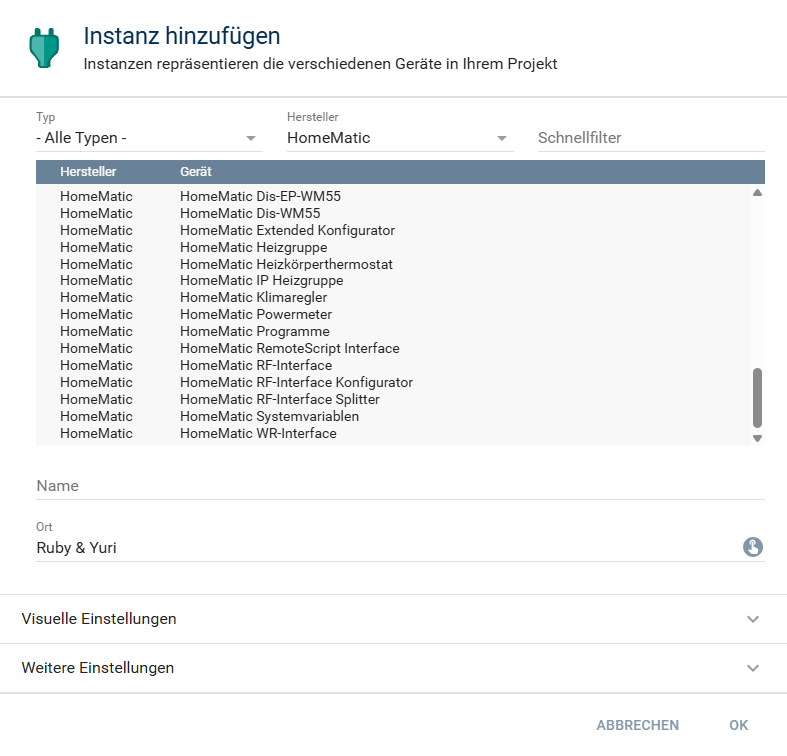
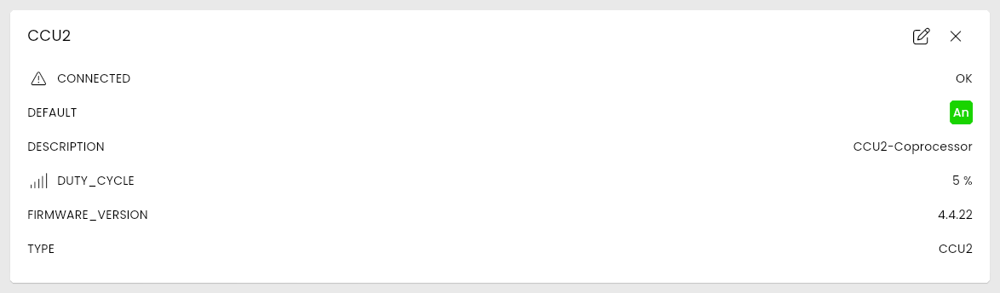
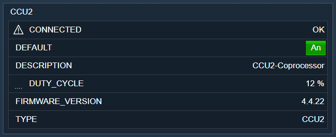

  

  

# HomeMatic RF-Interface  <!-- omit in toc -->

   Bereitstellen der Informationen zu den Funk-Interfaces innerhalb von IPS.

## Dokumentation <!-- omit in toc -->

**Inhaltsverzeichnis**

- [1. Funktionsumfang](#1-funktionsumfang)
- [2. Voraussetzungen](#2-voraussetzungen)
- [3. Software-Installation](#3-software-installation)
- [4. Einrichten der Instanzen in IP-Symcon](#4-einrichten-der-instanzen-in-ip-symcon)
- [5. Statusvariablen](#5-statusvariablen)
- [6. Visualisierung](#6-visualisierung)
  - [Kachel Visualisierung](#kachel-visualisierung)
  - [WebFront Visualisierung](#webfront-visualisierung)
- [7. PHP-Befehlsreferenz](#7-php-befehlsreferenz)
- [8. Aktionen](#8-aktionen)
- [9. Anhang](#9-anhang)
  - [1. Changelog](#1-changelog)
  - [2. Spenden](#2-spenden)
- [10. Lizenz](#10-lizenz)

## 1. Funktionsumfang

   Dies Instanz stellt alle Daten eines an einer CCU betriebenen Funk-Interfaces dar.  

## 2. Voraussetzungen

- IP-Symcon ab Version 9.0  
- Ein `HomeMatic RF-Interface Splitter` als übergeordnete Instanz  
- Ein Funk- oder HmIP-Interface (Gateway) ist an der CCU eingerichtet  

## 3. Software-Installation

Dieses Modul ist Bestandteil der [HomeMaticExtended-Library](../).  

## 4. Einrichten der Instanzen in IP-Symcon

  
   Unter Instanz hinzufügen ist das Gerät 'HomeMatic RF-Interface' unter dem Hersteller 'HomeMatic' zu finden.  
   Nach dem Anlegen der Instanz sollte als übergeordnetes Gerät schon der 'HomeMatic RF-Interface Splitter' ausgewählt sein.  
   Existieren in IPS mehrere 'HomeMatic RF-Interface Splitter', so ist der auszuwählen, an welcher CCU dieses Funk-Interface angeschlossen ist.  

   Da das Auslesen der Adresse der Funk-Interfaces über die WebUI der CCU relativ schwierig ist, wird empfohlen den [HomeMatic Extended Konfigurator](../ExtendedConfigurator/) zu benutzen. Er legt das Interface mit dem RF-Interface Splitter und dem Homematic Socket an.   

**Konfigurationsseite:**  

  

| Eigenschaft |  Typ   | Standardwert |        Funktion        |
| :---------: | :----: | :----------: | :--------------------: |
|   Address   | string |              | Adresse des Interfaces |

## 5. Statusvariablen

   Alle von der CCU gemeldeten Datenpunkte der Interfaces werden in IPS dargestellt.  
   Die folgenden Statusvariablen können durchaus variieren.  

|  Name  /  Ident  |   Typ   |     Profil     |
| :--------------: | :-----: | :------------: |
|    CONNECTED     | boolean |                |
|     DEFAULT      | boolean |                |
|   DESCRIPTION    | string  |                |
|    DUTY_CYCLE    | integer | ~Intensity.100 |
| FIRMWARE_VERSION | string  |                |
|       TYPE       | string  |                |

## 6. Visualisierung

### Kachel Visualisierung

  

### WebFront Visualisierung

Die direkte Darstellung im WebFront ist möglich, es wird aber empfohlen mit Links zu arbeiten.  
  

## 7. PHP-Befehlsreferenz

   Es existieren keine PHP-Befehle für dieses Modul.  

## 8. Aktionen

**Grundsätzlich können alle bedienbaren Statusvariablen als Ziel einer [`Aktion`](https://www.symcon.de/service/dokumentation/konzepte/automationen/ablaufplaene/aktionen/) mit `Auf Wert schalten` angesteuert werden, so dass hier keine speziellen Aktionen benutzt werden müssen.**  

## 9. Anhang

### 1. Changelog

Der vollständige Changelog der Library steht in der [Haupt-README](../README.md#2-changelog).  

**Version 3.75:**

- Ein Interface, das die CCU nicht mehr meldet (offline), setzt `CONNECTED` auf `false` (Issue 13).  
- Die übergeordnete Instanz wird über die Instanzverbindung des RF-Interface Splitters bereitgestellt.  

### 2. Spenden

Dieses Modul ist für die nicht kommerzielle Nutzung kostenlos, Schenkungen als Unterstützung für den Autor werden hier akzeptiert:

  

  

## 10. Lizenz

[Custom NC-SA](../LICENSE)
