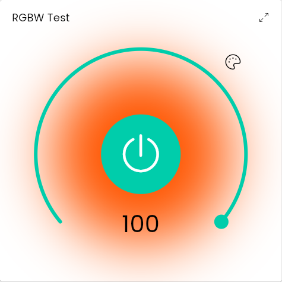
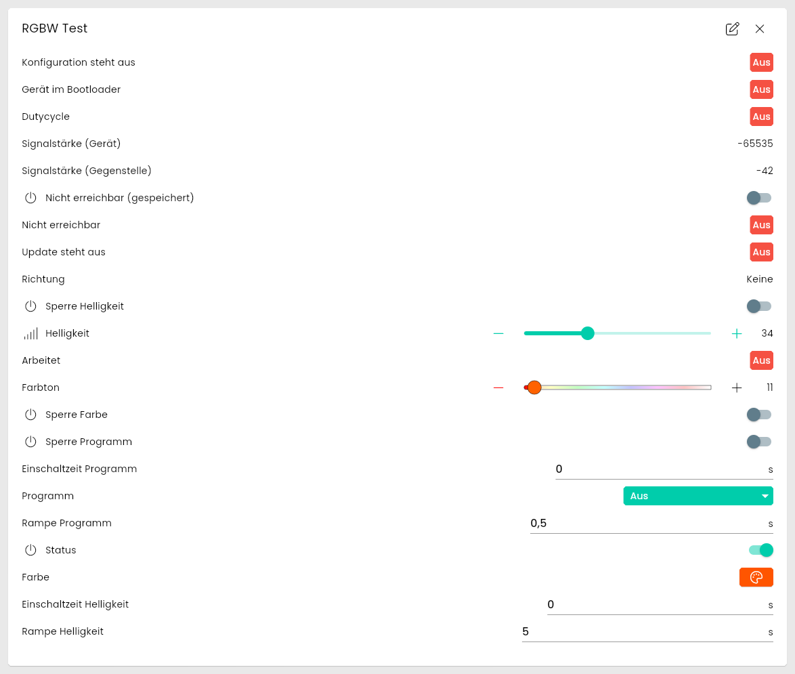

[](https://www.symcon.de/service/dokumentation/entwicklerbereich/sdk-tools/sdk-php/)
[](https://community.symcon.de/t/modul-homematic-extended-systemvariablen-programme-powermeter-u-v-m/38340)
[](https://www.symcon.de/de/service/dokumentation/installation/migrationen/v81-v90-q1-2026/)  
[](#10-lizenz)
[](https://github.com/Nall-chan/HomematicExtended/actions)
[](https://github.com/Nall-chan/HomematicExtended/actions)  
[](#2-spenden)
[](#2-spenden)

# HomeMatic RGBW  <!-- omit in toc -->

Funk-RGBW-Controller `HM-LC-RGBW-WM` für LED-Streifen mit allen drei Kanälen in einer Instanz.

## Dokumentation <!-- omit in toc -->

**Inhaltsverzeichnis**

- [1. Funktionsumfang](#1-funktionsumfang)
- [2. Voraussetzungen](#2-voraussetzungen)
- [3. Software-Installation](#3-software-installation)
- [4. Einrichten der Instanzen in IP-Symcon](#4-einrichten-der-instanzen-in-ip-symcon)
- [5. Statusvariablen](#5-statusvariablen)
- [6. Visualisierung](#6-visualisierung)
  - [Kachel Visualisierung](#kachel-visualisierung)
  - [WebFront Visualisierung](#webfront-visualisierung)
- [7. PHP-Befehlsreferenz](#7-php-befehlsreferenz)
- [8. Aktionen](#8-aktionen)
- [9. Anhang](#9-anhang)
  - [1. Changelog](#1-changelog)
  - [2. Spenden](#2-spenden)
- [10. Lizenz](#10-lizenz)

## 1. Funktionsumfang

Der Controller hat vier PWM-Ausgänge (R, G, B, W) und drei Funkkanäle, die sich diese Ausgänge teilen. Die Instanz bildet alle drei ab, ihre Adresse ist die Geräteadresse ohne Kanal.

| Kanal | Aufgabe | Verhalten am Gerät |
| :---- | :------ | :----------------- |
| 1 (Helligkeit) | Ein/Aus und Helligkeit (`LEVEL`), Rampenzeit und Einschaltdauer | Schaltet den Streifen. Nach einer Einschaltdauer schaltet das Gerät selbst aus. `OLD_LEVEL` stellt die Helligkeit vor dem Ausschalten wieder her. |
| 2 (Farbe) | Farbton (`COLOR`) | Nur der Farbton: 0 bis 199 ist der Farbkreis (0 bis 360 Grad), 200 ist Weiß. Der Wert schaltet einen ausgeschalteten Streifen **nicht** ein und ändert die Helligkeit nicht. |
| 3 (Automatik) | Programm (`PROGRAM`) | Farbdurchläufe (langsam, normal, schnell), Lagerfeuer, Wasserfall und TV-Simulation. Während eines Programms ändert das Gerät den Farbton selbst, ein Farbbefehl beendet das Programm. |

Das Modul ergänzt:

- einen **Status** (Boolean) für die Licht-Kachel: Einschalten stellt die vorherige Helligkeit des Gerätes wieder her (`OLD_LEVEL`), Ausschalten setzt die Helligkeit auf 0;
- die **Farbe** als HSV-Wert für den Farbwähler der Kachel-Visualisierung (Farbton und Sättigung, die Helligkeit stellt Kanal 1 ein);
- die **Vorgaben für Rampenzeit und Einschaltdauer** des Kanals 1. Das Gerät liefert diese beiden Werte nicht zurück, sie werden vor dem nächsten Schaltbefehl gesendet;
- die Funktionen `HM_SetLevel`, `HM_SetColor`, `HM_ReadWhiteBalance` und `HM_SetWhiteBalance` sowie die Aktion `Weißabgleich einstellen`.

**Zu den Einstellungen am Gerät:** Der Schiebeschalter (RGB, RGB + Weiß, Weiß) legt fest, wie das Gerät Weiß erzeugt, und die drei Trimmer sind der Weißabgleich für reine RGB-Streifen. Beides ist Hardware-Konfiguration beim Einbau und per Funk nicht lesbar. Der Weißabgleich steht zusätzlich im Gerät und lässt sich mit der Aktion `Weißabgleich einstellen` ändern, ohne dass die Trimmer bedient werden müssen.

> [!NOTE]
> Das Modul ist neu und bisher nur an einem HM-LC-RGBW-WM mit einem RGB-Streifen (ohne Weiß, Schiebeschalter auf RGB) getestet. Geprüft sind Helligkeit mit Rampenzeit und Einschaltdauer, `OLD_LEVEL`, Farbton, Programme, das Lesen der Werte und die Licht-Kachel (Ein/Aus, Helligkeit, Farbanzeige). Das Verhalten mit angeschlossenem Weiß-Kanal ist ungeprüft.

## 2. Voraussetzungen

- IP-Symcon ab Version 9.0
- Ein Homematic Socket (`HomeMatic Socket`), an dem die CCU angebunden ist, mit aktivierter Funk-Schnittstelle (BidCos-RF)
- Ein HM-LC-RGBW-WM ist an der CCU angelernt

## 3. Software-Installation

Dieses Modul ist Bestandteil der [HomeMaticExtended-Library](../).

## 4. Einrichten der Instanzen in IP-Symcon

> [!TIP]
> Am einfachsten wird die Instanz über den `HomeMatic Extended Konfigurator` angelegt. Er bietet jeden HM-LC-RGBW-WM an und trägt Adresse und System selbstständig ein.

Alternativ unter `Instanz hinzufügen` das Gerät `HomeMatic RGBW` unter dem Hersteller `HomeMatic` auswählen.

**Konfigurationsseite:**

  

| Eigenschaft | Name    | Typ    | Standardwert | Beschreibung                                                  |
| :---------- | :------ | :----- | :----------- | :------------------------------------------------------------ |
| Adresse     | Address | string | (leer)       | Adresse des Gerätes **ohne** Kanal, z.B. `MEQ1097619`.        |

Beim Übernehmen der Einstellungen und beim Start von Symcon liest die Instanz die Kanäle und Datenpunkte des Gerätes von der CCU, legt die Statusvariablen an und liest deren Werte.

## 5. Statusvariablen

Der Ident einer Statusvariable ist `<Datenpunkt>_<Kanal>`, beim Wartungskanal 0 nur `<Datenpunkt>`.

| Ident | Name | Typ | Darstellung | Aktion | Beschreibung |
| :---- | :--- | :-- | :---------- | :----: | :----------- |
| STATE | Status | boolean | Schalter (An/Aus) | ja | Zustand des Streifens, an, wenn die Helligkeit größer 0 ist. Einschalten stellt die vorherige Helligkeit des Gerätes wieder her. |
| LEVEL_1 | Helligkeit | float | Schieberegler 0 bis 100 % (Verwendung Intensität) | ja | Helligkeit, die Rampenzeit und die Einschaltdauer der Vorgaben gelten dabei. |
| COLOR_HSV | Farbe | string | Farbe (HSV) | ja | Farbwähler. Aus dem Farbton wird `{"h":…,"s":100,"v":100}` abgeleitet (Farbton in Grad, Sättigung und Helligkeit in Prozent) (Weiß: `s` 0). Eine gewählte Farbe mit Sättigung unter 50 % wird zu Weiß, die Helligkeit ändert der Farbwähler nicht. |
| COLOR_2 | Farbton | integer | Schieberegler 0 bis 200 mit Farbverlauf | ja | Der Datenpunkt `COLOR`: 0 bis 199 Farbkreis, 200 Weiß. |
| PROGRAM_3 | Programm | integer | Aufzählung: Aus, Langsamer/Normaler/Schneller Farbdurchlauf, Lagerfeuer, Wasserfall, TV-Simulation | ja | Programm. Ein Farbbefehl beendet es, die Variable zeigt dann `Aus`. |
| RAMP_TIME_1, ON_TIME_1 | Rampe Helligkeit, Einschaltzeit Helligkeit | float | Werteingabe in Sekunden | ja | **Vorgabe** für den nächsten Schaltbefehl (Standard 0,5 s und 0 s = unbegrenzt). Das Gerät liefert die Werte nicht zurück. |
| RAMP_TIME_3, ON_TIME_3 | Rampe Programm, Einschaltzeit Programm | float | Werteingabe in Sekunden | ja | Zeiten der Programme. |
| WORKING_1, DIRECTION_1 | Arbeitet, Richtung | boolean, integer | | | Zustand der Helligkeitsänderung. |
| INHIBIT_1 bis INHIBIT_3 | Sperre Helligkeit, Sperre Farbe, Sperre Programm | boolean | Schalter | ja | Sperrt den jeweiligen Kanal (1 Helligkeit, 2 Farbe, 3 Programm). |
| UNREACH, STICKY_UNREACH, CONFIG_PENDING, UPDATE_PENDING, DEVICE_IN_BOOTLOADER, DUTYCYCLE, RSSI_DEVICE, RSSI_PEER | | | | | Werte des Wartungskanals (Erreichbarkeit, Signalstärke usw.). |

Welche Variablen angelegt werden, richtet sich nach der Beschreibung der Datenpunkte, welche die CCU liefert. Nicht lesbare Datenpunkte (z.B. `OLD_LEVEL`, `RAMP_STOP`, die Datenpunkte `ACT_HSV_COLOR_VALUE`, `USER_COLOR` und `USER_PROGRAM`), die Sollwerte der Programme (`ACT_BRIGHTNESS`, `ACT_MIN_BOARDER`, `ACT_MAX_BOARDER`, ohne erkennbare Wirkung), `LOWBAT` (das Gerät hat keine Batterie), der Schlüssel `AES_KEY` und der Installationstest `INSTALL_TEST` werden nicht angelegt.

## 6. Visualisierung

### Kachel Visualisierung

Die Instanz erscheint in der Kachel-Visualisierung als [Licht](https://www.symcon.de/de/service/dokumentation/komponenten/objekt-darstellung/licht/): Ein/Aus-Taste, Helligkeit als Ring und die Farbauswahl.



Die maximierte Kachel zeigt alle Statusvariablen als Liste.



Die Variablen `STATE` (Schalter An/Aus), `LEVEL_1` (Schieberegler, Verwendung Intensität) und `COLOR_HSV` (Farbe mit Variablenaktion) erfüllen die Voraussetzungen, damit Symcon die Instanz in der Kachel-Visualisierung als [Licht](https://www.symcon.de/de/service/dokumentation/komponenten/objekt-darstellung/licht/) darstellen kann (Symcon ab 7.0). Der Farbton `COLOR_2` bietet daneben einen Schieberegler mit Farbverlauf. Der Farbwert `COLOR_HSV` hat den Farbton in Grad sowie Sättigung und Helligkeit in Prozent (0 bis 100), so erwartet es die Kachel.

### WebFront Visualisierung

Das klassische WebFront kennt die Licht-Darstellung nicht und zeigt die Instanz als Liste. Die Variablen sind bedienbar, der Farbverlauf des Schiebereglers und die Farbauswahl werden dort nicht in jedem Fall angezeigt.

## 7. PHP-Befehlsreferenz

**`bool HM_SetLevel(integer $InstanzID, float $Level, float $RampTime, float $OnTime);`**

Setzt die Helligkeit (Kanal 1) mit Rampenzeit und Einschaltdauer in einem Aufruf.
`$Level` ist die Helligkeit von `0.0` (aus) bis `1.0` (100 %), `$RampTime` die Rampenzeit in Sekunden (Standard des Gerätes `0.5`) und `$OnTime` die Einschaltdauer in Sekunden (`0` = unbegrenzt, danach schaltet das Gerät selbst aus). Zeiten sind von 0 bis 85825945,6 Sekunden zulässig. Ungültige Werte werden mit einer Meldung abgelehnt und nicht gesendet.
Liefert `true`, wenn die CCU die Aufträge angenommen hat.

```php
HM_SetLevel(12345, 0.5, 3.0, 600.0); // 50 %, 3 s Rampe, nach 10 Minuten aus
```

**`bool HM_SetColor(integer $InstanzID, integer $Hue, integer $Saturation);`**

Setzt die Farbe (Kanal 2) und beendet ein laufendes Programm. `$Hue` ist der Farbton in Grad (0 bis 360), `$Saturation` die Sättigung in Prozent (0 bis 100). Eine Sättigung unter 50 % ergibt Weiß. Die Helligkeit bleibt unverändert, ein ausgeschalteter Streifen schaltet nicht ein.
Liefert `true`, wenn die CCU den Auftrag angenommen hat.

```php
HM_SetColor(12345, 240, 100); // Blau
```

**`string|false HM_ReadWhiteBalance(integer $InstanzID);`**

Liest den Weißabgleich der RGB-Ausgänge aus dem Gerät. Liefert ein JSON-Objekt mit `Red`, `Green` und `Blue` in Prozent, bei einem Fehler `false`.

```php
$Weissabgleich = json_decode(HM_ReadWhiteBalance(12345), true);
```

**`bool HM_SetWhiteBalance(integer $InstanzID, integer $Red, integer $Green, integer $Blue);`**

Stellt den Weißabgleich ein, wie es die drei Trimmer am Gerät tun. Jeder Wert ist ein Prozentwert von 0 bis 100 (100 = volle Ausgangsleistung). Der Weißabgleich wird im Gerät gespeichert und muss nur einmal je LED-Streifen eingestellt werden.
Liefert `true`, wenn die CCU den Auftrag angenommen hat.

```php
HM_SetWhiteBalance(12345, 95, 90, 100);
```

**`bool HM_RequestState(integer $InstanzID, string $Ident);`**

Liest den Wert eines Datenpunktes von der CCU (RPC `getValue`) und schreibt ihn in die Statusvariable.
`$Ident` ist der Ident der Statusvariable, z.B. `COLOR_2` oder `LEVEL_1`. Die abgeleiteten Variablen `STATE` und `COLOR_HSV` sowie die Vorgaben `RAMP_TIME_1` und `ON_TIME_1` haben keinen Datenpunkt und werden mit einer Fehlermeldung abgelehnt.
Liefert `true`, wenn die CCU den Wert geliefert hat, sonst `false`.

```php
HM_RequestState(12345, 'COLOR_2');
```

**`bool HM_WriteValueBoolean2(integer $InstanzID, string $Parameter, bool $Value);`**
**`bool HM_WriteValueInteger2(integer $InstanzID, string $Parameter, int $Value);`**
**`bool HM_WriteValueFloat2(integer $InstanzID, string $Parameter, float $Value);`**
**`bool HM_WriteValueString2(integer $InstanzID, string $Parameter, string $Value);`**

Schreibt einen Wert in eine bedienbare Statusvariable (Spalte `Aktion` in der Tabelle der Statusvariablen). Die Funktion entspricht der Bedienung der Variable: Der Wert wird wie dort verarbeitet und an die CCU gesendet.
`$Parameter` ist der Ident der Statusvariable, z.B. `LEVEL_1`, `COLOR_2` oder `PROGRAM_3`. Ein unbekannter Ident, eine nicht bedienbare Variable oder ein Wert, dessen Typ nicht zur Variable passt, wird mit einer Fehlermeldung abgelehnt (Funktion für Boolean bei Boolean-Variablen, Integer auch für Aufzählungen, Float für Fließkommazahlen, String für Texte).
Liefert `true`, wenn der Wert angenommen wurde, sonst `false`.
Ab Symcon 10.0 stehen dieselben Funktionen auch ohne `2` zur Verfügung (`HM_WriteValueBoolean` usw.). Ein Modul kann diese Namen erst ab Symcon 10.0 belegen, bis dahin sind die Funktionen mit `2` zu verwenden. Ab Symcon 10.0 erzeugt ein Aufruf der Funktionen mit `2` eine Warnung im Log.

```php
HM_WriteValueInteger2(12345, 'PROGRAM_3', 4); // Lagerfeuer
```

## 8. Aktionen

**Grundsätzlich können alle bedienbaren Statusvariablen als Ziel einer [`Aktion`](https://www.symcon.de/service/dokumentation/konzepte/automationen/ablaufplaene/aktionen/) mit `Auf Wert schalten` angesteuert werden, so dass hier keine speziellen Aktionen benutzt werden müssen.**

Zusätzlich bietet die Library die Aktion `Weißabgleich einstellen` für diese Instanz an, siehe [actions.md](../actions.md). Das Formular liest die aktuellen Werte nur, wenn die Instanz aktiv, der Homematic Socket verbunden und das Gerät erreichbar ist, sonst zeigt es einen Hinweis.

## 9. Anhang

### 1. Changelog

Der vollständige Changelog der Library steht in der [Haupt-README](../README.md#2-changelog).

**Version 3.90:**

- Neues Modul: HM-LC-RGBW-WM mit allen Kanälen in einer Instanz, Funktionen `HM_SetLevel`, `HM_SetColor`, `HM_ReadWhiteBalance`, `HM_SetWhiteBalance`, Aktion `Weißabgleich einstellen`.

### 2. Spenden

Dieses Modul ist für die nicht kommerzielle Nutzung kostenlos, Schenkungen als Unterstützung für den Autor werden hier akzeptiert:

  [](https://paypal.me/Nall4chan)

  [](https://www.amazon.de/hz/wishlist/ls/YU4AI9AQT9F?ref_=wl_share)

## 10. Lizenz

[Custom NC-SA](../LICENSE)
