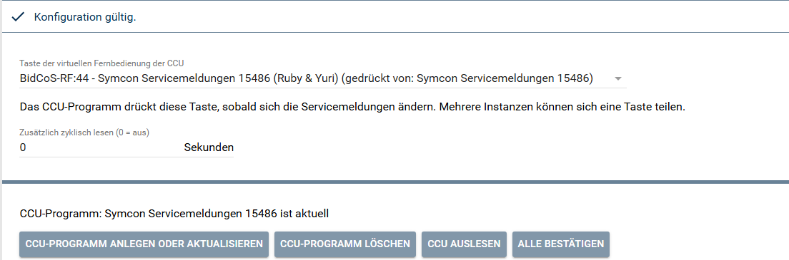
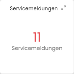
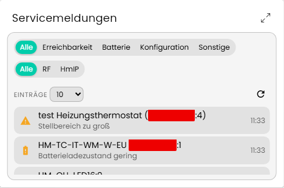
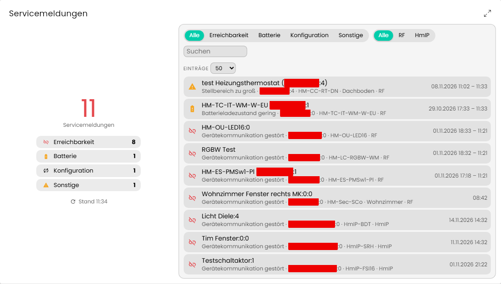

[](https://www.symcon.de/service/dokumentation/entwicklerbereich/sdk-tools/sdk-php/)
[](https://community.symcon.de/t/modul-homematic-extended-systemvariablen-programme-powermeter-u-v-m/38340)
[](https://www.symcon.de/de/service/dokumentation/installation/migrationen/v81-v90-q1-2026/)  
[](#10-lizenz)
[](https://github.com/Nall-chan/HomematicExtended/actions)
[](https://github.com/Nall-chan/HomematicExtended/actions)  
[](../README.md#6-spenden)
[](../README.md#6-spenden)

# HomeMatic Servicemeldungen  <!-- omit in toc -->

   Die Servicemeldungen der CCU als Kachel und per PHP-Befehl, für alle Schnittstellen (BidCos-RF, HmIP und Wired).  

## Dokumentation <!-- omit in toc -->

**Inhaltsverzeichnis**

- [1. Funktionsumfang](#1-funktionsumfang)
- [2. Voraussetzungen](#2-voraussetzungen)
- [3. Software-Installation](#3-software-installation)
- [4. Einrichten der Instanzen in IP-Symcon](#4-einrichten-der-instanzen-in-ip-symcon)
  - [Das CCU-Programm](#das-ccu-programm)
  - [Eigenschaften](#eigenschaften)
- [5. Statusvariablen](#5-statusvariablen)
- [6. Visualisierung](#6-visualisierung)
  - [Kachel Visualisierung](#kachel-visualisierung)
  - [WebFront Visualisierung](#webfront-visualisierung)
- [7. PHP-Befehlsreferenz](#7-php-befehlsreferenz)
- [8. Aktionen](#8-aktionen)
- [9. Anhang](#9-anhang)
  - [1. Changelog](#1-changelog)
  - [2. Spenden](#2-spenden)
- [10. Lizenz](#10-lizenz)

## 1. Funktionsumfang

- Liest alle anstehenden Servicemeldungen der CCU, so wie sie die WebUI unter `Servicemeldungen` zeigt: Gerät, Kanal, Meldung, Raum, Schnittstelle, erstes und letztes Auftreten.  
- Ordnet die Meldungen nach Art: Erreichbarkeit, Batterie, Sabotage, Konfiguration und Sonstige.  
- Bestätigt einzelne oder alle Meldungen, die sich bestätigen lassen (z.B. „Gerätekommunikation war gestört“).  
- Zeigt zu jeder Meldung, ob das Gerät in Symcon als Instanz eingerichtet ist.  
- Änderungen kommen sofort in Symcon an: Ein Programm auf der CCU drückt bei jeder Änderung der Servicemeldungen eine Taste der virtuellen Fernbedienung. Das Modul legt dieses Programm auf Wunsch selbst an.  
- Die Instanz legt keine Statusvariablen an. Die Meldungen zeigt eine eigene Kachel, Skripte erhalten sie per [PHP-Befehl](#7-php-befehlsreferenz).  

> [!NOTE]
> Die XML-RPC-Funktion `getServiceMessages` der CCU liefert keine Meldungen von HmIP- und Wired-Geräten. Das Modul liest die Meldungen deshalb per HM-Script aus der Logikschicht (ReGa) der CCU, dort stehen die Meldungen aller Schnittstellen.

## 2. Voraussetzungen

- IP-Symcon ab Version 9.0  
- Ein Homematic Socket (`HomeMatic Socket`), an dem die CCU angebunden ist  
- Die Firewall der CCU erlaubt den Zugriff auf die `Remote HomeMatic-Script API` (siehe [Haupt-README](../README.md#2-voraussetzungen))  
- Für die sofortige Aktualisierung: Im Homematic Socket ist das Interface der virtuellen Fernbedienung aktiviert (`BidCos-RF` für `BidCoS-RF:n`, `HomeMatic IP` für `HmIP-RCV-1:n`).  

## 3. Software-Installation

Dieses Modul ist Bestandteil der [HomeMaticExtended-Library](../).  

## 4. Einrichten der Instanzen in IP-Symcon

> [!TIP]
> Die Instanz wird am einfachsten über den [HomeMatic Extended Konfigurator](../ExtendedConfigurator/) angelegt.

   Unter Instanz hinzufügen ist das Modul 'HomeMatic Servicemeldungen' unter dem Hersteller 'HomeMatic' zu finden. Als übergeordnete Instanz wird der Homematic Socket der CCU gewählt. Eine Instanz je CCU genügt.  

   Einrichtung:  

1. Unter `Taste der virtuellen Fernbedienung der CCU` eine freie Taste wählen. Die Liste zeigt je Taste den Namen (nur wenn er vom Werksnamen abweicht) und die Verwendung, wie beim Modul [HomeMatic Systemvariablen](../Systemvariablen/#4-einrichten-der-instanzen-in-ip-symcon). Die Taste kann sich die Instanz mit Instanzen der Module Systemvariablen und Alarmvariable teilen.  
2. `Übernehmen`.  
3. Mit `CCU-Programm anlegen oder aktualisieren` das Programm auf der CCU anlegen. Die Zeile darüber zeigt, ob das Programm vorhanden ist.  

   Ohne Taste liest die Instanz nur auf Anforderung (Kachel, PHP-Befehl, Schaltfläche `CCU lesen`) oder zyklisch, wenn ein Intervall eingestellt ist.  

  

### Das CCU-Programm

   Das Modul legt auf der CCU ein systeminternes Programm `Symcon Servicemeldungen <Instanz-ID>` an. Es reagiert auf jede Aktualisierung der Systemvariable `Servicemeldungen` (Anzahl der Meldungen) und drückt als Aktivität die gewählte Taste kurz. Das Event der Taste startet in Symcon das Lesen.  

   Die CCU aktualisiert die Systemvariable `Servicemeldungen` auch dann, wenn ein Gerät eine schon anstehende Meldung erneut sendet. Das kann alle paar Sekunden passieren. Die Instanz liest deshalb nach einem Tastendruck höchstens alle 30 Sekunden. Lesen per Kachel, PHP-Befehl oder Schaltfläche erfolgt immer sofort.  

   Für Name der Taste, belegte Tasten, Löschen und systeminterne Programme gilt dasselbe wie beim Modul [HomeMatic Systemvariablen](../Systemvariablen/#das-ccu-programm). Das Modul ändert und löscht nur das eigene Programm.  

### Eigenschaften

|                Eigenschaft                 |     Name      |  Typ   |  Standardwert  |                                                         Beschreibung                                                         |
| :----------------------------------------: | :-----------: | :----: | :------------: | :-------------------------------------------------------------------------------------------------------------------------: |
| Taste der virtuellen Fernbedienung der CCU |    Address    | string | `XXX9999999:n` | Adresse der Taste, `BidCoS-RF:1` bis `BidCoS-RF:50` oder `HmIP-RCV-1:1` bis `HmIP-RCV-1:50`. Der Platzhalter bedeutet: keine Taste |
|    Zusätzlich zyklisch lesen (0 = aus)     |   Interval    |  int   |       0        |                                       Intervall in Sekunden, 0 = aus, sonst mindestens 5                                        |
|                 Protokoll                  |   Protocol    |  int   |       0        |                                  Wird nicht im Formular angezeigt, ergibt sich aus der Taste                                   |

```php
IPS_SetProperty(12345, 'Address', 'BidCoS-RF:49');
IPS_ApplyChanges(12345);
```

   Statuscodes: `102` aktiv, `104` keine Taste und kein Intervall (Meldungen werden nur auf Anforderung gelesen), `203` Intervall kleiner als 5 Sekunden.  

## 5. Statusvariablen

   Die Instanz legt keine Statusvariablen an. Die Anzahl der Meldungen steht auf der CCU in der Systemvariable `Servicemeldungen` und kann bei Bedarf mit dem Modul [HomeMatic Systemvariablen](../Systemvariablen/) als Statusvariable angelegt werden.  

## 6. Visualisierung

### Kachel Visualisierung

   Die Instanz bringt eine eigene Kachel mit. Sie passt sich der Größe an und übernimmt Farben und Schrift der Visualisierung.  

| Größe der Kachel   | Anzeige                                                                                                                       |
| :----------------- | :---------------------------------------------------------------------------------------------------------------------------- |
| 1 × 1              | Anzahl der Meldungen                                                                                                          |
| 3 × 2              | Liste der Meldungen mit Filter nach Art (Chips oben)                                                                          |
| ab ca. 7 × 4       | Links die Anzahl je Art (ein Klick filtert), rechts die Liste mit Filter, Suche, Adresse, Raum, Gerätetyp, Schnittstelle sowie erstem und letztem Auftreten |


  

  

- Die Chips oben und die Legende links filtern gleich, es erscheinen nur Arten mit Meldungen. Die Auswahl merkt sich der Browser.  
- Die Suche oben rechts durchsucht Gerät, Adresse, Gerätetyp, Raum, Gewerk und Meldung (ab ca. 7 × 4).  
- `Stand <Uhrzeit>` zeigt, wann zuletzt gelesen wurde. Ein Klick darauf liest sofort neu, währenddessen dreht sich das Symbol.  
- Meldungen, die sich bestätigen lassen, haben einen Knopf `Bestätigen`. `Alle bestätigen` in der Kopfzeile (ab ca. 7 × 4) bestätigt nach einer Rückfrage alle.  
- Geräte ohne Instanz in Symcon sind gekennzeichnet (`Gerät nicht in Symcon eingerichtet`).  

### WebFront Visualisierung

Das klassische WebFront wird nicht unterstützt, die Instanz bietet nur die Kachel-Visualisierung.  

## 7. PHP-Befehlsreferenz

   Alle Funktionen melden Fehler an den Aufrufer und liefern dann `false`.  

```php
array|false HM_GetServiceMessages(integer $InstanzID);
```

   Liest die anstehenden Servicemeldungen sofort von der CCU und liefert sie als Liste, die neueste zuerst. Ohne Meldungen ist die Liste leer. Jede Meldung enthält:  

| Feld           | Typ     | Inhalt                                                                                                   |
| :------------- | :------ | :------------------------------------------------------------------------------------------------------- |
| `id`           | int     | ID der Meldung auf der CCU, für `HM_ConfirmServiceMessage`                                               |
| `address`      | string  | Adresse des Kanals, z.B. `JEQ0000000:0`                                                                  |
| `device`       | string  | Adresse des Gerätes ohne Kanal                                                                           |
| `channel`      | int     | Kanal, `-1` wenn die Adresse keinen Kanal enthält                                                        |
| `datapoint`    | string  | Datenpunkt der Meldung, z.B. `UNREACH`, `LOWBAT`, `CONFIG_PENDING`, `SABOTAGE`                           |
| `value`        | mixed   | Wert des Datenpunkts                                                                                     |
| `text`         | string  | Text des Wertes bei Aufzählungen (z.B. `SABOTAGE`), sonst leer                                           |
| `group`        | string  | Art: `unreach`, `battery`, `sabotage`, `config` oder `other`                                             |
| `interface`    | string  | Schnittstelle: `BidCos-RF`, `HmIP-RF`, `BidCos-Wired` usw.                                               |
| `type`         | string  | Gerätetyp, z.B. `HM-OU-LED16`                                                                            |
| `deviceName`   | string  | Name des Gerätes auf der CCU                                                                             |
| `channelName`  | string  | Name des Kanals auf der CCU                                                                              |
| `rooms`        | string  | Räume des Kanals, kommagetrennt                                                                          |
| `functions`    | string  | Gewerke des Kanals, kommagetrennt                                                                        |
| `first`        | int     | Erstes Auftreten (Unix-Zeit)                                                                             |
| `last`         | int     | Letztes Auftreten (Unix-Zeit)                                                                            |
| `confirmable`  | bool    | `true`, wenn sich die Meldung bestätigen lässt                                                           |
| `instanceID`   | int     | Symcon-Instanz des Gerätes, `0` wenn keine gefunden wurde                                                |
| `instanceName` | string  | Name dieser Instanz, sonst leer                                                                          |

```php
// Alle Batteriemeldungen ausgeben
foreach (HM_GetServiceMessages(12345) as $Message) {
    if ($Message['group'] == 'battery') {
        echo $Message['deviceName'] . ' (' . $Message['address'] . ')' . PHP_EOL;
    }
}
```

```php
bool HM_ConfirmServiceMessage(integer $InstanzID, integer $MessageID);
```

   Bestätigt eine Meldung auf der CCU. `$MessageID` ist das Feld `id` aus `HM_GetServiceMessages`. Bestätigen lassen sich nur Meldungen mit `confirmable` = `true`, die übrigen verschwinden von selbst, sobald die Ursache behoben ist (z.B. Batterie getauscht). Liefert `true`, wenn die CCU die Meldung bestätigt hat.  

```php
int|false HM_ConfirmAllServiceMessages(integer $InstanzID);
```

   Bestätigt alle Meldungen, die sich bestätigen lassen. Liefert die Anzahl der bestätigten Meldungen (auch `0`).  

```php
string HM_CreateCCUProgram(integer $InstanzID);
string HM_DeleteCCUProgram(integer $InstanzID);
```

   Legt das CCU-Programm für die gespeicherte Taste an (ein vorhandenes Programm der Instanz wird ersetzt) bzw. löscht es. Liefert eine Meldung für den Nutzer.  

## 8. Aktionen

**Grundsätzlich können alle bedienbaren Statusvariablen als Ziel einer [`Aktion`](https://www.symcon.de/service/dokumentation/konzepte/automationen/ablaufplaene/aktionen/) mit `Auf Wert schalten` angesteuert werden, so dass hier keine speziellen Aktionen benutzt werden müssen.**  

   Diese Instanz hat keine Statusvariablen und keine eigenen Aktionen. Die PHP-Befehle lassen sich über die Aktion `PHP-Code ausführen` nutzen.  

## 9. Anhang

### 1. Changelog

Der vollständige Changelog der Library steht in der [Haupt-README](../README.md#2-changelog).  

**Version 4.10:**

- Neues Modul.  

### 2. Spenden

Dieses Modul ist für die nicht kommerzielle Nutzung kostenlos, Schenkungen als Unterstützung für den Autor werden hier akzeptiert:

  [](https://paypal.me/Nall4chan)

  [](https://www.amazon.de/hz/wishlist/ls/YU4AI9AQT9F?ref_=wl_share)

## 10. Lizenz

[Custom NC-SA](../LICENSE)
