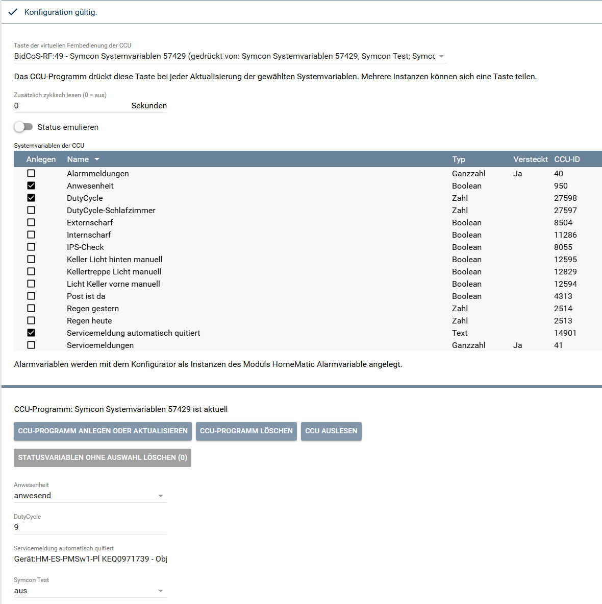
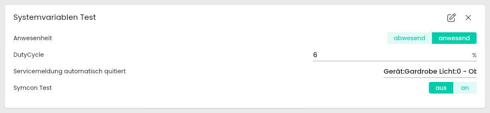
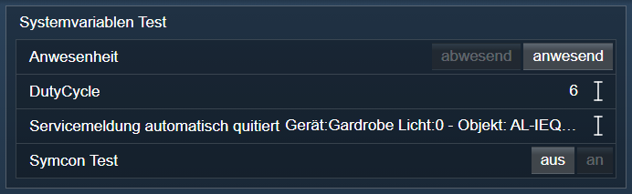

[](https://www.symcon.de/service/dokumentation/entwicklerbereich/sdk-tools/sdk-php/)
[](https://community.symcon.de/t/modul-homematic-extended-systemvariablen-programme-powermeter-u-v-m/38340)
[](https://www.symcon.de/de/service/dokumentation/installation/migrationen/v81-v90-q1-2026/)  
[](#10-lizenz)
[](https://github.com/Nall-chan/HomematicExtended/actions)
[](https://github.com/Nall-chan/HomematicExtended/actions)  
[](../README.md#6-spenden)
[](../README.md#6-spenden)

# HomeMatic Systemvariablen  <!-- omit in toc -->

   Bereitstellen der Systemvariablen einer CCU in Symcon.  

## Dokumentation <!-- omit in toc -->

**Inhaltsverzeichnis**

- [1. Funktionsumfang](#1-funktionsumfang)
- [2. Voraussetzungen](#2-voraussetzungen)
- [3. Software-Installation](#3-software-installation)
- [4. Einrichten der Instanzen in IP-Symcon](#4-einrichten-der-instanzen-in-ip-symcon)
  - [Das CCU-Programm](#das-ccu-programm)
  - [Eigenschaften](#eigenschaften)
  - [Umstellung von Version 3.78 und älter](#umstellung-von-version-378-und-älter)
- [5. Statusvariablen](#5-statusvariablen)
- [6. Visualisierung](#6-visualisierung)
  - [Kachel Visualisierung](#kachel-visualisierung)
  - [WebFront Visualisierung](#webfront-visualisierung)
- [7. PHP-Befehlsreferenz](#7-php-befehlsreferenz)
- [8. Aktionen](#8-aktionen)
- [9. Anhang](#9-anhang)
  - [1. Changelog](#1-changelog)
  - [2. Spenden](#2-spenden)
- [10. Lizenz](#10-lizenz)

## 1. Funktionsumfang

- Auswahl der Systemvariablen der CCU in einer Liste, auch der versteckten (systeminternen) Systemvariablen.  
- Lesen der Werte und Schreiben aus Symcon (Bedienung der Statusvariablen, PHP-Befehle).  
- Änderungen auf der CCU kommen sofort in Symcon an: Ein Programm auf der CCU drückt bei jeder Aktualisierung einer gewählten Systemvariable eine Taste der virtuellen Fernbedienung. Das Modul legt dieses Programm auf Wunsch selbst an.  
- Gelesen wird mit einer einzigen Anfrage an die CCU, egal wie viele Systemvariablen gewählt sind. Die CCU liefert dabei nur die Systemvariablen, die seit dem letzten Lesen aktualisiert wurden.  
- Zusätzlich kann zyklisch gelesen werden.  

Alarmvariablen der CCU bildet das Modul [HomeMatic Alarmvariable](../Alarmvariable/) ab. Die Zähler der Energiezähler (`svEnergyCounter…`) und Wetterstationen (`svHmIP…`) lesen die Module [HomeMatic Powermeter](../PowerMeter/) und [HomeMatic Weather](../Weather/), sie erscheinen nicht in der Liste.  

## 2. Voraussetzungen

- IP-Symcon ab Version 9.0  
- Ein Homematic Socket (`HomeMatic Socket`), an dem die CCU angebunden ist  
- Die Firewall der CCU erlaubt den Zugriff auf die `Remote HomeMatic-Script API` (siehe [Haupt-README](../README.md#2-voraussetzungen))  
- Für die sofortige Aktualisierung: Im Homematic Socket ist das Interface der virtuellen Fernbedienung aktiviert (`BidCos-RF` für `BidCoS-RF:n`, `HomeMatic IP` für `HmIP-RCV-1:n`).  

## 3. Software-Installation

Dieses Modul ist Bestandteil der [HomeMaticExtended-Library](../).  

## 4. Einrichten der Instanzen in IP-Symcon

> [!TIP]
> Die Instanz wird am einfachsten über den [HomeMatic Extended Konfigurator](../ExtendedConfigurator/) angelegt.

   Unter Instanz hinzufügen ist das Modul 'HomeMatic Systemvariablen' unter dem Hersteller 'HomeMatic' zu finden. Als übergeordnete Instanz wird der Homematic Socket der CCU gewählt. Mehrere Instanzen an einem Socket sind möglich, z.B. um Systemvariablen thematisch zu trennen.  

   Einrichtung:  

1. Unter `Taste der virtuellen Fernbedienung der CCU` eine freie Taste wählen. Die Liste zeigt je Taste den Namen (nur wenn er vom Werksnamen abweicht) und die Verwendung: `Bedingung in` bzw. `gedrückt von` für Programme der CCU, `Direktverknüpfungen` und `Symcon-Instanzen` dieser Library. Tasten mit Werksnamen ohne Verwendung sind als `frei` gekennzeichnet.  
2. In der Liste `Systemvariablen der CCU` die gewünschten Systemvariablen anhaken und `Übernehmen`. Die Statusvariablen werden angelegt und gelesen. Die Spalte `Name` zeigt den Namen der Statusvariable in Symcon, solange es sie noch nicht gibt den Namen auf der CCU. Gewählte Systemvariablen, die es auf der CCU nicht mehr gibt, erscheinen rot mit dem Typ `fehlt`. Abwählen löscht keine Statusvariable: Nach dem Übernehmen wird sie nur nicht mehr aktualisiert und kann bei den Aktionen über `Statusvariablen ohne Auswahl löschen (n)` gelöscht werden. Beim ersten Abwählen nach dem Öffnen der Konfiguration erscheint dazu ein Hinweis.  
3. Mit `CCU-Programm anlegen oder aktualisieren` das Programm auf der CCU anlegen. Die Zeile darüber zeigt, ob das Programm vorhanden ist und zur Auswahl passt.  

  

### Das CCU-Programm

   Das Modul legt auf der CCU ein systeminternes Programm `Symcon Systemvariablen <Instanz-ID>` an. Es enthält für jede gewählte Systemvariable zwei Bedingungen `bei Aktualisierung`, die zusammen jeden Wert abdecken (z.B. `= aus` oder `= an`), und drückt als Aktivität die gewählte Taste kurz. Das Event der Taste startet in Symcon das Lesen.  

> [!IMPORTANT]
> Nach jeder Änderung der Auswahl oder der Taste muss das CCU-Programm über die Schaltfläche aktualisiert werden. Die Statuszeile im Formular zeigt an, wenn es nicht mehr zur Auswahl passt.

   Ist die Taste Bedingung eines Programms der CCU oder direkt mit einem Gerät verknüpft, legt das Modul kein Programm an und meldet das: Jeder Tastendruck würde diese Programme bzw. Geräte mit auslösen. Drücken andere Programme dieselbe Taste (`gedrückt von`), ist das unkritisch.  

   Trägt die Taste noch ihren Werksnamen (z.B. `HM-RCV-50 BidCoS-RF:49`), erhält sie den Namen des Programms. Wechselt die Instanz die Taste oder wird das Programm gelöscht, erhält die Taste ihren Werksnamen zurück, sofern sie noch den Namen des Programms trägt. Von Hand vergebene Namen werden nie geändert.  

   Das Modul ändert und löscht nur das eigene Programm (ID und Name müssen passen). Beim Löschen der Instanz bleibt das Programm auf der CCU erhalten, es kann vorher mit `CCU-Programm löschen` entfernt werden. Systeminterne Programme zeigt die WebUI der CCU unter `Programme` nur mit der Option `Systeminterne Programme anzeigen`.  

   Mehrere Instanzen (auch des Moduls [HomeMatic Alarmvariable](../Alarmvariable/)) können sich eine Taste teilen, jede liest nur ihre eigenen Variablen. Mit getrennten Tasten entfallen Anfragen von Instanzen, deren Variablen sich nicht geändert haben.  

> [!NOTE]
> Ein von Hand angelegtes Programm nach der Anleitung bis Version 3.78 löst die Taste nicht bei jedem Wert aus: Jede Bedingung vergleicht zusätzlich einen Wert, die Aktivität folgt nur, wenn eine der Bedingungen erfüllt ist. Es sollte durch das Programm des Moduls ersetzt werden.

### Eigenschaften

|                Eigenschaft                 |     Name      |  Typ   |  Standardwert  |                                                                       Beschreibung                                                                        |
| :----------------------------------------: | :-----------: | :----: | :------------: | :-------------------------------------------------------------------------------------------------------------------------------------------------------: |
| Taste der virtuellen Fernbedienung der CCU |    Address    | string | `XXX9999999:n` |                     Adresse der Taste, `BidCoS-RF:1` bis `BidCoS-RF:50` oder `HmIP-RCV-1:1` bis `HmIP-RCV-1:50`. Der Platzhalter bedeutet: keine Taste                     |
|    Zusätzlich zyklisch lesen (0 = aus)     |   Interval    |  int   |       0        |                                                 Intervall in Sekunden, 0 = aus, sonst mindestens 5                                                  |
|              Status emulieren              | EmulateStatus |  bool  |     false      | Nach dem Schreiben wird der Wert sofort in die Statusvariable übernommen, ohne auf die Rückmeldung der CCU zu warten (sinnvoll ohne CCU-Programm)  |
|          Systemvariablen der CCU           |   Variables   | string |      `[]`      |                                    JSON-Liste der Systemvariablen: `Id` = ID der Systemvariable auf der CCU, `Use` = anlegen                                     |
|                  Protokoll                 |   Protocol    |  int   |       0        |                                         Wird nicht im Formular angezeigt, ergibt sich aus der Taste                                         |

```php
IPS_SetProperty(12345, 'Address', 'BidCoS-RF:49');
IPS_SetProperty(12345, 'Variables', json_encode([['Id' => 950, 'Use' => true], ['Id' => 27598, 'Use' => true]]));
IPS_ApplyChanges(12345);
```

   Statuscodes: `102` aktiv, `104` keine Taste und kein Intervall (Werte werden nur beim Übernehmen und auf Anforderung gelesen), `203` Intervall kleiner als 5 Sekunden.  

### Umstellung von Version 3.78 und älter

   Vorhandene Instanzen werden beim Update übernommen:  

- Der bisherige Auslöser (Variable `PRESS_SHORT` einer Taste der virtuellen Fernbedienung) wird zur Taste der Instanz.  
- Alle vorhandenen Statusvariablen werden in der Liste angehakt. Systemvariablen, die es auf der CCU nicht mehr gibt, erscheinen rot und mit einem Hinweis im Log.  
- Die Profile `HM.SysVar<Instanz-ID>.<CCU-ID>` werden durch Darstellungen ersetzt und gelöscht. Eigene Profile bzw. Darstellungen an den Variablen bleiben erhalten.  
- Alarmvariablen (Ident `AlDP…`) und ihre Untervariablen werden nicht mehr aktualisiert. Sie werden über die Schaltfläche `Alte Alarmvariablen löschen` entfernt, sobald die Alarmvariablen als Instanzen des Moduls [HomeMatic Alarmvariable](../Alarmvariable/) angelegt sind. Das Alarm-Script der Instanz entfällt.  
- Das CCU-Programm muss einmal über die Schaltfläche angelegt werden (siehe [Das CCU-Programm](#das-ccu-programm)).  

> [!WARNING]
> Die Schaltflächen `Statusvariablen ohne Auswahl löschen (n)` und `Alte Alarmvariablen löschen` löschen die Statusvariablen samt ihrer archivierten Daten. Abgewählte Systemvariablen werden sonst nie gelöscht.

## 5. Statusvariablen

   Für jede gewählte Systemvariable wird eine Statusvariable angelegt. Der Ident ist die ID der Systemvariable auf der CCU (Spalte `CCU-ID` der Liste), der Name wird beim Anlegen von der CCU übernommen. Spätere Namensänderungen auf der CCU oder in Symcon werden nicht abgeglichen.  

| Systemvariable der CCU            | Typ     | Darstellung                                        |
| :-------------------------------- | :------ | :------------------------------------------------- |
| Logikwert mit Beschriftungen      | boolean | Aufzählung mit den Beschriftungen der CCU          |
| Logikwert ohne Beschriftungen     | boolean | Schalter                                           |
| Werteliste                        | integer | Aufzählung mit den Einträgen der Werteliste        |
| Zahl                              | float   | Werteingabe mit der Einheit der CCU                |
| Zeichenkette                      | string  | Werteingabe                                        |
| Zähler (z.B. `Servicemeldungen`)  | integer | Werteingabe                                        |

   Alle Statusvariablen sind bedienbar, ein geschriebener Wert wird auf die CCU übertragen. Ändert sich der Typ einer Systemvariable auf der CCU, wird die Statusvariable nicht mehr aktualisiert (Hinweis im Log), damit ihre archivierten Daten erhalten bleiben.  

## 6. Visualisierung

### Kachel Visualisierung

  

### WebFront Visualisierung

  

## 7. PHP-Befehlsreferenz

   Der Parameter `$Ident` ist der Ident der Statusvariable, also die ID der Systemvariable auf der CCU als Text (Spalte `CCU-ID` der Liste, z.B. `'950'`). Alle Funktionen melden Fehler an den Aufrufer und liefern dann `false`.  

```php
bool HM_ReadSystemVariables(integer $InstanzID);
```

   Liest alle gewählten Systemvariablen von der CCU. Liefert `true` bei Erfolg.  

```php
bool HM_WriteValueBoolean(integer $InstanzID, string $Ident, bool $Value);
bool HM_WriteValueInteger(integer $InstanzID, string $Ident, int $Value);
bool HM_WriteValueFloat(integer $InstanzID, string $Ident, float $Value);
bool HM_WriteValueString(integer $InstanzID, string $Ident, string $Value);
```

   Schreibt einen Wert in die Systemvariable. Der Typ muss zur Statusvariable passen (Wertelisten: Index des Eintrags ab 0). Liefert `true`, wenn die CCU den Wert übernommen hat.  

```php
// Systemvariable mit der CCU-ID 29612 (Logikwert) einschalten
HM_WriteValueBoolean(12345, '29612', true);
```

```php
string HM_CreateCCUProgram(integer $InstanzID);
string HM_DeleteCCUProgram(integer $InstanzID);
```

   Legt das CCU-Programm für die gespeicherte Auswahl und Taste an (ein vorhandenes Programm der Instanz wird ersetzt) bzw. löscht es. Liefert eine Meldung für den Nutzer.  

   Veraltete Funktionen (werden mit Version 3.90 entfernt, ein Aufruf erzeugt eine Warnung im Log): `HM_WriteValueBoolean2`, `HM_WriteValueInteger2`, `HM_WriteValueFloat2`, `HM_WriteValueString2` (ersetzt durch die Funktionen ohne `2`), `HM_SystemVariablesTimer` (ersetzt durch `HM_ReadSystemVariables`) und `HM_AlarmReceipt` dieses Moduls (ersetzt durch `HM_AlarmReceipt` des Moduls [HomeMatic Alarmvariable](../Alarmvariable/)).  

## 8. Aktionen

**Grundsätzlich können alle bedienbaren Statusvariablen als Ziel einer [`Aktion`](https://www.symcon.de/service/dokumentation/konzepte/automationen/ablaufplaene/aktionen/) mit `Auf Wert schalten` angesteuert werden, so dass hier keine speziellen Aktionen benutzt werden müssen.**  

## 9. Anhang

### 1. Changelog

Der vollständige Changelog der Library steht in der [Haupt-README](../README.md#2-changelog).  

**Version 3.80:**

- Umstellung auf den Datenfluss des Homematic Sockets, Auswahlliste der Systemvariablen, CCU-Programm per Schaltfläche, Lesen mit einer Anfrage, Darstellungen statt Profile. Alarmvariablen bildet das neue Modul [HomeMatic Alarmvariable](../Alarmvariable/) ab.  

**Version 3.75:**

- Keine Änderungen.  

### 2. Spenden

Dieses Modul ist für die nicht kommerzielle Nutzung kostenlos, Schenkungen als Unterstützung für den Autor werden hier akzeptiert:

  [](https://paypal.me/Nall4chan)

  [](https://www.amazon.de/hz/wishlist/ls/YU4AI9AQT9F?ref_=wl_share)

## 10. Lizenz

[Custom NC-SA](../LICENSE)
