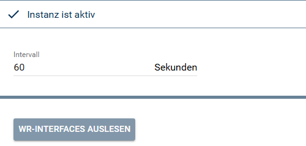
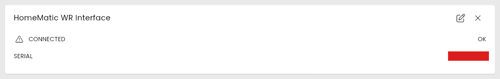

[](https://www.symcon.de/service/dokumentation/entwicklerbereich/sdk-tools/sdk-php/)
[](https://community.symcon.de/t/modul-homematic-extended-systemvariablen-programme-powermeter-u-v-m/38340)
[](https://www.symcon.de/de/service/dokumentation/installation/migrationen/v81-v90-q1-2026/)  
[](#10-lizenz)
[](https://github.com/Nall-chan/HomematicExtended/actions)
[](https://github.com/Nall-chan/HomematicExtended/actions)  
[](../README.md#6-spenden)
[](../README.md#6-spenden)

# HomeMatic WR-Interface  <!-- omit in toc -->

   Bereitstellen der Informationen zu dem Wired-Interface innerhalb von IPS.  

## Dokumentation <!-- omit in toc -->

**Inhaltsverzeichnis**

- [1. Funktionsumfang](#1-funktionsumfang)
- [2. Voraussetzungen](#2-voraussetzungen)
- [3. Software-Installation](#3-software-installation)
- [4. Einrichten der Instanzen in IP-Symcon](#4-einrichten-der-instanzen-in-ip-symcon)
- [5. Statusvariablen](#5-statusvariablen)
- [6. Visualisierung](#6-visualisierung)
  - [Kachel Visualisierung](#kachel-visualisierung)
  - [WebFront Visualisierung](#webfront-visualisierung)
- [7. PHP-Befehlsreferenz](#7-php-befehlsreferenz)
- [8. Aktionen](#8-aktionen)
- [9. Anhang](#9-anhang)
  - [1. Changelog](#1-changelog)
  - [2. Spenden](#2-spenden)
- [10. Lizenz](#10-lizenz)

## 1. Funktionsumfang

  Dies Instanz stellt alle Daten des an einer CCU betriebenen Wired-Interfaces dar.  

## 2. Voraussetzungen

- IP-Symcon ab Version 9.0  
- Ein Homematic Socket (`HomeMatic Socket`), an dem die CCU angebunden ist  
- Das Protokoll `Wired` ist im Homematic Socket aktiviert  
- Ein Wired-Interface ist an der CCU angebunden  

## 3. Software-Installation

Dieses Modul ist Bestandteil der [HomeMaticExtended-Library](../).  

## 4. Einrichten der Instanzen in IP-Symcon

  
   Unter Instanz hinzufügen ist das Gerät 'HomeMatic WR-Interface' unter dem Hersteller 'HomeMatic' zu finden.  
   Nach dem Anlegen der Instanz sollte als übergeordnetes Gerät schon der 'HomeMatic Socket' ausgewählt sein.  
   Existieren in IPS mehrere 'HomeMatic Socket', so ist der auszuwählen, an welche CCU dieses Wired-Interface angeschlossen ist.  

**Konfigurationsseite:**  
  

| Eigenschaft | Name     | Typ     | Standardwert | Beschreibung                                                                                 |
| :---------- | :------- | :------ | :----------- | :------------------------------------------------------------------------------------------- |
| Intervall   | Interval | integer | `60`         | Intervall in Sekunden für den Datenabruf. `0` schaltet den Abruf ab, kleinste Zeit `5`.        |

**Status der Instanz:**  

| Status | Bedeutung                                   |
| :----: | :------------------------------------------ |
|  102   | Abruf aktiv                                 |
|  104   | Abruf abgeschaltet (Intervall `0`)          |
|  202   | Intervall kleiner als 5 Sekunden            |

Ist die Instanz mit keinem Homematic Socket verbunden, läuft kein Abruf und es entstehen keine Fehlermeldungen. Ist der Homematic Socket inaktiv, das Protokoll `Wired` im Socket nicht aktiviert oder antwortet die CCU nicht, meldet jeder Abruf einen Fehler im Log (auch `Übernehmen` der Instanz), die Statusvariablen behalten ihren letzten Wert.  

**Beispiel für das Setzen des Intervalls per PHP:**  

```php
IPS_SetProperty(12345, 'Interval', 60);
IPS_ApplyChanges(12345);
```


## 5. Statusvariablen

**Statusvariablen:**  
   Alle von der CCU gemeldeten Datenpunkte der Interfaces werden in IPS dargestellt.  
   Die folgenden Statusvariablen können durchaus variieren.  

| Name  /  Ident |   Typ   | Profil |
| :------------: | :-----: | :----: |
|   CONNECTED    | boolean |        |
|     SERIAL     | string  |        |

**Profile:**  

 Es werden keine Profile angelegt.  

## 6. Visualisierung

### Kachel Visualisierung

  

### WebFront Visualisierung

Die direkte Darstellung im WebFront ist möglich, es wird aber empfohlen mit Links zu arbeiten.  

## 7. PHP-Befehlsreferenz

   Es existieren keine PHP-Befehle für dieses Modul.  

## 8. Aktionen

**Grundsätzlich können alle bedienbaren Statusvariablen als Ziel einer [`Aktion`](https://www.symcon.de/service/dokumentation/konzepte/automationen/ablaufplaene/aktionen/) mit `Auf Wert schalten` angesteuert werden, so dass hier keine speziellen Aktionen benutzt werden müssen.**  

## 9. Anhang

### 1. Changelog

Der vollständige Changelog der Library steht in der [Haupt-README](../README.md#2-changelog).  

Version 3.78:

- Neue Instanzen fragen das WR-Interface alle 60 Sekunden ab (bisher war der Abruf abgeschaltet). Vorhandene Instanzen behalten ihr Intervall.  
- Ohne verbundenen Homematic Socket läuft kein Abruf mehr und es entstehen keine Fehlermeldungen.  

Version 3.75:

- Eigene Meldung, wenn das Wired-Protokoll im Homematic Socket nicht aktiviert ist.  

### 2. Spenden

Dieses Modul ist für die nicht kommerzielle Nutzung kostenlos, Schenkungen als Unterstützung für den Autor werden hier akzeptiert:

  [](https://paypal.me/Nall4chan)

  [](https://www.amazon.de/hz/wishlist/ls/YU4AI9AQT9F?ref_=wl_share)

## 10. Lizenz

[Custom NC-SA](../LICENSE)
