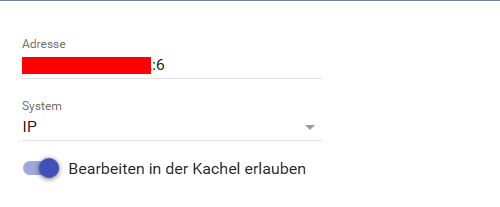
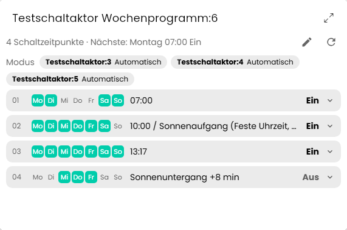
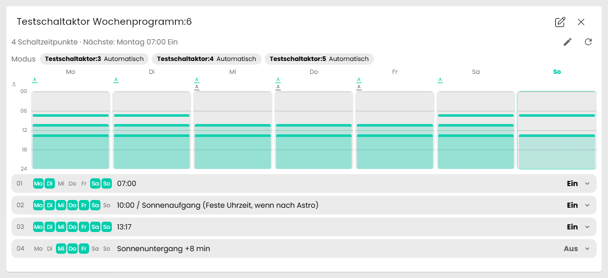
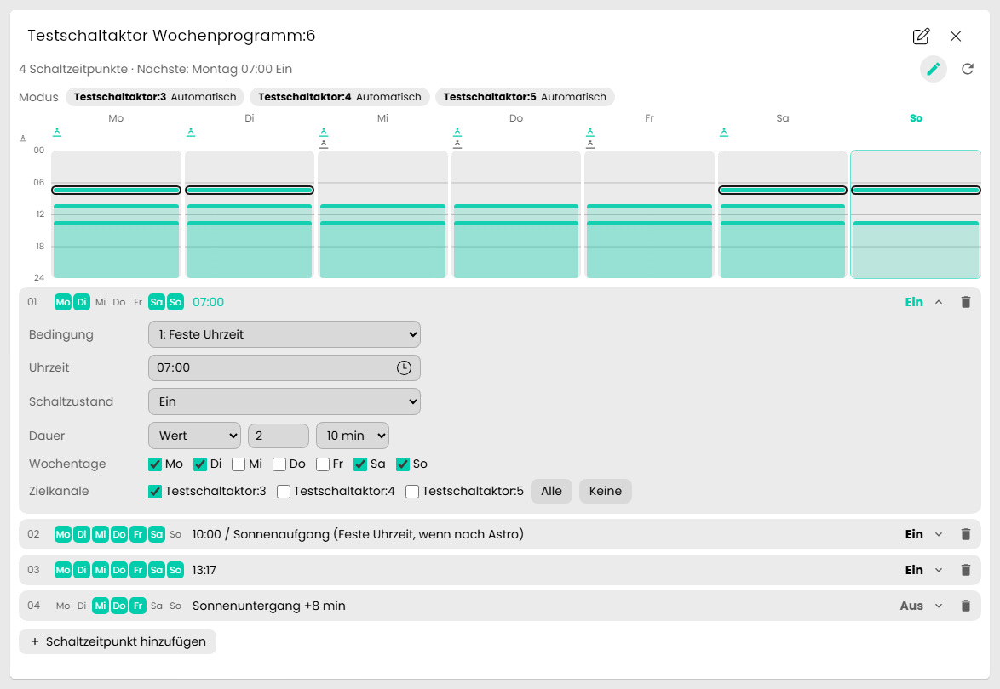

[](https://www.symcon.de/service/dokumentation/entwicklerbereich/sdk-tools/sdk-php/)
[](https://community.symcon.de/t/modul-homematic-extended-systemvariablen-programme-powermeter-u-v-m/38340)
[](https://www.symcon.de/de/service/dokumentation/installation/migrationen/v81-v90-q1-2026/)  
[](#10-lizenz)
[](https://github.com/Nall-chan/HomematicExtended/actions)
[](https://github.com/Nall-chan/HomematicExtended/actions)  
[](#2-spenden)
[](#2-spenden)

# HomeMatic IP Weekly Program  <!-- omit in toc -->

Wochenprogramm (Schaltzeitpunkte) der HomeMatic IP Aktoren, das in der CCU im Kanal `*_WEEK_PROFILE` gespeichert wird (z.B. Kanal 6 der Schaltaktoren).

## Dokumentation <!-- omit in toc -->

**Inhaltsverzeichnis**

- [1. Funktionsumfang](#1-funktionsumfang)
- [2. Voraussetzungen](#2-voraussetzungen)
- [3. Software-Installation](#3-software-installation)
- [4. Einrichten der Instanzen in IP-Symcon](#4-einrichten-der-instanzen-in-ip-symcon)
- [5. Statusvariablen](#5-statusvariablen)
- [6. Visualisierung](#6-visualisierung)
  - [Kachel Visualisierung](#kachel-visualisierung)
  - [WebFront Visualisierung](#webfront-visualisierung)
- [7. PHP-Befehlsreferenz](#7-php-befehlsreferenz)
- [8. Aktionen](#8-aktionen)
- [9. Anhang](#9-anhang)
  - [1. Changelog](#1-changelog)
  - [2. Spenden](#2-spenden)
- [10. Lizenz](#10-lizenz)

## 1. Funktionsumfang

> [!NOTE]
> Das Modul ist neu und bisher nur an einem HmIP-Schaltaktor getestet.

Das Modul

- liest das Wochenprogramm (Paramset `MASTER`, bis zu 75 Schaltzeitpunkte) über den Homematic Socket,
- schreibt ein geändertes Wochenprogramm in das Gerät und
- hält das zuletzt gelesene Programm in der Instanz, so dass es ohne Anfrage an die CCU angezeigt werden kann.

Ein Schaltzeitpunkt besteht aus Wochentagen, einer festen Uhrzeit oder einer Astro-Zeit (Sonnenaufgang bzw. -untergang mit Versatz), der Bedingung, die beides verknüpft, dem Schaltzustand (`LEVEL`), der Dauer und den Zielkanälen.

### Unterstützte Geräte

Das Wochenprogramm liegt bei allen HmIP-Aktoren im Kanal mit einem der Typen:

| Kanaltyp                               | Geräte (Anzahl laut Dokumentation)  | Zusätzliche Felder                                          | Getestet |
| -------------------------------------- | ----------------------------------- | ----------------------------------------------------------- | -------- |
| `SWITCH_WEEK_PROFILE`                  | Schaltaktoren (51)                  | Dauer                                                       | ✅ (HmIP-FSI16, Kanal 6) |
| `DIMMER_WEEK_PROFILE`                  | Dimmer (22)                         | Dauer, Rampenzeit                                           | ❌ |
| `BLIND_WEEK_PROFILE`                   | Rollladen- und Jalousieaktoren (26) | `LEVEL_2` (Lamellen)                                        | ❌ |
| `UNIVERSAL_LIGHT_WEEK_PROFILE`         | Universal-Lichtaktoren (4)          | Dauer, Rampenzeit, Farbe, Sättigung, Farbtemperatur, Effekt | ❌ |
| `DIMMER_OUTPUT_BEHAVIOUR_WEEK_PROFILE` | Dimmer mit Ausgangsverhalten (3)    | Dauer, Rampenzeit, `OUTPUT_BEHAVIOUR`                       | ❌ |
| `SERVO_WEEK_PROFILE`                   | HmIP-WSC (1)                        | Dauer, Rampenzeit                                           | ❌ |

Getestet ist das Lesen und Schreiben bisher nur an einem HmIP-Schaltaktor (Kanal 6). Die Felder der übrigen Typen werden nach der Beschreibung gelesen, die das Gerät selbst liefert (Typ, Bereich, Werteliste), und in der Kachel und beim Schreiben danach geprüft. Rückmeldungen mit dem Debug der Instanz sind willkommen.

### Felder eines Schaltzeitpunktes

Belegte Schaltzeitpunkte stehen lückenlos ab Nummer 1, ein Eintrag ist belegt, wenn `WEEKDAY` ungleich 0 ist. Die Bedeutung der Werte stammt aus dem Vergleich mit der CCU-Oberfläche an einem Schaltaktor.

| Feld                         | Bereich        | Bedeutung                                                                                                                                                             |
| :--------------------------- | :------------- | :-------------------------------------------------------------------------------------------------------------------------------------------------------------------- |
| `WEEKDAY`                    | 0 - 127        | Bitmaske der Wochentage: 1 = Sonntag, 2 = Montag, 4 = Dienstag, 8 = Mittwoch, 16 = Donnerstag, 32 = Freitag, 64 = Samstag                                              |
| `CONDITION`                  | 0 - 7          | 0 feste Uhrzeit, 1 Astro, 2 fest wenn vor Astro, 3 Astro wenn vor fest, 4 fest wenn nach Astro, 5 Astro wenn nach fest, 6 früheres von beiden, 7 späteres von beiden |
| `FIXED_HOUR`, `FIXED_MINUTE` | 0 - 23, 0 - 59 | Feste Uhrzeit                                                                                                                                                         |
| `ASTRO_TYPE`                 | 0 - 1          | 0 Sonnenaufgang, 1 Sonnenuntergang                                                                                                                                    |
| `ASTRO_OFFSET`               | -128 - 127     | Versatz zur Astro-Zeit in Minuten                                                                                                                                     |
| `LEVEL`                      | 0.0 - 1.01     | Schaltzustand: 1.0 = Ein, 0.0 = Aus (bei Dimmern der Wert). 1.01 ist der Maximalwert des Wertebereichs, die Bedeutung ist nicht belegt                                |
| `DURATION_BASE`              | 0 - 7          | Einheit der Dauer: 0 = 100 ms, 1 = 1 s, 2 = 5 s, 3 = 10 s, 4 = 1 min, 5 = 5 min, 6 = 10 min, 7 = 1 h                                                                  |
| `DURATION_FACTOR`            | 0 - 31         | Faktor der Dauer. Basis 7 mit Faktor 31 bedeutet dauerhaft                                                                                                            |
| `TARGET_CHANNELS`            | 0 - 16777215   | Bitmaske der Zielkanäle, Bit 0 = erster Schaltkanal des Gerätes (bei den Kanälen 3 bis 5: 1 = Kanal 3, 2 = Kanal 4, 4 = Kanal 5)                                       |

## 2. Voraussetzungen

- IP-Symcon ab Version 9.0
- Ein Homematic Socket (`HomeMatic Socket`), an dem die CCU angebunden ist, mit aktiviertem HmIP
- Ein HmIP-Aktor mit Wochenprogramm ist an der CCU angelernt

## 3. Software-Installation

Dieses Modul ist Bestandteil der [HomeMaticExtended-Library](../).

## 4. Einrichten der Instanzen in IP-Symcon

> [!TIP]
> Am einfachsten wird die Instanz über den `HomeMatic Extended Konfigurator` angelegt. Er erkennt die Kanäle `*_WEEK_PROFILE` und trägt Adresse und System selbstständig ein.

Alternativ unter `Instanz hinzufügen` das Gerät `HomeMatic IP Weekly Program` unter dem Hersteller `HomeMatic` auswählen.

**Konfigurationsseite:**

| Eigenschaft | Name     | Typ     | Standardwert | Beschreibung                                                           |
| :---------- | :------- | :------ | :----------- | :--------------------------------------------------------------------- |
| Adresse     | Address  | string  | (leer)       | Adresse des Wochenprogramm-Kanals mit Kanal, z.B. `002560C99B959A:6`. |
| System      | Protocol | integer | `2`          | Schnittstelle der CCU: `2` = IP.                                       |
| Bearbeiten in der Kachel erlauben | AllowEdit | boolean | `true` | Ist die Option aus, ist die Kachel eine reine Anzeige und `Übernehmen` wird von der Instanz abgelehnt. Gilt für alle Benutzer der Visualisierung. |

  

Beim Übernehmen der Einstellungen und beim Start von Symcon liest die Instanz das Wochenprogramm.

## 5. Statusvariablen

Das Modul legt keine Statusvariablen an. Das Wochenprogramm wird in der Instanz gehalten und über die Kachel und die Funktionen bedient.

## 6. Visualisierung

### Kachel Visualisierung

Die Kachel passt sich der Größe an und übernimmt Farben und Schrift der Visualisierung. Ist die Überschrift der Kachel aktiv, rückt der Inhalt unter die Überschrift, sonst bleibt oben rechts Platz für den Maximieren-Pfeil.  

| Größe der Kachel                        | Anzeige                                                                                     |
| :-------------------------------------- | :------------------------------------------------------------------------------------------ |
| klein (Höhe unter 150 px)               | Anzahl der Schaltzeitpunkte und die nächste Schaltung                                       |
| mittel                                  | Liste der Schaltzeitpunkte, ein Klick zeigt die Einzelheiten                                |
| groß (ab 560 × 360 px)                  | Wochenübersicht (Montag bis Sonntag, 0 bis 24 Uhr, Astro-Zeiten in einer eigenen Zeile) und die Liste |

Ein Klick auf einen Balken der Wochenübersicht öffnet den zugehörigen Eintrag in der Liste. Dauerhaft eingeschaltete Zeiten zeigt die Übersicht als dünnen Balken mit blasser Fläche bis zum Tagesende. Die nächste Schaltung berücksichtigt nur Zeitpunkte mit fester Uhrzeit, Astro-Zeiten kennt die Kachel nicht.  
**Bearbeiten:** Der Stift in der Kopfzeile schaltet den Bearbeitungsmodus ein (nur wenn die Eigenschaft `Bearbeiten in der Kachel erlauben` aktiv ist). Die Einträge zeigen dann ihr Formular:

- Bedingung (Feste Uhrzeit, Astro, die Mischformen), Uhrzeit, Astro mit Versatz,
- Schaltzustand (Ein/Aus, bei Dimmern und Rollläden ein Wert in Prozent),
- Dauer nur bei Ein (dauerhaft oder Wert mit Einheit, wie in der CCU-Oberfläche), bei Aus gibt es keine Dauer,
- Wochentage und Zielkanäle (mit den Namen der Kanal-Instanzen, `Alle`/`Keine`),
- Löschen eines Eintrags und `Schaltzeitpunkt hinzufügen`.

Geändert wird nur ein Entwurf, die Kopfzeile zeigt `Nicht übernommene Änderungen` sowie `Übernehmen` und `Verwerfen`. Erst `Übernehmen` schreibt das Programm in das Gerät: Die Einträge werden nach Uhrzeit geordnet (Astro-Zeiten nach 6 Uhr bzw. 18 Uhr plus Versatz), die Instanz prüft alle Werte und liest das Programm danach zur Kontrolle neu von der CCU. Fehler erscheinen in der Kopfzeile der Kachel. Felder, die nur einzelne Gerätetypen kennen (Rampenzeit, Lamellen, Farbe, Effekt, Ausgangsverhalten), zeigt das Formular nach der Beschreibung des Gerätes: Auswahlen aus der Werteliste, Prozentwerte, Zeiten als Wert mit Einheit. Sie sind bisher nur mit simulierten Daten geprüft.  

**Modus der Schaltkanäle:** Unter der Kopfzeile zeigt die Kachel je Schaltkanal den Modus (`Manuell` oder `Automatisch`). Mit der Berechtigung schaltet ein Klick auf den Kanal den Modus um (Wochenprogramm für diesen Kanal an oder aus). Die Kachel folgt auch Änderungen am Gerät oder in der CCU, weil die Instanz das Ereignis `WEEK_PROGRAM_CHANNEL_LOCKS` auswertet.

Die Kachel steht nur in der Kachel-Visualisierung zur Verfügung, nicht im klassischen WebFront.

Die Kachel im Raster (mit Modus der Kanäle und Liste):



Maximiert, mit Wochenübersicht:



Im Bearbeitungsmodus mit dem Formular eines Schaltzeitpunktes:



### WebFront Visualisierung

Das klassische WebFront wird nicht unterstützt, die Instanz bietet nur die Kachel-Visualisierung.  

## 7. PHP-Befehlsreferenz

`string|false HM_ReadWeeklyProgram(integer $InstanzID);`
Liest das Wochenprogramm von der CCU und liefert die belegten Schaltzeitpunkte als JSON (Nummer => Felder).
Bei einem Fehler wird `false` zurückgegeben und eine Meldung ausgegeben.

**Beispiel:**

```php
$Program = json_decode(HM_ReadWeeklyProgram(12345), true);
```

`boolean HM_WriteWeeklyProgram(integer $InstanzID, string $Program);`
Schreibt das Wochenprogramm in das Gerät. `$Program` ist ein JSON-Array mit Schaltzeitpunkten, die Felder entsprechen der Tabelle oben. Das bisherige Programm wird ersetzt, die Nummern werden lückenlos ab 1 vergeben. Nicht mehr benötigte Einträge werden geleert.
Ungültige Werte werden vor dem Senden abgelehnt (Rückgabe `false`, Meldung).

**Beispiel:** Montag und Mittwoch um 12:34 Uhr für 3 Minuten, nur der zweite Zielkanal:

```php
$Program = [[
    'WEEKDAY' => 2 + 8,
    'CONDITION' => 0,
    'FIXED_HOUR' => 12,
    'FIXED_MINUTE' => 34,
    'LEVEL' => 1.0,
    'DURATION_BASE' => 4,
    'DURATION_FACTOR' => 3,
    'TARGET_CHANNELS' => 2
]];
HM_WriteWeeklyProgram(12345, json_encode($Program));
```

`string|false HM_ReadWeeklyProgramModes(integer $InstanzID);`
Liest den Modus der Schaltkanäle von der CCU und liefert je Schaltkanal (Reihenfolge der Kanäle des Gerätes) `true` bei manuellem Modus als JSON.

`boolean HM_SetWeeklyProgramMode(integer $InstanzID, integer $Kanaele, string $Modus);`
Stellt den Modus des Wochenprogramms für Schaltkanäle ein. `$Kanaele` ist eine Bitmaske der Kanäle (1 = erster Schaltkanal, 2 = zweiter, 4 = dritter), `$Modus` ist `MANU_MODE`, `AUTO_MODE_WITHOUT_RESET` oder `AUTO_MODE_WITH_RESET`.

**Beispiel:** Wochenprogramm für den zweiten Schaltkanal ausschalten (manueller Modus):

```php
HM_SetWeeklyProgramMode(12345, 2, 'MANU_MODE');
```

## 8. Aktionen

**Grundsätzlich können alle bedienbaren Statusvariablen als Ziel einer [`Aktion`](https://www.symcon.de/service/dokumentation/konzepte/automationen/ablaufplaene/aktionen/) mit `Auf Wert schalten` angesteuert werden, so dass hier keine speziellen Aktionen benutzt werden müssen.**  

Die Schaltzeitpunkte und der Modus werden über die Funktionen aus der PHP-Befehlsreferenz bzw. in der Kachel geändert.

## 9. Anhang

### 1. Changelog

Der vollständige Changelog der Library steht in der [Haupt-README](../README.md#2-changelog).

**Version 3.90:**

- Neues Modul: Wochenprogramm der HomeMatic IP Aktoren lesen und schreiben, Kachel mit Wochenübersicht, Liste, Modus der Schaltkanäle und Bearbeiten (in der Instanz abschaltbar).

### 2. Spenden

Dieses Modul ist für die nicht kommerzielle Nutzung kostenlos, Schenkungen als Unterstützung für den Autor werden hier akzeptiert:

  [](https://paypal.me/Nall4chan)

  [](https://www.amazon.de/hz/wishlist/ls/YU4AI9AQT9F?ref_=wl_share)

## 10. Lizenz

[Custom NC-SA](../LICENSE)
