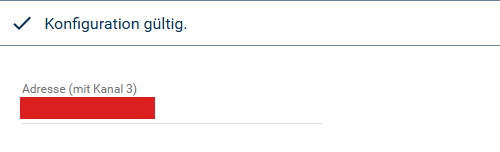

[](https://www.symcon.de/service/dokumentation/entwicklerbereich/sdk-tools/sdk-php/)
[](https://community.symcon.de/t/modul-homematic-extended-systemvariablen-programme-powermeter-u-v-m/38340)
[](https://www.symcon.de/de/service/dokumentation/installation/migrationen/v81-v90-q1-2026/)  
[](#10-lizenz)
[](https://github.com/Nall-chan/HomematicExtended/actions)
[](https://github.com/Nall-chan/HomematicExtended/actions)  
[](../README.md#6-spenden)
[](../README.md#6-spenden)

# HomeMatic Dis-EP-WM55  <!-- omit in toc -->

Steuert das ePaper-Statusdisplay `HM-Dis-EP-WM55` im 55er-Rahmen über den Homematic Socket.  

## Dokumentation <!-- omit in toc -->

**Inhaltsverzeichnis**

- [1. Funktionsumfang](#1-funktionsumfang)
- [2. Voraussetzungen](#2-voraussetzungen)
- [3. Software-Installation](#3-software-installation)
- [4. Einrichten der Instanzen in IP-Symcon](#4-einrichten-der-instanzen-in-ip-symcon)
- [5. Statusvariablen](#5-statusvariablen)
- [6. Visualisierung](#6-visualisierung)
- [7. PHP-Befehlsreferenz](#7-php-befehlsreferenz)
  - [Parameter der Befehle](#parameter-der-befehle)
  - [HM\_WriteValueDisplayNotify](#hm_writevaluedisplaynotify)
  - [HM\_WriteValueDisplayLine](#hm_writevaluedisplayline)
  - [HM\_WriteValueDisplayLineEx](#hm_writevaluedisplaylineex)
  - [HM\_WriteValueDisplay](#hm_writevaluedisplay)
  - [HM\_WriteValueDisplayEx](#hm_writevaluedisplayex)
- [8. Aktionen](#8-aktionen)
- [9. Anhang](#9-anhang)
  - [1. Changelog](#1-changelog)
  - [2. Spenden](#2-spenden)
- [10. Lizenz](#10-lizenz)

## 1. Funktionsumfang

- Beschreibt die drei Zeilen des ePaper-Displays mit Text und Icon.  
- Steuert den Summer (Tonfolge, Wiederholungen) und die LED des Displays.  
- Es werden bis zu 12 Zeichen pro Zeile dargestellt, längere Texte werden abgeschnitten.  
- Umlaute und der Doppelpunkt werden für die Anzeige automatisch umgewandelt.  

## 2. Voraussetzungen

- IP-Symcon ab Version 9.0  
- Ein Homematic Socket (`HomeMatic Socket`), an dem die CCU angebunden ist  
- Das Display `HM-Dis-EP-WM55` ist an der CCU angelernt  

## 3. Software-Installation

Dieses Modul ist Bestandteil der [HomeMaticExtended-Library](../).  

## 4. Einrichten der Instanzen in IP-Symcon

> [!TIP]
> Am einfachsten wird die Instanz über den `HomeMatic Extended Konfigurator` angelegt. Er trägt die Adresse mit dem Kanal 3 selbstständig ein.  

  

Alternativ unter `Instanz hinzufügen` das Gerät `HomeMatic Dis-EP-WM55` unter dem Hersteller `HomeMatic` auswählen.  
Nach dem Anlegen der Instanz sollte als übergeordnetes Gerät schon der Homematic Socket ausgewählt sein.  
Existieren in IPS mehrere Homematic Sockets, so ist der auszuwählen, an welcher CCU das Display angelernt ist.  

**Konfigurationsseite:**  
  

| Eigenschaft           | Name    | Typ    | Standardwert                 | Beschreibung                                                     |
| :-------------------- | :------ | :----- | :--------------------------- | :--------------------------------------------------------------- |
| Adresse (mit Kanal 3) | Address | string | `XXX9999996:0` (Platzhalter) | Geräteadresse des Displays mit dem Kanal 3, z.B. `NEQ1234567:3`. |

> [!IMPORTANT]
> Die Adresse muss den Kanal 3 enthalten (`NEQ1234567:3`), denn nur dieser Kanal besitzt den Datenpunkt `SUBMIT`.  

Der Platzhalter ist notwendig, damit sich der Homematic Konfigurator von Symcon nicht aufhängt, und gilt als nicht eingetragen.  

**Status der Instanz:**  

| Status | Bedeutung                                                                 |
| :----: | :------------------------------------------------------------------------ |
|  102   | Konfiguration gültig                                                      |
|  104   | Keine Adresse eingetragen (Platzhalter)                                   |
|  202   | Die Adresse enthält keinen Kanal (z.B. `NEQ1234567` statt `NEQ1234567:3`) |

**Beispiel für das Setzen der Adresse per PHP:**  

```php
IPS_SetProperty(12345, 'Address', 'NEQ1234567:3');
IPS_ApplyChanges(12345);
```

## 5. Statusvariablen

Es werden keine Statusvariablen und Profile angelegt.  

## 6. Visualisierung

Die Instanz besitzt keine Statusvariablen und wird nicht visualisiert.  

## 7. PHP-Befehlsreferenz

Das Display wird über die folgenden PHP-Befehle beschrieben.  
Alle Befehle liefern `true`, wenn die CCU die Daten angenommen hat. Bei ungültigen Parametern, einer ungültigen Adresse oder einem Fehler bei der Übertragung wird eine Fehlermeldung ausgegeben und `false` geliefert.  

> [!NOTE]
> Das ePaper-Display ist batteriebetrieben. Die Anzeige wird erst nach der Übertragung durch die CCU aktualisiert, das kann einige Sekunden dauern.  

### Parameter der Befehle

Die Parameter haben bei allen Befehlen die gleiche Bedeutung.  

**`$InstanzID`** Instanz-ID der Instanz `HomeMatic Dis-EP-WM55`.  

**`$Line`** Die Zeile, welche beschrieben wird (1-3).  

**`$Text`** Der darzustellende Text (bis zu 12 Zeichen).  
Ein leerer Text löscht die Zeile.  
Statt eines Textes können auch die im Display hinterlegten Textblöcke durch die Zeichenfolge `0x80` bis `0x89` angezeigt werden.  
Umlaute (`ÄÖÜäöüß`) und der Doppelpunkt werden automatisch in die passenden Zeichen des Displays umgewandelt.  

**`$Icon`** Das anzuzeigende Icon (0-9):  

| Wert  | Icon        |
| :---: | :---------- |
|   0   | keins       |
|   1   | Lampe aus   |
|   2   | Lampe an    |
|   3   | Schloss auf |
|   4   | Schloss zu  |
|   5   | Fehler      |
|   6   | OK          |
|   7   | Info        |
|   8   | Nachricht   |
|   9   | Service     |

**`$Chime`** Die Tonfolge des Summers (0-6):  

| Wert  | Ton            |
| :---: | :------------- |
|   0   | aus            |
|   1   | lang lang      |
|   2   | lang kurz      |
|   3   | lang kurz kurz |
|   4   | kurz           |
|   5   | kurz kurz      |
|   6   | lang           |

**`$Repeat`** Anzahl der Wiederholungen der Tonfolge (0-15).  

**`$Wait`** Wartezeit zwischen den Wiederholungen in Einheiten zu 10 Sekunden (0-15). Der Wert `3` entspricht 30 Sekunden.  

**`$Color`** Die Farbe der LED (0-3):  

| Wert  | Farbe  |
| :---: | :----- |
|   0   | aus    |
|   1   | rot    |
|   2   | grün   |
|   3   | orange |

### HM_WriteValueDisplayNotify  

Steuert den Summer und die LED des Displays.  

```php
bool HM_WriteValueDisplayNotify(int $InstanzID, int $Chime, int $Repeat, int $Wait, int $Color);
```

**Beispiele:**  

```php
// Ton 1, keine Wiederholung, Farbe rot
HM_WriteValueDisplayNotify(12345, 1, 0, 0, 1);

// Ton 2, eine Wiederholung, 30 Sekunden Pause, Farbe grün
HM_WriteValueDisplayNotify(12345, 2, 1, 3, 2);

// Kein Ton, Farbe orange
HM_WriteValueDisplayNotify(12345, 0, 0, 0, 3);

// Ton 3, zwei Wiederholungen, 10 Sekunden Pause, LED aus
HM_WriteValueDisplayNotify(12345, 3, 2, 1, 0);
```

### HM_WriteValueDisplayLine  

Beschreibt eine Zeile des Displays. Die anderen Zeilen werden dabei gelöscht.  
Wird ein leerer Text übergeben, wird die Zeile gelöscht.  

```php
bool HM_WriteValueDisplayLine(int $InstanzID, int $Line, string $Text, int $Icon);
```

**Beispiele:**  

```php
// Zeile 1 mit dem Text 'Zeile 1' ohne Icon
HM_WriteValueDisplayLine(12345, 1, 'Zeile 1', 0);

// Zeile 1 löschen und das Icon OK anzeigen
HM_WriteValueDisplayLine(12345, 1, '', 6);

// Zeile 3 mit dem Text 'Welt!' und dem Icon Service
HM_WriteValueDisplayLine(12345, 3, 'Welt!', 9);

// Zeile 2 mit dem Text 'Hallo' und dem Icon Info
HM_WriteValueDisplayLine(12345, 2, 'Hallo', 7);

// Umlaute und Doppelpunkt werden umgewandelt
HM_WriteValueDisplayLine(12345, 1, 'Grüße: Äpfel', 0);
```

### HM_WriteValueDisplayLineEx  

Beschreibt eine Zeile des Displays und steuert den Summer sowie die LED an.  
Die anderen Zeilen werden dabei gelöscht.  
Wird ein leerer Text übergeben, wird die Zeile gelöscht.  

```php
bool HM_WriteValueDisplayLineEx(int $InstanzID, int $Line, string $Text, int $Icon, int $Chime, int $Repeat, int $Wait, int $Color);
```

**Beispiel:**  

```php
// Zeile 1 mit dem Text 'Zeile 1' ohne Icon
// Ton 1, keine Wiederholung, Farbe rot
HM_WriteValueDisplayLineEx(12345, 1, 'Zeile 1', 0, 1, 0, 0, 1);
```

### HM_WriteValueDisplay  

Beschreibt alle drei Zeilen des Displays.  
Wird ein leerer Text übergeben, wird die Zeile gelöscht.  

```php
bool HM_WriteValueDisplay(int $InstanzID, string $Text1, int $Icon1, string $Text2, int $Icon2, string $Text3, int $Icon3);
```

**Beispiele:**  

```php
// Zeile 1 mit dem Text '111' und dem Icon Lampe aus
// Zeile 2 mit dem Text '222' und dem Icon Lampe an
// Zeile 3 mit dem Text '333' und dem Icon Schloss auf
HM_WriteValueDisplay(12345, '111', 1, '222', 2, '333', 3);

// Display komplett löschen
HM_WriteValueDisplay(12345, '', 0, '', 0, '', 0);
```

### HM_WriteValueDisplayEx  

Beschreibt alle drei Zeilen des Displays und steuert den Summer sowie die LED an.  
Wird ein leerer Text übergeben, wird die Zeile gelöscht.  

```php
bool HM_WriteValueDisplayEx(int $InstanzID, string $Text1, int $Icon1, string $Text2, int $Icon2, string $Text3, int $Icon3, int $Chime, int $Repeat, int $Wait, int $Color);
```

**Beispiele:**  

```php
// Zeile 1 mit dem Text '111' und dem Icon Lampe aus
// Zeile 2 mit dem Text '222' und dem Icon Lampe an
// Zeile 3 mit dem Text '333' und dem Icon Schloss auf
// Ton 1, 15 Wiederholungen ohne Pause, Farbe grün
HM_WriteValueDisplayEx(12345, '111', 1, '222', 2, '333', 3, 1, 15, 0, 2);

// Display löschen, Summer und LED ausschalten
HM_WriteValueDisplayEx(12345, '', 0, '', 0, '', 0, 0, 0, 0, 0);
```

**Fehlerhafte Aufrufe:**  

```php
// Zeile außerhalb von 1-3: Fehlermeldung 'Parameter Line außerhalb des zulässigen Bereiches.', Rückgabe false
HM_WriteValueDisplayLine(12345, 4, 'Hallo', 0);

// Icon außerhalb von 0-9: Fehlermeldung 'Parameter Icon außerhalb des zulässigen Bereiches.', Rückgabe false
HM_WriteValueDisplayLine(12345, 1, 'Hallo', 10);

// Tonfolge außerhalb von 0-6: Fehlermeldung 'Parameter Chime außerhalb des zulässigen Bereiches.', Rückgabe false
HM_WriteValueDisplayNotify(12345, 7, 0, 0, 0);
```

## 8. Aktionen

**Grundsätzlich können alle bedienbaren Statusvariablen als Ziel einer [`Aktion`](https://www.symcon.de/service/dokumentation/konzepte/automationen/ablaufplaene/aktionen/) mit `Auf Wert schalten` angesteuert werden, so dass hier keine speziellen Aktionen benutzt werden müssen.**  

Die Instanz besitzt keine Statusvariablen. Die Anzeige wird daher über die PHP-Befehle, z.B. in einer Aktion `PHP-Code ausführen`, beschrieben.  

## 9. Anhang

### 1. Changelog

Der vollständige Changelog der Library steht in der [Haupt-README](../README.md#2-changelog).  

**Version 3.75:**

- Die Adresse wird vor dem Senden geprüft und muss den Kanal 3 enthalten (neue Statuscodes 104 und 202).  
- Die Zeile der Befehle `HM_WriteValueDisplayLine` und `HM_WriteValueDisplayLineEx` wird auf 1-3 geprüft.  
- Der Platzhalter für die Adresse verhindert Fehler im Homematic Konfigurator von Symcon.  
- Der `HomeMatic Extended Konfigurator` kann das Display anlegen.  

### 2. Spenden

Dieses Modul ist für die nicht kommerzielle Nutzung kostenlos, Schenkungen als Unterstützung für den Autor werden hier akzeptiert:  

  [](https://paypal.me/Nall4chan)  

  [](https://www.amazon.de/hz/wishlist/ls/YU4AI9AQT9F?ref_=wl_share)  

## 10. Lizenz

[Custom NC-SA](../LICENSE)  
